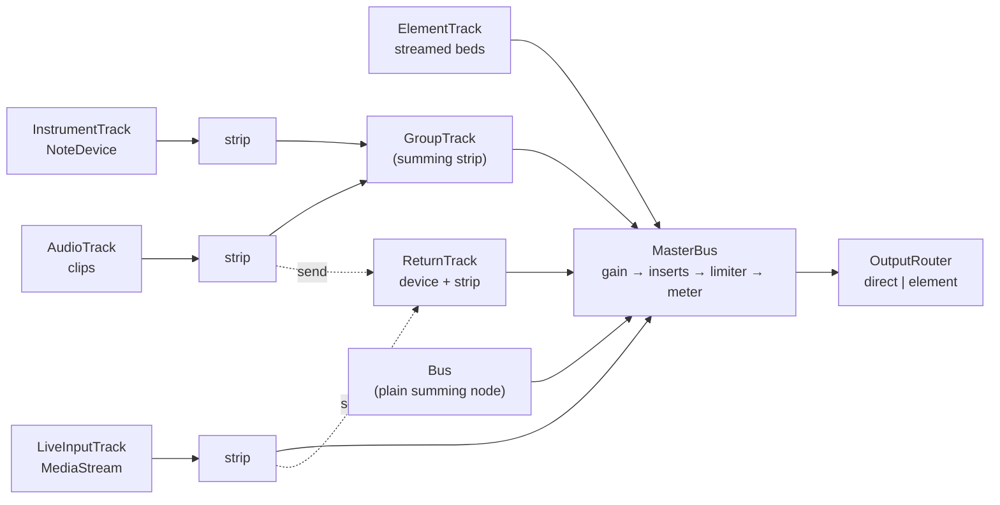
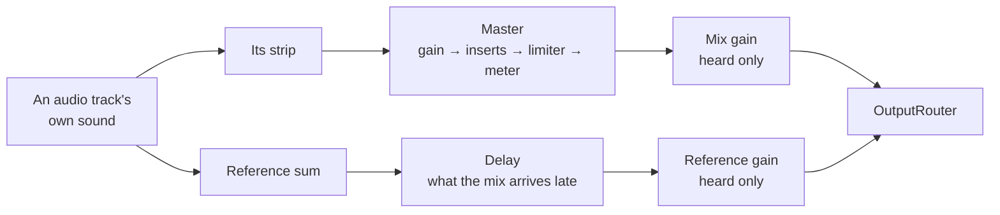

# The mixer: tracks, strips, groups, buses, master

One graph shape for every product (R1): tracks of kind audio, element,
instrument, live-input and return, optionally summed by groups, feeding buses
and one master with a single output terminus. Every routing or parameter
change while playing is a ramp or a crossfade, never a hard switch (R2).



## Track kinds

| Kind              | Made by                                                    | What it plays                                                                                                |
| ----------------- | ---------------------------------------------------------- | ------------------------------------------------------------------------------------------------------------ |
| `AudioTrack`      | `engine.addAudioTrack(name, { lookaheadSec, preloadSec })` | Clips over decoded samples from the `SampleStore`, scheduled inside the lookahead window, equal-power voices |
| `ElementTrack`    | `engine.addElementTrack(name)`                             | Clips over `ElementSource`s — an `<audio>` element per bed, streamed, envelope on the audio clock            |
| `InstrumentTrack` | `engine.addInstrumentTrack(name, { device })`              | A `NoteDevice` (`noteOn(id, hz, gain)` / `noteOff`) — Felt, a WAM synth, an app's own generator              |
| `LiveInputTrack`  | `engine.addLiveInputTrack(name)`                           | Any `AudioNode` or `MediaStream` attached later; nothing is buffered ([live-input](./live-input.md))         |
| `ReturnTrack`     | `engine.addReturnTrack(name, { device })`                  | The sum of every send pointed at it, through one device, then its strip                                      |
| `GroupTrack`      | `engine.addGroup(name, { members })`                       | A summing strip its members feed; hosts inserts, sends and automation of its own (R4)                        |
| `Bus`             | `engine.addBus(name)`                                      | A plain summing node with a fader and inserts, outside the solo tree — Breathwork Live's duck bus            |

Every kind has a `name`, a `destination` (the master by default, or a group,
bus or node) and `dispose()`. `engine.tracks`, `groups`, `buses`,
`liveInputs`, `instruments`, `returnTracks`, `elementTracks` list them;
`engine.track(name)` resolves an audio track; `engine.onChange` announces
additions and removals.

## Channel strips

Every track except `ElementTrack` has a `strip` (`ChannelStrip`): input gain →
inserts → pan → fader → mute/solo gate → destination, plus post-fader `sends`.

```ts
const kick = engine.addAudioTrack('kick')
const snare = engine.addAudioTrack('snare')
const drums = engine.addGroup('drums', { members: [kick, snare] }) // summing strip → master

kick.strip.setPan(-0.3) // −1 … 1
drums.strip.setLevel(0.8) // linear gain; dbToGain/gainToDb for dB
kick.strip.setInputGain(1.2)
snare.strip.setMute(true)
kick.strip.setSolo(true) // solo-in-place: pad/voice ramp to silence, drums and returns stay open
engine.solo.clear()
drums.strip.addInsert(plate) // any Device; removeInsert(plate) later
drums.strip.sends.add(hall, { level: 0.2 }) // post-fader
kick.strip.onChange((change) => …) // level | pan | mute | solo | inserts | routing | members …
```

All changes are `setTargetAtTime` approaches (5 ms constant by default,
`RampOptions` to change), never steps.

A strip can also be **ridden**: `strip.setRide(value, { layer })` is a gain
after the fader and before the gate, at 1 until moved, for something that
performs the mix without changing it (scenes and dials, [perform.md](../perform.md)).
The fader keeps the level that was composed; the post-fader sends follow the ride.
A ride given an `arriveAt` is at its value by then, so a track ridden to 0 over
a long morph is silent when the morph ends.

**Lazy nodes.** A track's strip creates **no nodes until first used** (pan,
level, mute, solo, an insert or a send), so the Phase 0 graph is unchanged:
voices and dry gains connect straight to the destination and are re-pointed
into the strip on first use, at unity, on one render quantum. That is how
Breathwork Live's recorded-node-order harness stayed green when strips
arrived. Groups are explicit and build their four nodes on creation;
`group.input` is the summing node.

**One channel and two.** A strip plays one channel as it plays two: at the
centre a source leaves as loud as it came, both sides, whether it was recorded
in one channel or in two. The pan stage (`createPan`: the strip's, a rack
chain's and the utility's) is a StereoPanner told to take two channels, so one
channel is both of them before it is panned. Left alone the node has two laws:
one channel is panned with equal power, 3.01 dB down each side at the centre,
and two pass at the centre as they came. What reaches the pan is not what was
recorded (the browser's compressor gives two channels out for one in, every
WASM device does, and a strip with no nodes has no panner), so a voice in one
channel played 3.01 dB louder with a compressor in its chain than without it,
and 3.01 dB quieter from the moment its fader was first touched. What that
changed, for a source in one channel that reached a pan stage as one channel
(nothing ahead of the pan made two of it, and nothing in two channels shared
its strip or its group):

| Pan       | Before, left / right | Now, left / right   |
| --------- | -------------------- | ------------------- |
| Centre    | -3.01 dB / -3.01 dB  | 0 dB / 0 dB         |
| Half left | -0.69 dB / -8.34 dB  | +4.65 dB / -3.01 dB |
| Hard left | 0 dB / silent        | +6.02 dB / silent   |

The right-hand column is what a source in two channels, or one with a
compressor or a WASM device ahead of the pan, always played at; a strip with
no nodes yet plays the centre row's 0 dB as it always did, so making its nodes
no longer moves a level. A source in one channel panned hard is 6 dB up in its
one side, as two alike channels are: turn it down or pan it less. The rise
is the same through a rack's chain, the utility, and a group that a strip with
no nodes plays into, and whatever is after the pan hears it: a post-fader
send, a meter, a group's or the master's compressor or limiter. A clip placed
with a pan of its own (`Clip.pan`) keeps its own law, equal power with the
centre at 0 dB. Measured in headless Chrome
(`browser-tests/specs/one-and-two-channels.spec.ts`).

**Solo-in-place.** A soloed strip is heard through its normal routing at the
main output; every other strip is muted by a ramp on its gate unless it is
soloed, an ancestor group is soloed, a descendant is soloed, or it is
`soloSafe` (returns default to `soloSafe: true`). An explicit `mute` always
wins. Plain `Bus`es sit outside the solo tree.

## Master

`engine.master` is a `MasterBus`: fader → inserts → _limiter_ → _meter_ → the
`OutputRouter`. Nothing below is in the default graph — the engine creates
exactly the nodes it did in Phase 0 (router → master gain → optional analyser
meter → buses) — so each stage is installed once, after the engine exists,
because it loads a worklet.

**Limiter (R3).** `engine.master.installLimiter((ctx) => createTruePeakLimiter(ctx, options))`
places the device the factory returns as a fixed stage after the fader and
every insert, ahead of the meter and the terminus. It is not an insert:
`removeInsert` cannot reach it, the returned `MasterLimiter` exposes
`setParam`/`getParam`/`params`/`latencySec` and **no bypass**, and the bus
disposes it. `createTruePeakLimiter` (`./dsp`, `cpp/devices/true-peak-limiter/`)
is a stereo-linked lookahead brickwall whose detector is the ITU-R BS.1770-4
Annex 2 four-phase true-peak FIR — the same table the meter uses — so the
meter's true-peak reading of the limited output never exceeds `ceilingDb`
(−20..0 dBTP, default −1). Attack is a linear ramp over the 1.5 ms lookahead
ending exactly when the peak arrives; `releaseMs` (10..2000, default 100) is
the exponential recovery; `inputGainDb` (±24) drives the detector. Latency 77
samples at 48 kHz (`truePeakLimiterLatencySamples(sampleRate)`). Any other
`Device` can be installed the same way (`createFetLimiter` for character
before the wall — as an insert — or a custom device as the wall).

**Meters.** `LufsMeter.create(ctx, { intervalMs, processorUrl, createNode })`
hosts `worklets/meter.js`, an AudioWorklet sink (one stereo input, no output)
that computes BS.1770-4 momentary (400 ms), short-term (3 s) and gated
integrated loudness (−70 LUFS absolute, −10 LU relative, 0.01 LU histogram so
memory is fixed for any session length), sample peak and true peak (4× to
48 kHz, 2× to 96 kHz), and posts a `MeterReading` at ≤ 30 Hz (default 20 Hz).
Read it synchronously (`lufsShortTerm`, `truePeakDb`, `maxTruePeakDb`, …) or
`subscribe`. Feed it from any bus with `bus.addTap(meter.input)` — taps are
re-fed after every insert change — or use
`engine.master.installLufsMeter(options)`, which taps the limited output.
`Meter` (an analyser) is the cheap peak/RMS reader every strip and the master
can have (`master: { meter: true }`, `engine.master.level()`);
`LoudnessAnalyzer` is the BS.1770 DSP as a plain class for offline analysis of
decoded buffers, tested against the EBU Tech 3341 references (997 Hz at
−23 dBFS stereo → −23.0 LUFS ±0.1, gating cases).

**Output.** `engine.output` is the `OutputRouter`, the one node every audible
path ends at: `ctx.destination` in `direct` mode, a
`MediaStreamAudioDestinationNode` behind an `<audio>` element in `element`
mode for iOS lock-screen playback ([getting started §5](../getting-started.md#5-ios-element-output-mode-and-activation)).
Nothing in the engine — or in a well-behaved consumer — connects to
`ctx.destination` itself.

**A reference beside the mix.** `engine.setHeard({ source: 'reference' })`
plays the tracks' own sound at the output in place of the mix, for hearing
what the mix has done to it, and `engine.setHeard({ source: 'mix' })` plays
the mix again. Both go on playing all the while, so the playhead keeps its
place, and they cross over 20 ms (`HEARD_CROSS_SECONDS`): the one that is
heard approaches its gain as the other approaches silence, the two adding up
to one all the way.



```ts
engine.setHeard({ source: 'reference', referenceGain: 0.7 }) // made on this first call
engine.heard // { source: 'reference', mixGain: 1, referenceGain: 0.7 }
engine.setHeard({ source: 'mix' }) // what is left out stays as it was
```

- **What it is.** The sum of what every audio track hands its strip (clip
  tracks and stretch tracks): each clip's voice with its own fades, trim and
  placement, and the track's own room. It is that sound and not a file. No
  strip is in it, so a track's trim, inserts, pan, level, mute and solo leave
  it as it is, and so does a solo of another track. No group, bus, return or
  master is in it either: it goes round all of them to the output. Instrument
  tracks, live inputs, element tracks and a room that tracks share
  (`sharedSpace`) are not in it. Where the tracks are the parts one recording
  was split into, it is that recording as nearly as the parts add up to it.
- **In time with the mix.** The sum is held back by one delay: the latest
  arrival of `engine.latencyReport()` when it is made, and after each
  `engine.alignLatency()` the latest arrival that reports, which is what the
  aligned tracks and the master's chain hold the mix back. A host that lines
  its tracks up after a change of devices therefore keeps the two in time. The
  delay is the stage an aligned strip has (`AlignmentDelay`), whose counts of
  samples a browser spec holds in a render
  ([render](./render.md#a-bypassed-device-and-an-aligned-strip)). It holds a
  second at most (`PDC_MAX_DELAY_SECONDS`), and a new count is written at
  once, not approached.
- **Two gains, heard only.** `mixGain` and `referenceGain` are linear gains
  on the two, each used while its own is the one heard, for playing the
  louder of the two as loud as the other. They sit after everything else at
  the output. The master's meters, its taps and a recorder on the master all
  read ahead of the mix's gain, so they read the mix at its own level
  whichever is heard.
- **In no render.** The reference is made on a playing engine by the first
  `setHeard`, and is no part of a score. `renderOffline` and `renderScore`
  build an engine of their own and never call it, so a bounce made while the
  reference is heard is the mix alone, at the mix's own level.
- **What it costs.** Nothing until the first `setHeard`: the default graph is
  as it was. From then on two gains at the output, one sum, one delay, and one
  connection from each sounding voice.
- **Stopping.** `engine.stop({ fadeSec })` fades the master, which the
  reference goes round: while the reference is heard its voices end at the
  end of the fade with no fade of their own.

What ran, and where: `src/core/__tests__/Engine.reference.test.ts`,
`Engine.latency.test.ts` and `src/core/tracks/__tests__/ChannelStrip.test.ts`,
in Node on the recording stand-ins for Web Audio, on 2026-11-22. They hold
what the graph is told: which nodes feed the sum and the two gains before
and after a `score.replace` with the same tracks, the approaches written to
the two gains, the count written to the delay as a device that takes time
comes onto the master's chain and off it, and that the graph of a
`renderScore` made while the reference is heard is the graph of one made
without it. Not tried: any browser. No sound was made, so that the reference
and the mix arrive on the same sample in a browser's graph was not measured.
Nothing here was listened to.

**Stats.** `engine.stats` counts glitches from `AudioContext.renderCapacity`
where a browser exposes it (`supported`), converting each update's
`underrunRatio` into render quanta; hosts add their own with
`stats.recordGlitch()` and read `snapshot()` / `subscribe`.

## Latency

`engine.ioLatency()` reports the context's base and output latency;
`engine.latencyReport()` walks every path and reports each device's latency
and each path's arrival; `engine.alignLatency()` inserts alignment delays so
clip and instrument tracks arrive together with the longest path (live inputs
excluded unless asked), and holds the reference beside the mix back by the
same. Details in [devices](./devices.md#latency-and-delay-compensation).

## Stopping and disposing

`engine.stop({ fadeSec })` fades the sounding audio and stops the transport;
`engine.dispose()` disposes every track, device and stage it created and
tears down timers (it never closes the `AudioContext` — the host owns that;
`engine.onDispose` lets renderers and UIs let go). Removal is by name:
`engine.removeTrack('kick')`, `removeGroup`, `removeBus`, `removeReturnTrack`,
`removeLiveInputTrack`, `removeInstrumentTrack`, `removeElementTrack`.
