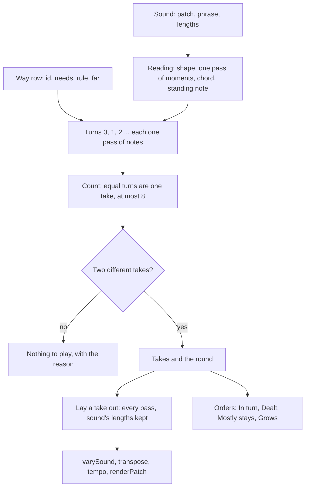

# Ways of Playing - Plan

## Goal Capsule

- Objective: a host of live-mix can list twenty named ways of playing, ask which of them have something to play on a given sound, and get the notes of each take of that sound played that way, so one painted sound can sound different from pass to pass and say in words how.
- Means: a table of pure rules beside `varySound`, each writing one pass of notes from a reading of the sound (KTD1, KTD2), with the takes a rule gives counted and gated by the engine (KTD3).
- Authority: this plan's Requirements first, then `docs/factory.md` for what a sound of the bank is held to, then `src/dsp/factory/vary.ts` as the pattern for writing notes from a recipe.
- Stop conditions: a way cannot be written without changing what `varySound`, `generateSound` or an existing factory render produce; a take cannot keep the sound's length and loop; a settled decision turns out not to work.
- Execution profile: one branch (`claude/project-thread-rapy9o`), one pull request against `main`. GitHub Actions runs `pnpm check` there.
- Nobody can listen in this environment. Every claim about a way is a property of its notes or a measurement of a render. Whether a way is worth keeping is for a person's ear, and the bench in U8 is what they listen from.

---

## Product Contract

### Summary

Add ways of playing to the factory code. A way is a named rule that writes the notes of a sound's takes from the sound's own notes, its key, a seed and an amount. The first catalogue is twenty ways in six families. The engine says how many different takes a way gives on a sound and in what round they come, refuses a way that has nothing to play there, and offers four orders over the takes. Nothing about playback changes: a host renders each take as it renders a variant and names the takes in a clip's `turns`.

### Problem Frame

A variant of a sound is the same on every pass for as long as a piece plays, and `varySound` edits the written notes without writing new ones. `docs/factory.md` says a bank of drones and pads "is varied mostly by its chords and its touch", and one drum struck once "does not vary at all". The app measured that at the amounts Vary opens at, the notes of a stroke are exactly as listed for 65 % of drone strokes. There is no arpeggiator and no note sequencer in the library. The owner asked for about twenty distinct ways of playing notes as one concept he can see beside a sound.

### Key Decisions

- **A catalogue of about twenty named ways, not one deeper randomiser.** The owner asked for it in those words. It was not weighed against alternatives with him, so it is carried as his directive. The one challenge planning raises: twenty ways nobody has heard is breadth before depth. It stands because a way is one small rule and one table row (R2), and the bench (R14) is how he culls. Governs R3.
- **Ways stand beside the four note makers that exist.** `varySound`, `generateSound`, the app's Chords block and its Play this shapes keep doing what they do. Governs R9.

### Requirements

**The contract**

- R1. A way is decided by the sound, the way's id, a seed and an amount called `far` (0 to 1), and by nothing else: the same ones always give the same takes.
- R2. Every way is one row of one table: a stable id, a name of at most 24 characters, its family, words of at most 300 characters that say what it does, what it needs of a sound, and what `far` changes with its default.
- R3. The table holds the twenty ways of the catalogue below, in six families, named in the project's own words.
- R4. For a sound and a way the engine gives the takes: how many different ones there are (at most 8) and the round they come in, a list of take numbers that may name a take more than once. Two takes are different when their notes are.
- R5. A way has something to play on a sound only when it gives at least two different takes there. Otherwise it gives none and says why in a few words.
- R6. A host can ask which ways have something to play on a sound, without rendering.

**What a take keeps**

- R7. A take keeps the sound's patch, length, skipped start, crossfade and fold, so every take of a sound can stand in one clip's `turns`.
- R8. A take stays in the sound's key, never puts the note the sound stands on anywhere but where it is, keeps the hardest note as hard as the sound's hardest, and starts on its attack where the sound does. A sound played on a kit, or made of another sound's audio, keeps every note on the key it is written on.
- R9. With no way named, or a way the table does not have, the sound itself comes back, the same object. Nothing that renders today renders differently.
- R10. A sound that is not written on the white keys (a generated sound, a sound a host made) is played in the key the host names.

**Orders, words and rendering**

- R11. Four orders over a way's takes, each a pure function of the takes, a seed and a length: In turn (the way's own round), Dealt (every take once before any comes twice, never the same twice running, the join of the list included), Mostly stays (keeps a take for a few passes, then moves to a neighbouring one) and Grows (the first take, then the first two, and so on).
- R12. A host can ask what a take does to its sound in numbers: how many notes sound, how many rest, how many are at another pitch, how many at another time, how many are new.
- R13. `renderFactorySound` and `renderGeneratedSound` take a way, a seed, a take and an amount, and play the way before any variant, so Vary still touches up the notes a way writes.

**Docs and bench**

- R14. `docs/factory.md` explains ways, a generated table lists them from the code and fails a test when stale, and the bench renders each way's takes beside the sound and flags a take that leaves what the sound is held to.

### The catalogue

A way reads one pass of the sound (KTD2). "Moment" is the notes struck together. "The chord" is the sound's own pitches, low to high. Every row's rule is the starting point; U3 to U5 settle the details and the bench decides what stays.

A moment that holds the note the sound stands on is left as written by every way (R8): a way that deals pitches round or moves notes in time deals the other moments, as `vary()`'s swaps never take the first or the lowest note. So "the chord's notes" in a row below are, on a phrase, the pitches above the standing note, laid on the moments that do not hold it. Whether a sound has enough left to give two different takes is the gate's to say (R5), not the row's.

| Family | Way | Needs | What a turn does | What `far` changes |
|---|---|---|---|---|
| One at a time | Rising | a held chord, or a phrase of 3 pitches | The chord's notes one after another, low to high. Each turn starts one note further up. | Past half, the climb runs on into the octave above. |
| One at a time | There and back | same | Up through the chord and down again, carried on from where the last turn stopped. | The same. |
| One at a time | Outside in | same | Lowest, highest, then the ones between. Each turn rotates the order one place. | The same. |
| One at a time | Carry on | a phrase | The phrase's own notes with the last left off, read on across turns, so the order comes round after one turn fewer than it has notes. | How many notes are left off, one or two. |
| Counting | Counted rests | a phrase or a beat | Each moment has a count from 1, 2, 3, 2 and sounds on every turn its count divides. | How many moments have a count above 1. |
| Counting | Leave one out | a phrase or a beat | One moment rests each turn, a different one each time. | One or two rest. |
| Counting | Turning rests | a phrase or a beat | Rests spread evenly through the phrase, turned one place each turn. | The share that rests. |
| Counting | Sliding window | a phrase or a beat of 8 moments | Half the phrase sounds. The window moves on by a quarter each turn. | The size of the window. |
| Growth | Gather | a phrase or a beat | A quarter of the phrase, then half, then three quarters, then all of it. | Where it starts: one moment, or a quarter. |
| Growth | One note slips | a phrase of 3 pitches | Each turn one more note has moved to its neighbour in the key, and stays there. | A step, or a third. |
| Growth | Climb | a phrase of 3 pitches | Every note above the lowest sits one chord note higher each turn, and comes home after four. | How many turns before it comes home. |
| Growth | Lean | a phrase of 3 pitches | Each note is played one moment later and one chord note higher each turn. | The same as Climb. |
| Trades | Neighbours swap | a phrase of 4 single notes | One pair of neighbouring notes changes places each turn, alternating which pairs, so the notes walk through each other. | How many turns before it comes home. |
| Trades | Home and away | a phrase of 3 pitches | Three turns as written, the fourth upside down within its own chord. | How many turns at home, three or one. |
| Held | Staggered entries | a held chord of 3 | The upper notes come in one at a time through the pass. The order they enter in rotates each turn. | How much of the pass the entries take. |
| Held | Voices come and go | a held chord of 3 | One upper note leaves part way through and the one that left last turn comes back. | When in the pass they trade. |
| Held | Unequal rounds | a held chord of 3 | Each upper note is struck again at a count of its own with no factor in common, carried across turns. | How fine the grid is. |
| Hits and voices | Echoes | one struck moment that ends | One to three softer repeats after the hit. Their number and spacing change each turn. | How many, and how late the last may be. |
| Hits and voices | Two readers | a phrase of 3 pitches | A second, softer voice reads the same notes at every third moment, a fifth higher, and carries on across turns. | How soft the second voice is. |
| Hits and voices | In the gaps | a phrase with rests | The written phrase stays. Chord notes sound in its widest gaps, different gaps each turn. | How many gaps are filled. |

### Scope Boundaries

- No change to playback, clips, `turns`, chance or the transport.
- No change to what `varySound`, `describeVariant`, `generateSound` or any factory sound produce.
- The lowest held note of a drone stays held in every way of the Held family. A way that restrikes or rests it is a later way.
- What this catalogue reaches, counted by two readers of this plan with `vary()`'s own test of a held sound: of the bank's 25 drones, 13 are one held note and fit no way, 8 are two held notes and fit at most the three "one at a time" ways that take a held chord, and 4 have the three notes the Held family needs (64 of 323 drones in the packs). Thirteen of the twenty ways need a phrase or a beat. That reach is accepted for this catalogue and is stated in the docs with the numbers the bank walk counts (U8). It is the owner's to change: ways for one or two held notes mean lifting the boundary above, and are listed under follow-up work.
- Considered and not built: one gain for all takes of a sound, so a thin take is as quiet as its notes. Takes are brought to the bank's peak one by one, as variants are. The bench flags a take more than 2 dB from its sound (LEVEL). If the bench shows that on most ways, a render option that plays a take at the written sound's gain is the fix.
- Considered and not built: ways for sounds whose passes are written differently from each other. `varySound` varies those where they stand, and a way refuses them (R5). The bank has few.

#### Deferred to Follow-Up Work

- The app half in `kieranklaassen/ambient-live`: the stroke menu, the saved paint word, the takes laid out as a stroke's `turns`, two agent tools, any sound with notes. Its own plan and pull request.
- Ways for a sound of one or two held notes (voices from the key that come and go above the held note, or the held note struck again). Most drones of the bank are such sounds and no way of this catalogue plays them.
- Ways that play an instrument's knobs, ways for recordings, and a shape for a whole piece. Cut in the ideation with their reasons.

### Sources

- `docs/factory.md`, "A variant of a sound": what a variant keeps, and the measured reach of each kind.
- `src/dsp/factory/vary.ts`: `VariedPlaying`, the held, round and ended shapes, `alongWhiteKeys`, the `draw` hash, the hardest-note rule and its reason (a render is brought to one peak).
- `src/dsp/factory/sounds/recipe.ts`: `looped`, `played`, `cycled`, which are the three shapes a way reads.
- `src/core/clips/Clip.ts` and `src/core/clips/turns.ts`: a clip's `turns.sourceIds` may name a source more than once, and the turn is the pass taken modulo the list.
- `src/dsp/factory/__tests__/vary.test.ts`: `problems()`, the invariants a variant is held to, which a take is held to as well.

---

## Planning Contract

### Key Technical Decisions

- KTD1. **A new module beside `vary.ts`, sharing its arithmetic and not its code path.** Ways live in `src/dsp/factory/ways/`. `vary.ts` exports the helpers a way needs (`alongWhiteKeys`, `draw`, the note range) and is otherwise untouched, so R9 holds by construction. Folding ways into `vary()` would put twenty rules inside a function whose every branch is pinned by 887 lines of tests.
- KTD2. **Every way works on a reading of the sound, and one function lays the result out again.** The reading is what `vary()` works out inline today: the shape (a chord held through a loop, a pass played round, a phrase that ends), one pass of moments, the chord, the note the sound stands on, whether its keys are pitches, and whether it keeps time. A rule returns one pass. Laying it out repeats it for every pass a round phrase renders, as `vary()` does, so a take loops where the sound loops.
- KTD3. **The engine counts takes by comparing notes.** A rule is asked for turns 0 to 15, stopping early at the turn that would need a ninth different take. Equal turns are one take. The round is the shortest run of turns from turn 0 that all the turns asked for repeat (turn i has the notes of turn i modulo the run), as a list of turn-to-take numbers; where there is no such run, the round is every turn asked for. A turn that happens to equal turn 0 does not end the round: Home and away's turns 0, 1 and 2 are the same notes and its round is `[0, 0, 0, 1]`. `wayTakes` says when a round was cut at eight takes, because the join from its last take back to its first then does not carry on. This gives R4 and R5 for every rule without each rule declaring a count, and it keeps what counting rules mean: a moment that sounds every third turn still does.
- KTD4. **Steps along the key go through the white keys.** A way moves a note along the sound's key with `alongWhiteKeys`. For a sound in another key (R10) the note is brought to the white keys by `factoryTranspose(key)`, moved, and brought back. One helper owns that.
- KTD5. **Most ways rearrange the sound's own pitches.** Orders, trades, Climb and Lean deal the chord the sound already has, so they cannot leave the key, and every moment that holds the note the sound stands on is left as written (the catalogue's preamble). Only One note slips, Two readers and the octave that `far` adds move along the key, and those go through KTD4 and the range `vary.ts` keeps.
- KTD6. **A draw is addressed by the seed, the way and the turn.** No stroke, clip or host id goes into it, so two strokes of one sound with one seed share their takes and a copied stroke sounds like its original. Most rules count and draw nothing.
- KTD7. **The way plays first, the variant second, the key and tempo last.** `renderFactorySound` becomes: play the way on the sound as written, vary that, transpose, set the tempo. A take of a round phrase is still a pass repeated, so `vary()` reads it as it reads any round phrase. A take of a held sound is not: its entries start inside the pass, so `vary()` no longer reads it as held, and where every entry is written before `durationSec` it reads the take as one pass of a round phrase, halves lengths with its speed kind and strikes the lowest note again (measured against `vary.ts` on a held chord of four with staggered entries: 44 of 200 seeds at an amount of 1, none for the written chord). So a take of a sound that reads as held is varied as a held sound is, by its chords and its touch: one function shared by the two renderers sets `speed` and `pattern` to 0 before it calls `varySound`. `vary.ts` stays as it is.
- KTD8. **The generated table is written by a test, as `shipped-sounds.json` is.** `UPDATE_WAYS_DOC=1` writes `docs/ways-generated.md` from the table, and the same test fails when the file is stale. A script could not import the TypeScript table without a build. The test passes the table through `prettier.format` with the repo's resolved config before it writes and before it compares, as `scripts/gen-devices.mjs` does for `docs/devices-generated.md`, because `pnpm lint` checks `docs/` with prettier and prettier pads a table.

### High-Level Technical Design



The shape of the public surface, as a sketch of names and not of signatures:

```text
WAYS                     the table, one row per way
WAY_FAMILIES             the six families in menu order
waysFor(sound)           ids of the ways with something to play there
wayTakes(sound, playing) { takes, round, cut } or { takes: 0, refusal }
playSound(sound, playing with a take)   the sound with that take's notes
describeTake(sound, playing with a take) counts: sounding, resting, moved, shifted, added
TAKE_ORDERS, takeOrder(order, takes or round, seed, length)
renderFactorySound(sound, { plays })    renderGeneratedSound(sound, { plays })
```

`playing` is `{ way, seed, far }`, with an optional key for R10.

### Assumptions

- A host caps how many takes it renders and how long a `turns` list is. The engine's own caps are 8 takes and 16 turns.
- On a held chord, a "one at a time" way strikes the upper notes on eight even steps of the pass and lets each ring into the next ones, while the lowest note holds as written. Whether eight is right for a 16 second pad is for the ear.
- A way that carries on across turns (Carry on, Unequal rounds, Two readers) has a round longer than eight takes on a long phrase: Carry on comes round after one turn fewer than the phrase has notes. Such a round is cut at eight takes and says so (KTD3). Whether a cut round is worth offering is for the ear and the bench.
- A take's seam is its own: when a clip turns from one take to the next, what rings over the join is the new take's folded tail. Chords by pass already behave so.

### Sequencing

U1 then U2. U3, U4, U5 and U6 depend only on U2 and on each other not at all. U7 needs all of them. U8 is last.

---

## Implementation Units

### U1. The reading of a sound, and laying a pass out again

- **Goal:** one place that reads a sound into what a rule works on and writes a rule's pass back as a phrase (KTD2), with the key helper (KTD4).
- **Requirements:** R7, R8, R10.
- **Dependencies:** none.
- **Files:** `src/dsp/factory/ways/reading.ts`, `src/dsp/factory/ways/types.ts`, `src/dsp/factory/vary.ts` (exports only), `src/dsp/factory/__tests__/ways-reading.test.ts`.
- **Approach:**
  1. Export from `vary.ts` the helpers named in KTD1. Change nothing else in the file.
  2. Read the shape as `vary()` does: held, round with a regular pass, round with passes that differ, ended.
  3. Group one pass into moments, list the chord, name the standing note (none for a kit or a sound with a `source`), and carry `bpm`, `tuning`, the lengths.
  4. Lay a pass out: a held or ended sound gets the pass once, a round one gets it for every pass the sound renders. Bring the hardest note to the sound's hardest, clamp gains as `vary()` does.
- **Patterns to follow:** `vary()` in `src/dsp/factory/vary.ts` from "A chord held through everything" to the final layout loop.
- **Test scenarios:**
  - A `looped` chord of four notes reads as held, with one moment, a chord of four and the lowest as its standing note.
  - A `cycled` phrase of eight strokes with one pre-roll pass reads as round with eight moments, and laying its own pass out again gives back the written notes exactly.
  - A `played` phrase reads as ended, and laid out again is the written notes.
  - A sound played on a kit has no standing note and its keys are not pitches. So has a sound with a `source`.
  - A round sound whose second pass differs from its first reads as irregular.
  - A note moved three steps along D dorian from D lands on G, and along E major from E lands on A, and both come back by minus three.
  - Every factory sound and every pack sound reads without throwing, and laid out again unchanged equals its written phrase.
- **Verification:** the round trip holds for the whole bank and every pack.

### U2. The table, the takes and the gate

- **Goal:** the way contract, the table, counting takes (KTD3), the gate (R5), `playSound`, `wayTakes`, `waysFor` and `describeTake`, proven with the first family.
- **Requirements:** R1, R2, R4, R5, R6, R9, R12, and R3 for the four "one at a time" ways.
- **Dependencies:** U1.
- **Files:** `src/dsp/factory/ways/index.ts`, `src/dsp/factory/ways/table.ts`, `src/dsp/factory/ways/one-at-a-time.ts`, `src/dsp/factory/__tests__/ways.test.ts`, `src/dsp/factory/__tests__/ways-support.ts`.
- **Approach:**
  1. A row is the fields of R2 plus its rule and a test of the reading that says whether the way fits and, if not, why.
  2. `wayTakes` asks the rule for turns as KTD3 says and compares laid-out notes with times to a ten-thousandth of a second and pitches to a cent, as `vary()` keys its notes.
  3. `playSound` with no playing, an unknown way, or a way with nothing to play returns the sound itself. A take number past the count is taken round.
  4. `describeTake` compares a take with the written pass moment by moment.
  5. `ways-support.ts` holds `takeProblems(sound, way, seed, far)`: R7 and R8 as a list of what is broken, in the manner of `problems()` in `vary.test.ts`. U3 to U6 reuse it. For the standing note it reports any moment that held it in the written pass and does not hold it, at the written time and pitch, in the take. It does not hold Echoes to the "ends later" check of `problems()`: U5 gives Echoes a bound of its own.
  6. The four ways of this unit deal, on a phrase, only the moments that do not hold the standing note (the catalogue's preamble). On a held chord the lowest note holds as written and the upper notes are dealt.
- **Patterns to follow:** `describeVariant` for a description in numbers; `VARIATION_KINDS` for a table a host lists.
- **Test scenarios:**
  - Every row's name is at most 24 characters, its words at most 300, its id unique, and its family one of the six.
  - `playSound(sound)` and `playSound(sound, { way: 'no-such-way', ... })` return the same object.
  - Rising on a held chord of four gives three takes or more, each different, and take 0 at every seed is the same notes.
  - Rising on a single held note gives no takes and a reason.
  - There and back on a phrase of four pitches gives a round that comes back, and its first take differs from the written phrase or is it.
  - Outside in and Carry on each pass `takeProblems` on three sounds of the bank they fit, at `far` 0.25, 0.5 and 1.
  - `wayTakes` twice with the same arguments gives equal results, and with another seed a way that draws nothing gives the same takes.
  - `waysFor` on a kit loop names no way that needs pitches.
  - `describeTake` of a take that rests two of eight moments says 6 sounding and 2 resting.
  - A take number of 9 on a way with 4 takes is take 1.
  - A rule made for the test whose turns 0, 1 and 2 are equal and whose turn 3 differs, repeating so, gives two takes and the round `[0, 0, 0, 1]`.
  - A rule made for the test that never repeats gives eight takes, a round of the turns up to the one that would need a ninth, and says it was cut.
  - Rising on a bass line of the bank whose lowest note is on its first moment: in every take that moment is as written.
- **Verification:** the four ways pass `takeProblems` on every sound of the bank they say they fit.

### U3. Counting and growth: eight ways

- **Goal:** Counted rests, Leave one out, Turning rests, Sliding window, Gather, One note slips, Climb, Lean.
- **Requirements:** R3, R8.
- **Dependencies:** U2.
- **Files:** `src/dsp/factory/ways/counting.ts`, `src/dsp/factory/ways/growth.ts`, `src/dsp/factory/ways/table.ts`, `src/dsp/factory/__tests__/ways-counting.test.ts`, `src/dsp/factory/__tests__/ways-growth.test.ts`.
- **Approach:** the first moment of a pass always sounds, and so does any moment that holds the standing note. Turning rests spreads its rests as `vary()`'s pattern does. One note slips moves through KTD4 and never moves the first note or the standing note.
- **Test scenarios:**
  - Counted rests on an eight-moment phrase: turn 0 is the phrase as written, and a moment with a count of 3 sounds on turns 0 and 3 only.
  - Leave one out never rests the first moment or one with the standing note, and over its round every other moment rests once.
  - Turning rests at `far` 1 rests no more than 40 % of the moments, and two neighbouring turns differ.
  - Sliding window on a phrase of four moments gives no takes and a reason.
  - Gather's last take is the phrase as written and its first has the fewest notes.
  - One note slips: take n has n notes off their written pitch, each on a white key for a sound of the bank, and none of them is the first or the standing note.
  - Climb's every take has the written standing note, and its round comes home.
  - Lean keeps every note on a moment the written phrase has.
  - Each of the eight passes `takeProblems` on the sounds of the bank it fits. No kit loop takes One note slips, Climb or Lean; each kit loop of eight moments or more takes all four counting ways and Gather; a kit loop of fewer than eight moments is refused by Sliding window, and one of a single moment by all eight.
- **Verification:** every way of the two families has at least one sound of each kind it claims in the table on which it has takes.

### U4. Trades and held sounds: five ways

- **Goal:** Neighbours swap, Home and away, Staggered entries, Voices come and go, Unequal rounds.
- **Requirements:** R3, R7, R8.
- **Dependencies:** U2.
- **Files:** `src/dsp/factory/ways/trades.ts`, `src/dsp/factory/ways/held.ts`, `src/dsp/factory/ways/table.ts`, `src/dsp/factory/__tests__/ways-trades.test.ts`, `src/dsp/factory/__tests__/ways-held.test.ts`.
- **Approach:** a held way writes notes inside the stretch that is rendered: an entry is timed from the end of the skipped start, and a note that enters stays down through the crossfade as the written chord does. The lowest note is the written note untouched.
- **Test scenarios:**
  - Neighbours swap keeps the first note in place, changes one or more pairs each turn, and every take has the written pitches exactly.
  - Home and away's round is three of one take and one of another, and the other take has the same set of pitches.
  - Staggered entries on a held chord of four: the lowest note is as written, each upper note enters once inside the pass, and no two takes enter in the same order.
  - Voices come and go: in every take at most one upper note is absent at any moment, and the note that leaves in one turn is the one that enters in the next.
  - Unequal rounds: each upper note is struck more than once in a pass and the first three takes differ.
  - Each held way gives no takes on a held chord of two notes, on a phrase and on a kit.
  - Each of the five passes `takeProblems` on the sounds it fits, including every `looped` sound of the bank with three notes or more.
- **Verification:** every drone and pad of the bank with three held notes has takes from all three held ways.

### U5. Hits and second voices: three ways

- **Goal:** Echoes, Two readers, In the gaps.
- **Requirements:** R3, R8.
- **Dependencies:** U2.
- **Files:** `src/dsp/factory/ways/voices.ts`, `src/dsp/factory/ways/table.ts`, `src/dsp/factory/__tests__/ways-voices.test.ts`.
- **Approach:** an added note is never harder than the written hardest and never earlier than the attack. In Two readers and In the gaps, an added note in a sound that ends is never later than where its last written note stands, so the take still dies away inside its length. Echoes has a bound of its own, because its written note is the hit itself: every repeat comes after the hit and is held as long as the written note or to the end of the sound's length, whichever is sooner, and the last is struck before three quarters of the length at `far` 1, which is where `vary()` draws its line for the notes a sound ends on. Where the written note is still down when a repeat strikes, the unit checks by a render how the instrument takes a second strike of a key it holds, and lifts the earlier note at the strike if it does not take it. A sound that keeps time gets added notes only on places its own notes divide the pass into.
- **Test scenarios:**
  - Echoes on one struck note that ends: every take has the written note first and unchanged, one to three softer notes after it, all at the written pitch.
  - Echoes on a single kit stroke has takes. `varySound` leaves that sound as it is.
  - Echoes on a phrase gives no takes and a reason.
  - Two readers adds notes only at moments the phrase has, each a fifth above a written pitch along the key or an octave above where the fifth leaves the range, and none on a kit.
  - In the gaps leaves every written note as it is, adds notes only inside gaps wider than the narrowest, and gives no takes on a phrase of even strokes.
  - Each of the three passes `takeProblems` on the sounds it fits.
- **Verification:** every one-shot of the bank that is one struck moment has takes from Echoes.

### U6. Orders over takes

- **Goal:** the four orders of R11 and their table.
- **Requirements:** R11.
- **Dependencies:** U2 for the shape of a round.
- **Files:** `src/dsp/factory/ways/take-order.ts`, `src/dsp/factory/__tests__/take-order.test.ts`.
- **Approach:** an order returns a list of take numbers of the asked length or the nearest length its rule allows. In turn is the way's own round repeated. The others read only how many takes there are.
- **Test scenarios:**
  - In turn with a round of `[0, 0, 0, 1]` and a length of 8 is that round twice.
  - Dealt with 4 takes and a length of 16: each run of four holds every take once, no two neighbours are equal, and the last is not the first.
  - Dealt with 2 takes alternates. With 1 take every order is that take.
  - Mostly stays never moves by more than one take, wrapping from the last take to the first counts as one, and it stays for at least two passes at a time.
  - Grows with 4 takes starts `0, 0, 1, 0, 1, 2, 0, 1, 2, 3`.
  - Every order is the same list for the same seed, and Dealt differs between two seeds.
  - Every order's name and words fit R2's limits.
- **Verification:** each order holds its rule across the join of its list.

### U7. Rendering a take, and what the package exports

- **Goal:** `plays` on the two renderers (KTD7), the public exports, and renders that show a take is a sound of the bank.
- **Requirements:** R7, R9, R13.
- **Dependencies:** U3, U4, U5, U6.
- **Files:** `src/dsp/factory/index.ts`, `src/dsp/index.ts`, `src/__tests__/public-entry.test.ts`, `src/dsp/factory/__tests__/ways-render.test.ts`, `src/dsp/factory/__tests__/ways-bank.test.ts`.
- **Approach:** `renderGeneratedSound` passes the sound's own key to the way (R10). Both renderers vary a take through the one function of KTD7, so a take of a held sound gets no speed and no pattern. The package's `./dsp` entry is built from `src/dsp/index.ts`, which names each export of the factory one by one, so every new value and type is added there as well as in the factory's own index, and the values are added to the list `public-entry.test.ts` pins. The bank test walks every factory sound and every pack sound with every way that fits, without rendering, and counts how many sounds of each kind each way has takes on.
- **Test scenarios:**
  - `renderFactorySound(sound, {})` and `renderFactorySound(sound, { plays: undefined })` give the same samples as before this change for three sounds, compared sample for sample with a render that bypasses the new option.
  - A take of a held pad renders to the pad's own length in frames, peaks at the bank's level, and its ends meet as the pad's do (`measureEnds`).
  - A take of a round bass line at another tempo is as many frames as the line at that tempo.
  - A take with a variant on top (`plays` and `vary` together) renders, and differs from the take alone.
  - A generated sound in E major played with One note slips renders with no note off the key.
  - For every sound of the bank and of every pack, every way that fits passes `takeProblems` at `far` 0.5 and seeds 1 and 77.
  - Every way has takes on at least five sounds of the bank.
  - Every held way's take of three held sounds of the bank with a skipped start of 4 s or less, varied with every kind at 1 at 200 seeds, still has the written lowest note down from before the skipped start through the crossfade.
  - `src/dsp/index.ts` exports every value of the public surface sketch (`WAYS`, `WAY_FAMILIES`, `waysFor`, `wayTakes`, `playSound`, `describeTake`, `TAKE_ORDERS`, `takeOrder`) and its types, and `public-entry.test.ts` lists the values.
- **Verification:** `pnpm check` passes, and the bank walk reports no problem.

### U8. Docs, the generated table, the bench and the changeset

- **Goal:** R14.
- **Requirements:** R14.
- **Dependencies:** U7.
- **Files:** `docs/factory.md`, `docs/ways-generated.md`, `src/dsp/factory/__tests__/ways-doc.test.ts`, `src/dsp/factory/__tests__/report.test.ts`, `.changeset/ways-of-playing.md`, `docs/README.md` if it lists the docs.
- **Approach:** a section "A way of playing a sound" after "A variant of a sound", in the manner of that section: an example, what a take keeps, how takes are counted, the orders, and that nobody has listened. A `FACTORY_REPORT=ways` mode beside `variants` writes, for each sound and each way that fits, the takes, the round, what each take does and its loudness against the sound, with KIND, SEAM, LEVEL and SAME in capitals, and the takes as WAV files under `FACTORY_WAV`. The bench is then run once over every fourth sound of the bank, and the new section of `docs/factory.md` gets two tables in the manner of "What the bench says, so nobody has to find out again": one row per way with how many takes were rendered and how many were flagged KIND, SEAM, LEVEL and SAME, and one row per way with how many sounds of each kind it has takes on, from the bank walk of U7. The section says in words that most drones of the bank have no way to play them, with the count. The pull request names every way flagged on most of the sounds it fits.
- **Test scenarios:**
  - `ways-doc.test.ts` fails when `docs/ways-generated.md` differs from what the table writes, and passes after `UPDATE_WAYS_DOC=1`.
  - Test expectation for the bench and the prose: none, they are skipped unless asked for or are documentation.
- **Verification:** the generated table lists twenty ways in six families, and the bench runs for one sound with `FACTORY=<part of an id>`.

---

## Verification Contract

| Gate | Command | Applies to |
|---|---|---|
| Types | `pnpm typecheck` | every unit |
| Lint and format | `pnpm lint` | every unit |
| Unit tests | `pnpm vitest run src/dsp/factory` | U1 to U8 |
| Everything CI runs | `pnpm check` | before the pull request |
| The bench, by hand | `FACTORY_REPORT=ways FACTORY=<part of an id> pnpm vitest run src/dsp/factory/__tests__/report.test.ts` | U8 |

## Definition of Done

- Twenty ways are in the table and each has takes on five sounds of the bank or more.
- Every way passes `takeProblems` on every sound of the bank and of every pack it fits.
- `vary.ts` differs from `main` only by exports, and no existing test changed its expectations.
- `pnpm check` passes.
- `docs/ways-generated.md` is current and `docs/factory.md` says what a way is and that none has been heard.
- The bench has been run over every fourth sound of the bank, its flags per way and the reach per kind of sound are in `docs/factory.md`, and the pull request names every way flagged on most of the sounds it fits.
- Every new value is exported from `src/dsp/index.ts` and pinned in `src/__tests__/public-entry.test.ts`.
- A changeset describes the addition.
- No file names a product, a maker, an artist or a track, or compares the library with another program.
- No code from an approach that was tried and dropped is left in the diff.
