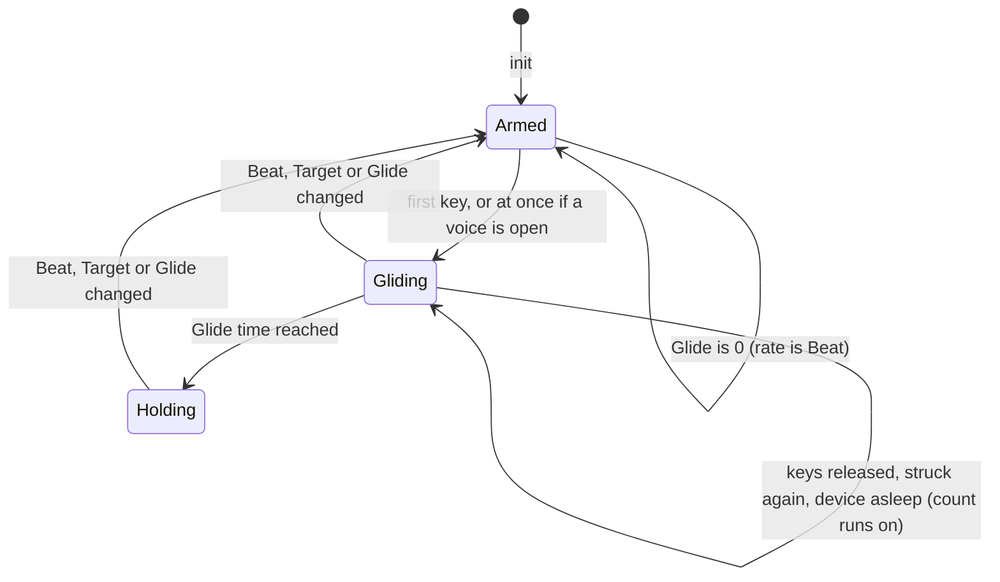
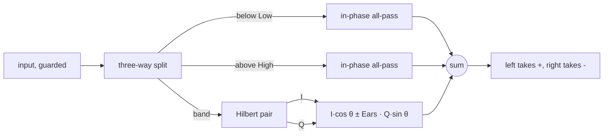
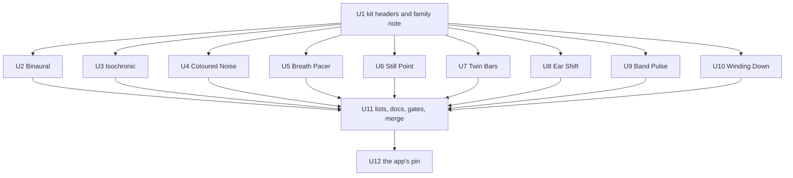

# Beat and Breath Devices - Plan

## Goal Capsule

- Objective: live-mix gains nine spec devices built on the sound techniques people use for "brainwave" listening: tones a few hertz apart in the two ears, evenly pulsed tones, coloured noise, paced breathing, and three ways to put a beat or a pulse on any sound. Ambient Town then carries them by a pin move.
- Means: shared clocks, laws and noise colours land first as three new kit headers (KTD1), then one builder and one independent checker per device, then one integration pass over the shared lists, then the app's pin.
- Authority: this plan's Requirements first, then `docs/recipes/adding-a-spec-device.md`, then `docs/devices.md` and `docs/factory.md` for levels and presets, then the write-ups under `docs/solutions/`.
- Stop conditions: a device cannot meet the recipe without changing an existing device's `.wasm` bytes or a shipped preset; a requirement here turns out to need a promise about the brain or health; the app needs more than a devices-only pin move.
- Execution profile: branch `claude/project-thread-cwobsq` in both repos. One pull request against `main` here, merged once the local gates pass. Then one pull request in the app (`kieranklaassen/ambient-live`) that moves the pin, which waits for the deploy rehearsal before it merges.
- Nobody can listen in this environment. Every claim about a device is a measurement of a render. What only an ear can judge is written down per device in `docs/devices.md` and in the pull request.

---

## Product Contract

### Summary

Add six instruments and three effects. Instruments: Binaural, Isochronic, Coloured Noise, Breath Pacer, Still Point, Twin Bars. Effects: Ear Shift, Band Pulse, Winding Down. Each is a full spec device: sound code, a native harness, sixteen presets of its own, bank presets or bank chains, a plate with a display, and docs. They share one law for how sound is split between the ears, one kind of clock, one pulse shape and one set of noise colours. No text anywhere promises a brain state or a health effect. A short docs page says what is known and what is not.

### Problem Frame

The owner asked for "binaural synths and techniques that are for brainwaves", researched deeply, as instruments and effects, in any number. The library has 55 instruments and about a hundred effects and none of these techniques as a device. A frequency shifter with a stereo mode, a tremolo and several beating bells exist, but a two-ear beat at a set rate, an even pulse to 40 Hz and noise by colour do not. The Breath effect already shapes any sound by In, Hold, Out and Rest in seconds on a free clock; what is missing there is an instrument that makes the breath's own sound, starts at In with the first key, marks the two turns and lengthens the cycle over minutes.

Three research reports ground the list (see Sources). What they change:

- A beat made in the air (two tones in the same ear, or a pulsed level) drives the hearing brain far harder than a beat that exists only between the ears. A two-ear beat needs headphones, tones under about 1 kHz and rates up to about 30 Hz, and is only about 3 dB deep to the listener.
- Whether any of it shifts the brain's own rhythms is unsettled: of fourteen studies reviewed, five found it, eight did not, one was mixed. Breathing paced near six breaths a minute is the best supported effect on the list.
- So each device says what it does to the sound, and every two-ear device has a control that brings the beat into the air for speakers.

### Key Decisions

- **Nine devices, not ten.** A tenth idea, a tone pair that follows the strongest note of the input, is deferred: it needs a pitch tracker, three shipped devices that track pitch each left an open fault, and Ear Shift already puts a two-ear beat on any sound. Governs R1.
- **Honest words only.** Devices are named for the technique and described by what is heard. Governs R3, R4, R14.
- **Timed swells belong to Breath Pacer.** Coloured Noise keeps steady colour and an unpaced drift, so the two do not overlap. Governs R23, R24.

### Requirements

**The family**

- R1. The library gains the nine devices of the table under High-Level Technical Design, with those ids, names and controls.
- R2. Each device meets the recipe in full: `device.json`, one header, a native harness with conformance, behaviour checks, a click check and a cost report; sixteen presets of its own (an effect may carry fewer where `FEWER_PRESETS` says why, KTD8); a palette, skin, display and display truth test; docs rows. An instrument has twenty bank presets, an effect two to five bank chains.
- R3. No device text, preset name, bank preset, chain, display or plate label names a state of mind or health, or promises one. That sentence is the rule; the guard list of KTD11 is its floor. Greek band letters appear only in the docs page of R14. A caution is not a promise (see Assumptions).
- R4. A device whose Ears default is above 0 (Binaural, Twin Bars, Ear Shift) opens its description with "On headphones". Every Ears, Width and Offset control says in its own description what speakers, a mono fold or a reverb fed from both sides give; for Offset, that at 180 degrees and half Duty the pulse is gone in mono.
- R5. One law splits sound between the ears on every device that has an Ears or Width control (KTD2). At 0 the two sides are identical to the sample. The left ear carries the higher tone on every device.
- R6. Every beat, pulse, breath, sweep and glide is exact to the sample: the same output for any block sizes, across silences, and after a control is moved in silence (KTD3).
- R7. A glide of a rate over minutes follows a closed form, reaches its target at the stated time within 0.1 %, and behaves as the state sketch shows (KTD4).
- R8. Levels meet recipe rule 9. A full pool of held keys never reaches the clip's knee in either ear (KTD5).
- R9. Within a device no two presets differ only by a rate, a target or a glide time. Every preset passes the existing preset tests unchanged.
- R10. No display changes brightness in time with a beat or a pulse, and no mark on a display completes its path more than three times a second (KTD10).
- R11. Each harness measures the device's rates, levels and noise balance at 44.1, 48 and 96 kHz.
- R12. Nothing that exists changes: every committed `.wasm` of an existing device rebuilds to the same bytes, no row of `src/dsp/__tests__/shipped-presets.json` changes, and no existing test is loosened.
- R13. Ambient Town at the new pin lists the nine devices, plays each, and passes its own checks with its landing copy's names and counts brought level.
- R14. `docs/concepts/beats-and-pulses.md` says in plain words what each technique is, what research supports, what it does not, and where the two-ear effect survives in a mix, with sources. It carries the research's cautions: keep it quiet, stop if dizzy or unwell, not while driving, ask a doctor first with a history of seizures, and that breathing slower than about 4.5 breaths a minute can cause overbreathing.
- R15. Each device has a row in a "what measurement says is weak" table in `docs/devices.md`, written by its checker.

**Instruments**

- R20. Binaural: each key is a pair of warm tones, one to an ear, Beat hertz apart, with the pair centred on the key. Beat is in hertz and the same on every key. Cross adds a second pair so each ear also beats in the air. A noise Bed, gated by the keys, sits under the tones. Beat can glide to a Target.
- R21. Isochronic: each key is a tone, or a band of noise at the key, switched on and off evenly by one pulse clock shared by all keys. Offset moves the right ear's pulse behind the left's. Rate can glide to a Target.
- R22. Binaural folds a key by octaves into 80 Hz to 1 kHz, where a two-ear beat works. Isochronic folds a key under 80 Hz up by octaves and plays every higher key where it is.
- R23. Coloured Noise: a held key opens one bed of noise whose slope runs from white through pink to brown, with low and high cuts. Its level does not grow with the number of keys. Tint adds a soft resonance at each held key. Drift is a slow, irregular, unpaced swell.
- R24. Breath Pacer: In, Hold, Out and Rest in seconds shape a swell of air and tone at the key, with a soft mark at the start of In and of Out. The cycle starts at In on the first key from silence and later keys join it. Slow to and Over lengthen the cycle over minutes. Its description says how it differs from the Breath effect and ends with a plain caution to stop on feeling light-headed.
- R25. Still Point: a sine sweeps back and forth through the held keys, from Reach below the lowest to Reach above the highest, so the beat against each key slows to stillness and speeds away. Ears moves the sine to one ear and the keys to the other. The name is ours: no device, text or docs page is named after the pieces of music that use the idea.
- R26. Twin Bars: each key strikes two bars whose every partial is Beat hertz apart, with the pair centred on the key. Ears places one bar in each ear or both in the middle.

**Effects**

- R30. Ear Shift: the band between Low and High is shifted up in the left ear and down in the right by half of Beat each, so any sound beats between the ears. Sound outside the band passes at its own level. Ears at 0 gives a pulse at Beat that is the same in both ears.
- R31. Band Pulse: the band between Low and High is pulsed at Rate by the shared pulse shape. Sound outside the band is not pulsed. The pulse only turns the band down. At Depth 0 the level of every frequency is as it came in (the split turns phase, not level).
- R32. Winding Down: layers of one pulse at rates an octave apart glide together and fade in and out, so the pulse seems to slow, or quicken, without end. It only turns the input down.
- R33. Each effect gives exact silence for silence, survives NaN, infinity and 1e30 at its input, and keeps its clock in step across any silence.

**The app**

- R40. The app's change is the pin, the lockfile, the landing copy's names and counts, and any test the new names trip. No behaviour of the app changes.

### Scope Boundaries

- No claim about the brain, sleep, focus, mood or health, in any text.
- No tempo sync of rates: a device receives no tempo.
- No device drives another, so there is no shared session ramp; glides live inside Binaural, Isochronic and Breath Pacer.
- No change to `cpp/kit/kit.h` or to any header an existing device includes, to `cpp/test/support`, or to the bank's limits.
- No new control, panel or tool in the app.
- No Mac build and nothing done on the live site by this work.

#### Deferred to Follow-Up Work

- The follower effect (a quiet tone pair in tune with the input's strongest note).
- An equal-loudness noise colour and a comb that travels between the ears for Coloured Noise.
- A 40 Hz click train as its own device; Isochronic at Rate 40 with a short Duty is the nearest preset.
- The kit gaps the research into past work lists (`take_input` does not sanitise, `kit::Noise::seed` leaves filter state, `kit::SineTable::lookup` reads one past its table): devices here work round them.

---

## Planning Contract

### Key Technical Decisions

- KTD1. **Shared pieces are three new kit headers, landed before any device.** `cpp/kit/beat.h` holds the slow clock, the tone pair, the Ears law, the rate glide and the pulse shape. `cpp/kit/colour.h` holds a generator with independent streams and noise colours worked out from the sample rate. `cpp/kit/band.h` holds a three-way split whose parts sum to flat level. None is included from `cpp/kit/kit.h`, so no existing `.wasm` changes (R12). Five devices need the pair or the glide and four need the pulse; private copies would drift apart. The split is fourth-order pairs whose parts are 6 dB down and in phase at each crossover. Through U2 to U10 the three headers stay with U1's owner: a builder or checker who finds a fault or a missing piece reports it and writes no private copy of a law; the fix lands once on the shared branch with a case in the header's own test, and every open device worktree takes it and reruns its harness. For these three headers this overrides the recipe's "write the helper in your own directory".
- KTD2. **The Ears law is a linear cross-mix.** With Ears `e`, `a = (1 + e) / 2` and `b = (1 - e) / 2`: left is `a·hi + b·lo`, right is `b·hi + a·lo`. The mid is the same at every setting, so mono level never moves with the knob; side over mid is `20·log10(e)` dB. Width on Coloured Noise uses the same law on two unlike noises. Pulse devices do not have Ears: they have Offset in degrees.
- KTD3. **One clock per device, in `double`, placed from a sample count.** `kit::Lfo`, `kit::SineOsc` and `kit::Smoother` are `float` and cannot hold a beat or a glide of minutes. Instruments restart every free-running thing at the sample where a key arrives with no voice active. Effects never stop their clocks: asleep, the clock moves on by the block's frame count using the same sums, as `cpp/devices/pulses/pulses.h` and `cpp/devices/around/around.h` do. Nothing is restarted "on waking", because sleep begins on a block boundary.
- KTD4. **A glide is closed form, by ratio.** `rate(t) = Beat · (Target / Beat)^(min(t / T, 1))`, with `t` a sample count. It is armed by `init` and by any change of Beat, Target or Glide. Armed with a voice open it starts at that sample; armed with none it starts at the first key. It counts on through releases and sleep and holds at Target. Glide 0 is off. Moving Glide is how a player runs it again, and its description says so. A glide's place is not saved with a piece: a fresh device starts at Beat. The phase adds up in `double` with the rate refreshed on multiples of 32 of the session count, never on block boundaries.
- KTD5. **Sustained pair instruments hold eight voices and scale by the root of the count.** The sum of sounding voices is scaled by `1 / sqrt(max(1, sum of each voice's envelope level squared))`, so the scale follows attacks and releases with no step when a tail ends. One key at gain 0.7 sits near -18 dBFS and eight at full gain reach the knee's edge and no further. `kit::soft_clip` stays as a guard only: inside the knee it would make difference tones in each ear, which is the opposite of a two-ear beat. A struck key retriggers its own voice. `level()` and `active()` come from the envelope, never the output, so a voice in a pulse's gap or a beat's null is not stolen first.
- KTD6. **One pulse shape.** A pulse is on for Duty of its period with raised-cosine edges of Edge milliseconds, clamped to half of the shorter of the on and off times. Depth `d` sets the off level to `(1 - d)^2`, exactly zero at 1. A change of Rate, Duty or Edge in mid-pulse becomes one more edge, never a jump. The right ear reads the same clock Offset degrees later.
- KTD7. **Bank presets stay 1.5 dB inside the bank's width rule.** A pure two-ear sound measures side equal to mid and fails `WIDE` on rounding. Bank presets keep Ears and Width at 0.8 or less and Offset at 120 degrees or less, or carry a centred layer; the device's own sixteen may go to the ends. The bank's limits are not changed.
- KTD8. **Draft the presets on the bench before the controls are frozen.** The preset tests hear 8 seconds of the mid signal, in tenths of a second for instruments and 43 ms frames for effects. Rates above about 5 Hz (instruments) or 12 Hz (effects), any glide, and any cycle longer than 8 seconds do not show. Presets must differ in colour, layer, envelope, ears or a slow rate (R9). An instrument that cannot give sixteen that the print tells apart changes. An effect that cannot (Ear Shift has four controls) ships the count its bench draft supports and records it with its reason in `FEWER_PRESETS` (`src/dsp/__tests__/effect-preset-support.ts`), the tree's standing allowance; no rule of the tests changes.
- KTD9. **Each harness carries the checks conformance lacks, from its first version.** Stepped silences (20 ms steps across fall time plus hold, and one long one) at block sizes 1, 128, 2048 and ragged, each against the 128-frame render to 1e-6, with a control moved inside the silence. The knob-moved-in-silence identity, asleep off the control beat. `suddenness()` under 0.15 for steal, restrike, note off and each smoothed control thrown end to end, at several places in the device's own cycle. For effects: NaN, infinity and 1e30 at the input.
- KTD10. **Displays draw a time axis and never flash.** A meter is read about 30 times a second, so a 40 Hz pulse cannot be shown in time, and light pulsing between 3 and 30 times a second is a known hazard. A display draws the pulse or the pair as a still shape over time. A mark may show the place in a breath, a sweep, a glide or a halving. The beat or pulse phase is drawn as a moving mark only at 3 Hz or under and is absent above. The output level an instrument's display must read is drawn averaged over one second, never as the raw reading, and a held key is lit while it is held, not once a pulse. Each display test proves it with a timed draw.
- KTD11. **A guard test holds the words.** One vitest file scans the nine devices' names, descriptions, preset names, bank presets and chains, each display's `info` and the words it writes at rest and running, and each skin's labels and name. It fails on any of these at the start of a word: sleep, focus, heal, therap, cure, anxi, stress, entrain, brain, mind, meditat, hypno, relax, calm, dream, trance, drows, sooth, lull, seren, tranquil, peace, mood, wellness, wellbeing, alert, concentrat, insomn, treat, medic, delta, theta, alpha, beta, gamma. Breath Pacer's caution sentence uses none of them. The guard reads each manifest's Ears default for R4's opening words and checks every Ears, Width and Offset description for its speakers or mono sentence. Each checker also reads every name and description of its device against R3's sentence, since a list cannot see every case.
- KTD12. **Ear Shift uses `kit::Hilbert`, one pair per channel, and has no Mix.** The pair is within one degree from 21 Hz at 48 kHz and 42.5 Hz at 96 kHz, so a band from 60 Hz up is inside it. Its quadrature output leads its in-phase one, so "up" is `I·cos + Q·sin` as in `cpp/devices/freq-shifter/freq_shifter.h`. Mixing the dry sound back would make each ear beat at half the rate, so the amount is set by Ears and the band's edges. Everything that does not pass the shifter passes the same in-phase all-pass, or the joins notch. A partial inside the split's overlap is in each ear both shifted and unshifted, so it pulses there at half of Beat, to silence at the edge itself. That is accepted, measured and written in R15's row.
- KTD13. **Band Pulse and Winding Down have no make-up gain.** Winding Down is one gain of at most one, so its peaks never pass the input's. Band Pulse turns one band down and its split turns phase, so a peak the band was holding down can rise by a small amount; that is measured, not trimmed. Their presets sit under dry by what they remove and inside the effect preset rule's 12 LU.
- KTD14. **Noise is scaled by the root of the rate** and every filter that colours it is worked out from the rate. Brown is high-passed so its 8-second mean stays under the offset limit. Colours are matched by RMS with fixed constants.
- KTD15. **The app change is a devices-only pin move and is held for the deploy rehearsal.** The pin is the squash commit on this repo's `main`. STATION_COMPAT does not move: an older build stands in for a device it does not know.

### Assumptions

No one was asked during planning, so these bets stand until the owner says otherwise:

- Nine devices is the right size for one round. The owner said any number will do. A device that cannot pass its gates by the end of its checker's round is left out of this pull request and named in it as deferred, so one device never holds the other eight.
- Binaural's default is Ears 1 (the name says so) with Beat at 6 Hz; the bank's presets sit at 0.8 or less.
- Folding keys into 80 Hz to 1 kHz on Binaural, and keys under 80 Hz up on Isochronic, is better than letting the technique fail silently on a high or a low key.
- Scaling by the root of the summed envelope power (KTD5) is acceptable on a sustained instrument: a held key drops 3 dB as a second key fades in.
- Box breathing and 4-7-8 are offered as presets named by their counts, though both are slower than the 4.5 breaths a minute one review flags for overbreathing. The docs page says so; no text recommends a pattern.
- A caution is not a claim. The research gives cautions as part of honest wording, so the docs page carries them and Breath Pacer's description ends with one. The owner may strike either.
- Preset names may carry a rate in words ("Ten a second"); they carry no Greek band letter.

### High-Level Technical Design

These sketches show intended shape. They are direction for the builders, not code to copy.

**The devices and their controls**

| Id | Name | Kind | Controls |
|---|---|---|---|
| `binaural` | Binaural | instrument | Beat 0.5 to 40 Hz, Ears, Layout (Pair, Cross), Warmth, Bed, Colour, Target, Glide 0 to 30 min, Attack, Release, Volume |
| `isochronic` | Isochronic | instrument | Rate 0.5 to 40 Hz, Duty, Edge 2 to 50 ms, Depth, Offset 0 to 180 deg, Warmth, Air, Target, Glide, Attack, Release, Volume |
| `coloured-noise` | Coloured Noise | instrument | Colour, Low cut, High cut, Tint, Drift, Drift time 2 to 30 s, Width, Attack, Release, Volume |
| `breath-pacer` | Breath Pacer | instrument | In, Hold, Out, Rest (seconds), Slow to 1 to 2 times, Over 0 to 30 min, Air, Tone, Bright, Marks, Floor, Release, Volume |
| `still-point` | Still Point | instrument | Time 4 to 120 s a pass, Reach 0.1 to 12 semitones, Level, Ears, Warmth, Attack, Release, Volume |
| `twin-bars` | Twin Bars | instrument | Beat 0.5 to 20 Hz, Ears, Bar (Metal, Wood, Glass), Mallet, Decay, Scatter 0 to 40 ms, Damp, Tone, Volume |
| `ear-shift` | Ear Shift | effect, spatial | Beat 0.5 to 40 Hz, Ears, Low 60 to 400 Hz, High 400 to 2000 Hz |
| `band-pulse` | Band Pulse | effect, modulation | Rate 0.5 to 40 Hz, Depth, Duty, Edge, Offset, Low 60 to 400 Hz, High 400 to 4000 Hz |
| `winding-down` | Winding Down | effect, modulation | Direction (Slower, Quicker), Rate 1 to 8 Hz, Halving 4 to 120 s, Layers 2 to 5, Depth, Edge, Offset |

**The tone pair and the Ears law**

A pair has one carrier phase `c` per voice and one half-beat phase `h` owned by the device, both in `double`: `hi = sin(2π(c + h))`, `lo = sin(2π(c - h))`. `h` advances by half of Beat per second, so every key's pair turns together. Warmth adds the second and third partials with the same split in hertz while they are under 1 kHz and unsplit above, so everything beats at one rate. Cross adds a second pair to each ear, offset so each ear beats in the air at Beat and the ears differ at half of Beat; the four tones stay centred on the key.

| Ears | Side over mid | Ripple inside each ear | Mono sum |
|---|---|---|---|
| 0 | none, sides identical | full depth | full-depth beat at Beat |
| 0.5 | -6.0 dB | 6.0 dB | the same |
| 0.8 | -1.9 dB | 1.9 dB | the same |
| 1 | 0 dB | none | the same |

The mono sum is a full beat at every setting. That is why a reverb fed from both ears, a pan, or one speaker turns a two-ear beat into an in-air one, and why R4 has each device say so.

**A glide's life**

**Ear Shift's path, per channel**

`θ = π · Beat · t` from the device's clock. The sign that sends the left ear up is fixed by a harness check, not by the formula as written in the research.

**How the work is ordered**

### System-Wide Impact

- Counts in `README.md`, `docs/devices.md`, `docs/factory.md` and the app's landing copy move: 61 instruments in the library's docs and 62 on the app's landing page (which also lists its own Sine), three more effects, 96 more instrument presets, 120 more bank presets, up to 48 more effect presets, and the new chains.
- Every pack test reads `AFTER_THE_PACKS`; a new instrument missing from it fails all of them.
- The whole native suite and the `.wasm` rebuild grow by nine devices; both are run locally because the owner's standing word is to run checks locally.

### Risks & Dependencies

- **Nothing is heard.** The illusions (a pulse that slows without end, a beat between the ears) are measured as signal properties only. Mitigation: R15's rows and the pull request say what to listen to first.
- **Presets may not tell apart.** Mitigation: KTD8, with the bench run on a first draft in each device unit.
- **A clock that depends on block size across a silence** was the commonest fault of earlier rounds. Mitigation: KTD3 and KTD9 in the first harness.
- **Cost at 96 kHz** for Ear Shift (four all-pass chains per channel) and Twin Bars (two bars of modes per key). Over 5 % of real time at 48 kHz means `experimental: true`, as the device units state; the 96 kHz figure is printed with it.
- **The app's master reverb and stroke pan fold the ears.** The devices cannot change that; R4 and R14 say it, and U12 measures it once in the app.

---

## Implementation Units

### Unit Index

| Unit | What | Depends on |
|---|---|---|
| U1 | Kit headers `beat.h`, `colour.h`, `band.h`, their tests, the family note | none |
| U2 | Binaural | U1 |
| U3 | Isochronic | U1 |
| U4 | Coloured Noise | U1 |
| U5 | Breath Pacer | U1 |
| U6 | Still Point | U1 |
| U7 | Twin Bars | U1 |
| U8 | Ear Shift | U1 |
| U9 | Band Pulse | U1 |
| U10 | Winding Down | U1 |
| U11 | Shared lists, docs, words guard, gates, merge | U2 to U10 |
| U12 | The app's pin move | U11 |

**What every device unit (U2 to U10) delivers.** Stated once here; each unit below adds only what is its own.

- Files: `cpp/devices/<id>/device.json`, `cpp/devices/<id>/<snake>.h`, `cpp/test/<snake>_test.cpp`, `src/react/components/displays/<id>.ts`, `src/react/__tests__/displays.<id>.test.ts`; for an instrument `src/dsp/factory/presets/<id>.ts` with twenty bank presets. Entries for shared files (palette, skin, display index, preset index, bank chains, the stepped-control list, docs rows) are made locally in the worktree, uncommitted, so the benches and the plate and display tests can see the device; the same entries are handed to U11 as text and only the device's own files are committed.
- Two workers, in the device's own git worktree: a builder, then a checker who rebuilds from clean, writes their own measuring programs, renders every preset, mutates the device one trait at a time and reports how many changes the harness caught, and writes the device's R15 row. Where the two disagree, the checker's figure is printed.
- The harness carries KTD9's checks, R11's three rates, the recipe's level rule, `report_cost`, and a second `init` that equals the first.
- Sixteen own presets drafted on the bench first (KTD8): `INSTRUMENT_PRESETS=<id> INSTRUMENT_REPORT=1 pnpm vitest run src/dsp/__tests__/instrument-presets.test.ts` or `EFFECT_PRESETS=<id> pnpm vitest run src/dsp/__tests__/effect-presets.test.ts`. Bank presets levelled with `FACTORY_REPORT=presets FACTORY_DEVICE=<id> pnpm vitest run src/dsp/factory/__tests__/report.test.ts`, bank chains with `FACTORY_REPORT=chains`.
- A plate: a palette with a colour no other plate has, a skin (sections from thirteen controls up), a display in a `window` that follows KTD10 and whose formula is the device's own, proved by the truth test. For R10 the same test file draws the display for two seconds at 30 frames a second at Beat or Rate 0.5, 6, 10 and 40 (or the device's nearest settings), with a signal and readings that pulse at that rate, and fails if anything drawn reverses direction more than six times in any second.
- Descriptions of 170 characters at most, ending in a full stop, no dash; R3 and R4 hold.
- Patterns to follow: `cpp/devices/mallets/mallets.h` and `cpp/devices/chamber-strings/chamber_strings.h` for voices (not `modal-bells` or `bowed-string`); `cpp/devices/dusk/dusk.h` for the restart on a key from silence; `cpp/devices/pulses/pulses.h` for clocks through sleep; `cpp/test/clarinet_test.cpp` for `suddenness()` and `cpp/test/horns_test.cpp` for `kink()`.
- Verification: `CXX=g++ bash scripts/dev-device.sh <id>` passes at 44.1, 48 and 96 kHz; the device's preset tests, `param-descriptions.test.ts`, `displays.test.ts`, `DevicePlate.test.tsx` and `displays.<id>.test.ts` pass with the local entries in place; cost is under 5 % of real time at 48 kHz or the device is marked `experimental`.

### U1. Kit headers and the family note

- Goal: the shared pieces exist once, tested, before any builder starts.
- Requirements: R5, R6, R7, R12; KTD1, KTD2, KTD3, KTD4, KTD6, KTD14.
- Dependencies: none.
- Files: `cpp/kit/beat.h`, `cpp/kit/colour.h`, `cpp/kit/band.h`, `cpp/test/beat_test.cpp`, `cpp/test/colour_test.cpp`, `cpp/test/band_test.cpp`, `scripts/test-native.sh`, `docs/recipes/beat-and-breath-family.md`.
- Approach: header-only, no allocation, nothing included from `kit.h`. `beat.h`: a slow clock placed from a sample count, the tone pair, the Ears gains, the rate glide with its three states, the pulse gain. `colour.h`: a generator whose streams are truly independent (two `kit::Rng` streams are offsets of one sequence), a slope filter built from the rate, RMS constants. `band.h`: the three-way split. The family note states the laws, which ear is higher, the restart rule, the wording rules and KTD9's checks; every builder's brief points at it.
- Patterns to follow: `cpp/kit/stft.h` for a kit header outside `kit.h`; `cpp/test/kit_test.cpp` for a kit test.
- Test scenarios:
  - Pair, 220 Hz, Beat 4 Hz, one hour at 48 kHz: the half-beat phase at the end equals the closed form within 1e-9 cycles.
  - Ears 0 gives left equal to right to the sample; Ears 1 leaves only the higher tone on the left; Ears 0.5 measures -6.0 dB side over mid within 0.1 dB.
  - Glide 10 to 4 Hz over ten minutes: the rate at 0, 5, 10 and 12 minutes equals the closed form within 0.1 %; stepping by blocks of 1, 128 and 2048 gives the same phase.
  - Glide re-arms when Beat changes in mid-glide and holds at Target after its time.
  - Target moved while a key is held: the rate leaves Beat at that sample and reaches Target one Glide later. Target moved with no voice open: the rate stays at Beat until the first key.
  - Pulse at 10 Hz, Duty 0.5, Edge 8 ms: on-time is half the period; Depth 1 gives exact zeros in the gap; Depth 0 gives gain 1 everywhere.
  - Pulse at 40 Hz with Edge 50 ms asked: the edge is 6.25 ms. Rate thrown from 2 to 40 Hz in mid-pulse: the gain's largest step is no more than a quarter over its own edge's.
  - Noise slope reads 0, -3 and -6 dB an octave within 0.5 dB from 100 Hz to 8 kHz at 44.1, 48 and 96 kHz; RMS within 1 dB across rates; two streams correlate under 0.02 over ten seconds.
  - Split: the three parts sum to flat within 0.1 dB from 20 Hz to 20 kHz at three rates; a tone at the band's centre is 30 dB down in the other two parts; at each crossover the two parts are 6 dB down and in phase.
- Verification: `bash scripts/test-native.sh` passes with the three new tests listed; a `.wasm` rebuild changes no committed file.

### U2. Binaural

- Goal: the two-ear tone pair as a playable instrument.
- Requirements: R2 to R11, R20, R22; KTD2 to KTD5, KTD7.
- Dependencies: U1.
- Approach: eight voices, each a carrier phase and an envelope; the device owns the half-beat phase and the glide. A key from silence restarts the half-beat phase at zero (KTD3), so that note begins on the beat's crest at Ears 0; a later key joins the running beat wherever it stands. The Bed is one stereo noise, gated by the loudest open envelope. Bank presets mostly `pad` and `drone`. If the generator carries a display reading for an instrument (none has one today), the device reports its glide's place from 0 to 1, running on through sleep, and the display draws the rate from Beat to Target over Glide with a mark at that place and the rate now in figures; if it does not, the display draws the planned curve from the controls with no mark and R15's row says so.
- Test scenarios:
  - A4 at Ears 1: the left ear's tone is Beat hertz above the right's, measured by zero crossings over ten seconds, at 44.1, 48 and 96 kHz.
  - Ears 0: sides identical; the mono sum's power envelope has its line at Beat within 0.01 Hz at Beat 0.5, 6 and 40.
  - Cross at Ears 1: each ear's envelope beats at Beat and the tones' mean is the key within 0.1 Hz.
  - Glide 10 to 4 Hz over two minutes: the measured beat at 0, 60, 120 and 150 s matches the closed form; releasing and striking again at 30 s does not restart it.
  - Keys C1 and C7 sound inside 80 Hz to 1 kHz at the same pitch class.
  - Eight keys at full gain held for ten minutes: neither ear reaches 0.5. One key at gain 0.7 peaks between -24 and -10 dBFS.
  - Warmth 1 on A2: the second and third partials are each split by Beat. Warmth 1 on A4: the second partial (880 Hz) is split by Beat and the third (1,320 Hz) is the same in both ears.
  - Three keys struck 100 ms apart at Ears 0 beat together: the nulls of the mono sum fall on the same samples as one key's.
  - Four keys held, three let go at a long Release: the held key's level moves by under 1 dB in any 100 ms while the tails fall and after they end, and neither ear reaches 0.5.
  - Bed against tone within 1 dB across the three rates; no Bed before a key or after the release.
  - Two keys into a full pool in one block are both present; a key struck twice with tied levels leaves exact silence after release.
- Verification: as stated for every device unit.

### U3. Isochronic

- Goal: an evenly pulsed tone or noise band, to 40 Hz.
- Requirements: R2 to R11, R21, R22; KTD3 to KTD7.
- Dependencies: U1.
- Approach: one pulse clock for the device, restarted on a key from silence so the first pulse begins on the left. Air crossfades the tone to a band of noise centred on the key. The glide's place is reported and drawn as in U2. Bank presets mostly `pad` and `texture`.
- Test scenarios:
  - Rate 10, Duty 0.5, Depth 1: the left ear's envelope has ten pulses a second and exact zeros between; the first 0.5 s of the left ear is above 1e-4 RMS at Offset 180.
  - Offset 180 at Duty 0.5: the mono sum's envelope ripple is under 1 dB; at Duty 0.25 it pulses at twice Rate.
  - Rate 0.5, Duty 0.1, a held key, blocks of 1, 128 and 2048: identical output, and 1.8 s of zeros does not put the device to sleep.
  - Rate, Duty, Edge and Depth each thrown end to end at eight places in the pulse: `suddenness()` under 0.15.
  - Three keys struck 100 ms apart pulse together to the sample.
  - A voice in its gap is not the one stolen when a ninth key arrives.
  - Glide of Rate from 12 to 6 Hz over one minute matches the closed form.
  - Air 1: noise level within 1 dB at the three rates; band centre at the key.
  - C1 sounds an octave or more up, at 80 Hz or over; C7 sounds at C7.
- Verification: as stated for every device unit.

### U4. Coloured Noise

- Goal: steady noise by colour, tuned lightly by the keys.
- Requirements: R2 to R6, R8 to R11, R23; KTD2, KTD7, KTD14.
- Dependencies: U1.
- Approach: one bed, two unlike noises through the Width law, level set by the loudest open envelope. Each held key adds a resonant band scaled by Tint. Drift is a seeded, irregular swell of level and brightness on a `double` clock that starts at its crest, not its trough. Bank presets mostly `texture`.
- Test scenarios:
  - Colour 0, 0.5 and 1 read 0, -3 and -6 dB an octave within 0.5 dB at the three rates; the loudest 400 ms is within 1 dB across Colour.
  - Low cut 200 Hz and High cut 2 kHz: bands outside are at least 12 dB down.
  - One key and ten keys at Tint 0 are the same level within 0.5 dB; at Tint 1 a peak stands at each held key.
  - Width 0: sides identical. Width 0.8: side over mid -1.9 dB within 0.5 dB.
  - Colour 1 for 8 s: the mean of each side is under 0.01.
  - Two `init` calls give the same render; a key after a silence of any length gives the same render at any block size.
  - Exact zero after the release; nothing before a key.
- Verification: as stated for every device unit.

### U5. Breath Pacer

- Goal: a breath pattern in seconds, heard as a swell.
- Requirements: R2 to R11, R24; KTD3, KTD4, KTD5.
- Dependencies: U1.
- Approach: one cycle clock in `double`; the level and brightness follow In (rise), Hold (stay), Out (fall), Rest (Floor). Marks are struck from the sample clock at the two turns. The slow-down scales the whole cycle in closed form, as a glide does: Slow to and Over arm it as Beat, Target and Glide arm a glide (KTD4), and In, Hold, Out and Rest do not. Its place is reported and drawn as in U2. `cpp/devices/breath/breath.h` is the pattern for the four-part cycle. A key up releases at once. Thirteen controls, so the skin has sections. Bank presets mostly `pad` and `texture`.
- Test scenarios:
  - In 5, Out 5: the level peaks at 5.0 s and returns to Floor at 10.0 s within 10 ms, at any block size; the first 0.5 s is above 1e-4 RMS.
  - 4-7-8 over two cycles at blocks of 1, 128 and 2048: identical, including the held seconds.
  - A second key at 3 s joins the cycle: its swell peaks with the first's.
  - A key let go and struck again inside Hold carries on the running cycle; after exact silence the next key starts at In.
  - Marks fall on the exact samples of the two turns; with Hold 0 there is one mark at the turn, not two.
  - Slow to 1.5 Over 2 min: the cycle at 0, 1, 2 and 3 minutes is 10, about 12.2, 15 and 15 s.
  - A pattern changed in mid-cycle moves the level without a step: `suddenness()` under 0.15.
  - Ten keys at the crest stay under the knee.
- Verification: as stated for every device unit.

### U6. Still Point

- Goal: a slow sine that passes through the held notes.
- Requirements: R2 to R6, R8 to R11, R25; KTD2, KTD3, KTD5, KTD7.
- Dependencies: U1.
- Approach: the sweep's place is a triangle on a `double` clock between limits that follow the held keys, smoothed by sample count; it starts at the lower limit going up when the first key arrives from silence. Keys are warm tones; the sine is gated by the keys. Bank presets mostly `drone` and `pad`.
- Test scenarios:
  - One key, Reach 0.5, Time 12: the sine meets the key at 6.0 s within 50 ms, and the beat rate one second either side is equal within 5 %.
  - Level 0.5 at Ears 0: the worst dip of the key at a meeting is no more than 6.5 dB, measured over twenty starts; the figure goes in R15's row.
  - Ears 1: the sine is on one side only and the keys on the other; no dip at a meeting.
  - A chord added and taken away in mid-sweep at three block sizes: identical; the limits move without a step.
  - Two keys landing in one block in either order give the same render.
  - The sine stops with the last key's release; exact zero after.
- Verification: as stated for every device unit.

### U7. Twin Bars

- Goal: struck bars in pairs that beat at one rate over the whole keyboard.
- Requirements: R2 to R6, R8 to R11, R26; KTD2, KTD7.
- Dependencies: U1.
- Approach: start from `cpp/devices/mallets/mallets.h`. Each key holds two bars of modes; every mode of the second is the first's plus Beat hertz, and the pair's mean is the key. A key struck again strikes the same bars. Scatter delays the second bar's strike. Bank presets mostly `bell`.
- Test scenarios:
  - C2, C4 and C6 at Beat 4: the fundamentals differ by 4.0 Hz within 0.05 Hz and their mean is the key, at 44.1, 48 and 96 kHz; the second and third modes differ by the same 4 Hz.
  - Ears 1: one bar on each side; Ears 0: sides identical.
  - Decay 6 s: the level falls 60 dB in 6 s within 15 %.
  - Sixteen strikes a second on one key for two seconds: the peak stays under the knee.
  - Two notes into a full pool are both present; a key struck twice with tied levels leaves exact silence by its deadline.
  - Damp 1: a key up ends the note inside 100 ms without a click.
- Verification: as stated for every device unit.

### U8. Ear Shift

- Goal: a two-ear beat on any sound.
- Requirements: R2 to R6, R9 to R11, R30, R33; KTD2, KTD3, KTD12.
- Dependencies: U1.
- Approach: per channel, the path of the sketch. The clock runs on through sleep. It must differ from the frequency shifter's stereo mode by its band and by Ears, and its description says which to reach for. Bank chains in `src/dsp/factory/chains/motion.ts`.
- Test scenarios:
  - A 440 Hz sine in, Beat 6: the left ear reads 443 Hz and the right 437 Hz; the unwanted sideband is 40 dB down. Repeated at the band's lower edge and at 44.1, 48 and 96 kHz.
  - Ears 0: sides identical, pulsing at Beat; its envelope equals the mid of the Ears 1 render.
  - A 3 kHz sine and a 50 Hz sine pass at their level within 0.1 dB and unshifted.
  - A slow sine sweep from 20 Hz to 20 kHz, read over whole beat cycles: each ear's level is flat within 1 dB more than an octave from either band edge and dips no more than 3.5 dB at an edge; the ripple inside each ear at each edge is measured and written in R15's row.
  - Silence in gives exact silence; a tone after a silence of 0.3 s and of 30 s finds the beat where the clock says, at blocks of 1, 128 and 2048.
  - NaN, infinity and 1e30 at the input: the next block is finite.
  - The mono fold at Ears 1 pulses to silence at Beat: measured and written in R15's row.
- Verification: as stated for every device unit.

### U9. Band Pulse

- Goal: an even pulse on the middle of a sound, leaving bass and air alone.
- Requirements: R2 to R6, R9 to R11, R31, R33; KTD3, KTD6, KTD13.
- Dependencies: U1.
- Approach: the split of `band.h`, the band multiplied by the pulse gain, the parts summed. Its description says how it differs from the tremolo. Bank chains in `motion.ts`.
- Test scenarios:
  - Pink noise in, Rate 8, Depth 1: the band's envelope pulses eight times a second to under -40 dB; the band below Low and the band above High ripple under 1 dB.
  - Depth 0: every third-octave band is within 0.1 dB of the input.
  - Offset 180, Duty 0.5: the mono sum's band ripple is under 1 dB.
  - Rate, Duty, Edge and Depth thrown in mid-pulse on a 110 Hz drone: `kink()` and `suddenness()` inside their limits.
  - The bank's phrase at -1 dBFS in, from twenty starts: each preset's peak over the input's is measured, any preset that passes full scale is named, and the worst figure goes in R15's row.
  - Level law from 0.5 to 40 Hz at Depth 0.6: the loudness moves by under 1 dB across Rate.
  - Silence, sleep and bad input as in U8.
- Verification: as stated for every device unit.

### U10. Winding Down

- Goal: a pulse that seems to slow, or quicken, without end.
- Requirements: R2 to R6, R9 to R11, R32, R33; KTD3, KTD6, KTD13.
- Dependencies: U1.
- Approach: one `double` position; each layer's rate is the centre Rate times a power of two that glides with the position, and its weight is a bell over its distance from the centre, zero where it enters and leaves. The layers' phases are doubles of one phase, so they stay locked when a layer wraps. Each layer's pulse is the kit's at full depth; the gain is one minus `1 - (1 - Depth)^2` times one minus the weighted sum, so Depth follows KTD6. Rate is the bell's centre and runs from 1 to 8 Hz. Direction flips the sign of the glide without a step. `cpp/devices/staircase/` is the in-tree relative. Bank chains in `motion.ts`.
- Test scenarios:
  - Slower, Halving 20 s: over 40 s the strongest layer's rate halves twice, and at 20 s each layer's rate and weight equal those of the layer one place along at 0 s within 1 %.
  - The mean level over each whole cycle is equal within 0.5 dB for ten cycles.
  - A layer's wrap: `kink()` on a 110 Hz drone no higher than elsewhere in the cycle.
  - At Rate 4 with four layers, layers above 16 Hz carry under 5 % of the weight; at Rate 8 with five layers the share is measured and written in R15's row.
  - Direction thrown at eight places: `suddenness()` under 0.15.
  - Peaks never pass the input's from twenty starts in the cycle.
  - Silence, sleep and bad input as in U8.
- Verification: as stated for every device unit.

### U11. Shared lists, docs, gates, merge

- Goal: the nine devices are in every list, the library's gates pass, and the work is on `main`.
- Requirements: R2, R3, R9, R12, R14, R15; KTD7, KTD11.
- Dependencies: U2 to U10.
- Files: generated `src/dsp/devices/index.gen.ts`, `scripts/devices.gen.sh`, `docs/devices-generated.md`, `src/dsp/wasm/<id>.wasm`; `src/dsp/factory/presets/index.ts`, `src/dsp/factory/packs/__tests__/support.ts`, `src/dsp/factory/chains/motion.ts`, `src/dsp/__tests__/shipped-presets.json`, `src/react/__tests__/control-math.test.ts`, `src/react/components/plate-palettes.ts`, `src/react/components/device-skins.tsx`, `src/react/components/displays/index.ts`, `src/dsp/__tests__/family-words.test.ts`, `docs/concepts/beats-and-pulses.md`, `docs/devices.md`, `docs/factory.md`, `docs/concepts/devices.md`, `README.md`, `.changeset/beat-and-breath-devices.md`.
- Approach: merge the nine worktrees; regenerate every generated file with `node scripts/gen-devices.mjs`, never merge one; record the shipped presets in update mode. Write the words guard and the docs page. Take each plate's picture once with `node scripts/plates/shoot.mjs`, flat and upright, and have one reader say per plate what the display shows and whether every word on it can be read; faults go back to the device's unit. Rebuild every `.wasm` with Emscripten 4.0.15 into a scratch directory and compare bytes with what is committed.
- Test scenarios:
  - The words guard fails when a description is given the word "focus", when a display writes "theta", when Binaural's description loses "On headphones", and when an Offset description loses its mono sentence; it passes on the tree.
  - `shipped-presets.json` gains one `(default)` row and one row a preset for each device (153 rows if every device carries sixteen) and changes none.
  - Every existing `.wasm` is byte-equal after the rebuild; the nine new ones equal their rebuild.
  - `factory.test.ts` finds each of the three effects in a bank chain; every pack test passes with the six instruments in `AFTER_THE_PACKS`.
  - Plate tests: nine unique plate colours, contrast limits met, Breath Pacer's sections name all thirteen knobs.
- Verification: the Verification Contract's library gates all pass on the merged tree; the pull request is merged and its squash commit is on `main`.

### U12. The app's pin move

- Goal: Ambient Town carries the nine devices.
- Requirements: R13, R40; KTD15.
- Dependencies: U11.
- Files, in `kieranklaassen/ambient-live`: `package.json`, `package-lock.json`, `app/frontend/pages/welcome/copy.ts`, `app/frontend/test/welcome-copy.test.ts`, and any picker test a new name trips.
- Approach: pin to the squash commit, remove the engine package and install again, add six instrument names and three effect names to the landing copy and bring its counts level. No instrument name contains "beat". Look at each device in the app once in a headless browser: it lists, loads, sounds, and its plate draws.
- Test scenarios:
  - `welcome-copy.test.ts` passes with 62 instruments and the new effect, preset and chain counts.
  - The instrument picker's family searches still return what their tests expect; "piano" still names three instruments; the "tape" search still finds three delays and three textures.
  - Each of the nine devices, added to a strip in the headless app, renders non-silent audio and draws its display without a console error.
  - A piece saved at the old pin opens unchanged.
  - Binaural and Ear Shift at Ears 1 on a plain piece: side over mid and the ripple inside each ear at Beat are measured at the app's output, once with the master reverb as a plain piece has it and once with its mix at 0; both pairs of figures go in the app's pull request.
- Verification: the Verification Contract's app gates pass; the pull request's number, head, squash tree and the engine commits between the two pins go to the coordinator, and it merges only on the deploy rehearsal's clear.

---

## Verification Contract

Library, run locally (the owner's standing word is to run checks locally, not on CI):

- `bash scripts/test-native.sh` (every native harness, three sample rates).
- `node scripts/gen-devices.mjs`, then `git status` shows nothing unexpected.
- With `emsdk_env.sh` sourced in the same shell: `bash scripts/build-wasm.sh tmp/wasm-rebuild`, then every file compared with `src/dsp/wasm/`.
- `pnpm check` (typecheck, lint, the whole vitest suite with no raised timeout since CI gives a test five seconds, the build and `pack:check`).
- `pnpm playground:smoke` (the playground smoke).
- Added lines only: no product, brand, maker, artist or track name, and no comparison with another product.

App, run locally (its GitHub Actions start no jobs):

- `npm run check`, `npm test` run alone with two workers, `npm run standalone`, `bin/rails test`.
- The headless look of U12.

Heavy commands share four slots and wait for free memory; vitest runs with `--no-file-parallelism` inside a worktree; cost is read as CPU time.

---

## Definition of Done

- R1 to R12, R14, R15, R20 to R26 and R30 to R33 hold on this repo's `main`, with every gate of the Verification Contract passing on the merged tree.
- Each device has its harness, its presets, bank presets or chains, plate, display, truth test with R10's timed draw, docs rows and R15 row, and a checker's report with its mutation count and its read against R3.
- The pull request says, per device, what was measured and what is left for an ear.
- R13 and R40 hold on the app's branch, its gates pass, and its pull request is handed over for the deploy rehearsal.
- Per unit: U1 is done when its three tests pass and no `.wasm` changed; a device unit when its checker's findings are fixed or written into its R15 row; U11 when the squash commit is on `main`; U12 when the hand-over is sent.

---

## Sources / Research

- Project files, outside this repo: `ambient-live/brainwaves/research-science.md` (the evidence, with a table of rates and fifteen statements a device can honestly make), `research-techniques.md` (twenty-five device ideas and their sources), `research-dsp.md` (formulas and a pitfalls list). R14's page carries the citations that matter into the repo.
- `docs/recipes/adding-a-spec-device.md`, `docs/devices.md`, `docs/factory.md`, `docs/react.md`.
- `docs/solutions/logic-errors/` (voice stealing, sleep and wake, block size across a silence, noise level against sample rate) and `docs/solutions/best-practices/` (click checks, mutation checks).
- In-tree relatives read for overlap: `cpp/devices/freq-shifter/`, `tremolo/`, `breath/`, `pulses/`, `around/`, `staircase/`, `modal-bells/`, `mallets/`, `drone/`, `noise-floor/`, `sine-shadow/`.
