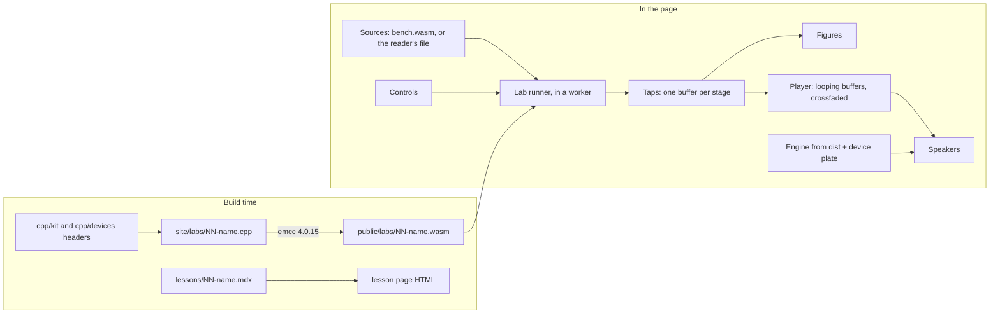

# A Public Site With Twenty Lessons - Plan

## Goal Capsule

- Objective: live-mix has a public website, built from this repository, that documents everything in the library and teaches twenty audio techniques the engine uses. In each lesson a loop runs through the engine's own C++ in the page, the reader sees and hears every stage, turns the controls, and reads how the signal processing works.
- Means: a self-contained static site in `site/` (KTD1, KTD2); one small WebAssembly module per lesson, compiled from the engine's headers, with a tap on every stage (KTD3, KTD4); the docs in `docs/` rendered as they are (KTD7); published to GitHub Pages by a workflow (KTD9).
- Authority: this plan's Requirements first, then the engine's sources under `cpp/` for what a lesson may say, then `docs/contributing.md` for how a change to this repository is made.
- Stop conditions: a lab module cannot be compiled from the engine's headers without changing them; the site cannot be kept out of the root install (R4); a settled decision turns out not to work.
- Execution profile: one branch (`claude/audio-lessons-site-cvepgr`), one pull request against `main`. Two other threads change `cpp/devices` and `src/visuals` at the same time: everything here stays in `site/` but for the short list in R5.
- Nobody can listen in this environment. Every claim a lesson makes is a property of a render, held by a test (R17). Whether a lesson sounds right and teaches well is for the owner's ear and eye.

---

## Product Contract

### Summary

Add a website to live-mix. It has four parts: twenty interactive lessons, the docs that already sit in `docs/`, a page for each of the 159 devices, and the API reference. A lesson takes one technique (the Fourier transform, compression, convolution reverb and seventeen more), runs a loop through the engine's code compiled to WebAssembly, and lays the signal out stage by stage: a picture of each stage, a button to hear it there, the controls that move it, and the mathematics in detail. Each lesson ends with the real device playing live behind its own plate. The site is built by a workflow and published to GitHub Pages.

### Problem Frame

The engine holds 159 devices built from a shared kit of filters, delays, transforms and oscillators, and nothing shows how any of it works. The docs are Markdown read on GitHub: 47 pages, no search, no device has a page a reader can play. The owner wants to learn the signal processing in depth, from the code that makes the sound, by seeing and hearing it. A compiled device gives only its output, so there is no way today to look inside one.

### Key Decisions

- **The site lives in this repository.** (session-settled: user-directed — chosen over a separate repository: the lessons read the engine's own sources and must not drift from them.) Governs R1, R4, R5.
- **Lessons run the engine's own code.** (session-settled: user-directed — chosen over teaching copies of the DSP written again in JavaScript: he wants to learn how these effects really work, and a copy can disagree with the device.) Governs R8, R9, R10. One conflict found, workable: the engine has no convolver in C++. It convolves in two places, both with the browser's `ConvolverNode` fed by an impulse synthesised in TypeScript: a track's room (`src/core/tracks/SpaceRoom.ts`, with the seeded impulse of `src/core/tracks/space.ts`) and the `convolver-reverb` device (`src/core/devices/native/ConvolverReverb.ts`, whose own default is a different, unseeded recipe). The convolution lesson runs the room's impulse through a `ConvolverNode`, which is the engine's own code, hands the same impulse to the device on its bench, and adds one convolution written for the lesson with the kit's FFT to show the mechanism, marked as written for the lesson (R9).
- **About twenty techniques to start.** (session-settled: user-directed — chosen over two or three lessons first: his word.) Governs R7.
- **Every stage says where it comes from.** A stage is read from the running device, computed by a kit class the device is built from, or written for the lesson. The page says which, under each stage. This is what keeps "deconstructing the parts" honest: the research found devices that carry their own filter or their own oscillator where a reader would expect the kit's. Governs R9, R10.
- **A lesson's numbers are tests.** A lesson that says "above the threshold the level rises by one part in four" holds that sentence with an assertion on a render. Governs R17.
- **The site looks like the engine's own controls.** It takes the React kit's stylesheet and tokens (paper white, ceramic grey, near-black, vermillion; light and dark), and one colour per role in every figure: what goes in, what comes out, what controls. Governs R19.

### Requirements

**The site**

- R1. `site/` holds a static website that builds to plain files and works under a path prefix (`/live-mix/`) and at a domain's root, chosen by environment at build time.
- R2. The site has a home page, a lessons index, the docs, a devices index with a page for each device, the API reference, and a search over all of it.
- R3. Every page works with JavaScript on in current Chromium, Firefox and Safari. Text, headings, tables and figures' captions are in the HTML as built, so a page reads without the scripts.
- R4. The site adds nothing to the root `package.json`'s dependencies and nothing to the root lockfile. A consumer that installs this repository installs no package of the site.
- R5. Outside `site/`, the change touches only: one ignore line in `eslint.config.js`, one in `.prettierignore`, the new workflow file, `docs/site.md`, one link each in `docs/README.md`, `docs/contributing.md` and `README.md`, this plan under `docs/plans/`, and a write-up under `docs/solutions/` if the work yields one. No file under `cpp/`, `src/` or `dist/` changes.
- R6. No lesson, page, file or identifier is named after a product, a brand, a maker, an artist or a track, and nothing is described by comparison with another program. The standard names of mathematics and of textbook structures stay (Fourier, Hilbert, Hadamard, Householder).

**The lessons**

- R7. Twenty lessons, in the order of "The twenty lessons" below. Each is one technique the engine uses, named in the lesson with the files that hold it.
- R8. In each lesson a loop or a test signal runs through a lab module compiled from the engine's C++. The reader chooses the source: loops played by the engine's own instruments, test signals from the kit's oscillators, or a file of their own.
- R9. A lesson shows the signal at each stage of the technique, in order. Each stage has a name, a picture fit for it (wave, spectrum, spectrogram, level over time, transfer curve, impulse response, frequency response), a button to hear the signal there where the stage is sound, and a label saying where the stage comes from: the device, the kit, or the lesson.
- R10. Where a lesson rebuilds a device from its parts, the page shows the difference between the rebuilt output and the device's output, as a level in decibels, computed in the lab on every render, and the lesson states the bound the rebuild holds to.
- R11. Each lesson has the controls that matter to the technique. Moving one renders again and redraws every stage, and what is playing carries on from the same place in the loop.
- R12. Each lesson explains the signal processing in detail: the idea in plain words, each stage with its equation and what the equation's terms are in the code, the constants the engine chose and why they matter, and what goes wrong at the edges (aliasing, zipper noise, ringing, pumping, latency).
- R13. Each lesson links every file it talks about to that file on GitHub at the commit the site was built from.
- R14. Each lesson ends with the real device running live through the engine, behind its own plate from the React kit, on the same loop.
- R15. Sound starts only on the reader's click. One play bar stays in view: play and stop, which stage is sounding, the source, the level.
- R16. A lab sets the device's controls so the textbook case shows. Where the device's defaults hide it (an equaliser that also clears mud, a compressor that holds its release while a tail dies), the lesson turns that off first, says so, and gives it back as a control.

**Proof**

- R17. Every quantity a lesson states is asserted by a test on a render of that lesson's lab. Every lab's taps are finite and not silent on the default source, and every control changes a tap.
- R18. A headless browser opens every lesson: the page renders with no error, every figure has drawn, a control redraws them, play starts the audio clock, and the real device's plate appears. A link check finds no dead link in the built site.

**Looks**

- R19. The site uses the React kit's tokens and stylesheet, light and dark by the reader's system setting, and one colour per signal role in all figures.
- R20. A page is laid out for reading at a phone's width and at a desk's. Figures scale with the column.

**Docs, devices, API**

- R21. Every Markdown page under `docs/`, but for `docs/plans/`, `docs/solutions/` and `docs/api/`, is a page of the site at a route that keeps its folder. The Markdown files are not edited: relative links between them become links between pages, links to files that are not pages go to the file on GitHub, Mermaid blocks are drawn.
- R22. Each device has a page built from its descriptor: name, family, what it does, every control with range, default, unit and description, its presets, its source folder, and the lessons that use it. Effects can be heard there on a loop; an instrument plays a phrase.
- R23. The API reference TypeDoc already writes is published under `/api/`.

**Publishing**

- R24. A workflow builds the site on a pull request that touches `site/`, `cpp/`, `src/`, `docs/`, the root `package.json`, `pnpm-lock.yaml`, `typedoc.json` or the workflow, and on every push to `main`. On `main` it publishes to GitHub Pages when Pages is switched on for the repository, and says so plainly and passes when it is not.
- R25. The site's address is read from the repository's Pages settings at build time, so a custom domain set there needs no change to the workflow.
- R26. `docs/site.md` says how the site is built, how a lesson is written, how Pages is switched on, and how a domain is pointed at it.

### The twenty lessons

| # | Lesson | The engine's code | Device on the bench |
|---|---|---|---|
| 1 | Samples, sine waves and aliasing | `cpp/kit/osc.h` | `saturator` off, as a clean path |
| 2 | The Fourier transform | `cpp/kit/fft.h` | `spectral-blur` |
| 3 | The short-time Fourier transform | `cpp/kit/stft.h` | `glimmer` |
| 4 | The one-pole filter and smoothing | `cpp/kit/filters.h`, `cpp/kit/smooth.h` | `ambient-eq` |
| 5 | The state-variable filter | `cpp/kit/filters.h` | `auto-filter` |
| 6 | Equalising with biquads | `cpp/kit/filters.h` | `ambient-eq` |
| 7 | Compression | `cpp/devices/ambient-comp` | `ambient-comp` |
| 8 | Limiting and true peaks | `cpp/devices/true-peak-limiter` | `true-peak-limiter` |
| 9 | Saturation and oversampling | `cpp/devices/saturator`, `cpp/kit/oversample.h` | `saturator` |
| 10 | Delay and echo | `cpp/kit/delay.h`, `cpp/devices/tape-echo` | `tape-echo` |
| 11 | Chorus and flanging | `cpp/devices/chorus`, `cpp/devices/flanger` | `chorus` |
| 12 | Phasing | `cpp/devices/phaser` | `phaser` |
| 13 | Plate reverb | `cpp/devices/plate-reverb` | `plate-reverb` |
| 14 | The feedback delay network | `cpp/kit/fdn.h`, `cpp/devices/fdn-reverb` | `fdn-reverb` |
| 15 | Convolution reverb | `src/core/tracks/space.ts`, `src/core/tracks/SpaceRoom.ts`, `src/core/devices/native/ConvolverReverb.ts`, `cpp/kit/fft.h` | `convolver-reverb`, handed the room's impulse |
| 16 | Frequency shifting | `cpp/kit/hilbert.h`, `cpp/devices/freq-shifter` | `freq-shifter` |
| 17 | Pitch shifting | `cpp/kit/pitch.h`, `cpp/devices/pitch-shifter` | `pitch-shifter` |
| 18 | Granular sound | `cpp/kit/grains.h`, `cpp/devices/grain-delay` | `grain-delay` |
| 19 | The plucked string | `cpp/kit/string.h`, `cpp/devices/guitar` | `guitar` |
| 20 | Frequency modulation | `cpp/devices/fm-glass` | `fm-glass` |

The device beside a lesson is a default. Where the research's map (`cpp/devices/<id>/*.h` read at build time) shows another device fits better, the lesson takes that one and says which.

### Scope Boundaries

- No change to the library, its devices, its package or its version. No changeset.
- The site is in English only.
- No accounts, no saving, no analytics, no comments.
- A lesson does not teach an instrument's or an effect's use in a mix. It teaches how it works.

**Deferred to Follow-Up Work**

- More lessons: modal synthesis, envelopes and low-frequency oscillators, stereo width, tape, lossy coding, loudness, the ladder filter, time stretching.
- Buying a domain and pointing it at the site. This plan proposes names in `docs/site.md` and leaves the purchase and the DNS to the owner.
- Showing the site inside the app.

### Sources

- The engine: `cpp/kit/*.h`, `cpp/devices/*/`, `cpp/common/device_api.h`, `scripts/build-wasm.sh`.
- The kit's page for a real device: `playground/src/plates.tsx`.
- What a contributor does: `docs/contributing.md`, `.github/workflows/ci.yml`.

---

## Planning Contract

### Key Technical Decisions

- KTD1. **`site/` is a project of its own, not a member of the root workspace.** It has its own `package.json`, its own `pnpm-lock.yaml` and its own `pnpm-workspace.yaml`. The root workspace lists only `.`, and both consumer apps install this repository with npm, which installs the root's `devDependencies`: a site package there would land in their installs. Chosen over a workspace member (one lockfile, but every root install and seven CI jobs would carry the site's packages) and over the playground's way of living on the root's packages (the site needs a static generator and MDX that the library does not). Governs R4, R5.
- KTD2. **Astro 7, MDX lessons, React islands.** Lessons are prose with live figures between the paragraphs, the docs are 47 Markdown files, and the device pages are generated: a static generator with content collections does all three, and the figures stay React so they can use the React kit. A probe built 65 pages with this stack in under twelve seconds. Chosen over a Vite and React app like the playground (no static HTML per page, no Markdown pipeline) and over a docs generator with its own theme (the lessons need a free layout). Things the probe found that the build must respect: the Markdown processor is Sätteri and takes plugins as `satteri({ hastPlugins })`; `src/content.config.ts` with loaders is required; `compressHTML` is set to `false` so links in running text keep their spaces; the dev server detaches when it sees an agent unless run with `--ignore-lock`.
- KTD3. **One lab module per lesson, compiled from the engine's headers.** A lab is a C++ file in `site/labs/` that includes the device and kit headers it needs, declares its controls and its taps, and renders the whole loop in one call. It is built with the repository's pinned Emscripten (4.0.15) and the flags `scripts/build-wasm.sh` uses, as raw WebAssembly with no imports. Chosen over adding taps to the devices (changes the engine for the site's sake, and two threads are in `cpp/devices` now) and over stopping at each device's output (no stages to show).
- KTD4. **A lab reads the device's own state where it can.** Lab files are compiled with `-fno-access-control`, so a lab can run the real device in blocks as short as its control interval and read the level it measured, the gain it applied, the phase of its oscillator. Where a stage is an audio signal the device never stores, the lab computes it with the same kit class and the same constants, and R10's difference shows on the page whether the rebuild matches. A value the device computes and does not keep (a local of its control step) is computed again in the lab from state read from the device, has the origin `lesson`, and is held to the device by a check against the next value the device does store. A stage's origin (device, kit, lesson) is declared in the lab and shown on the page.
- KTD5. **Lab modules are built, not committed.** `site/public/labs/*.wasm` is ignored by git and written by `site/scripts/build-labs.sh`. A lesson then always shows the engine as it is at that commit. The cost: building the site needs Emscripten, and a change to a device that breaks a lab fails the Site check on that pull request, with the fix in `site/labs/`. Chosen over committing them as `src/dsp/wasm/` does (every change to a device header would leave stale binaries in the site, and a reproducibility check would turn another thread's pull request red for a file it did not touch).
- KTD6. **Renders are offline, at 48,000 samples a second, in a worker.** A lab renders a loop of at most eight seconds (four by default) in one call; the page draws from the taps and plays them as looping `AudioBuffer`s, which the browser resamples to its own rate. A fixed rate makes every picture and every test repeatable. In the page the runner lives in one worker per lesson, holding the lab and the bench module, and posts the taps back as transferred buffers; the lab tests call the same runner in-process in Node. One eight-second pass through the committed device modules, timed in Node here, took 11 ms for `ambient-comp` and 160 to 185 ms for `fdn-reverb`, `saturator` and `pitch-shifter`: too long for the thread a control is dragged on. The store keeps one render in flight and renders once more with the latest values when it lands. Every lab and every bench source renders the loop twice and 20 ms more, keeps the second pass, and crossfades the extra 20 ms into the kept pass's first 20 ms, so a tail wraps and a device whose oscillator or grains do not repeat with the loop still loops without a step.
- KTD7. **The docs are rendered where they are.** A content collection globs `../docs/**/*.md` with the three folders of R21 left out. A page's title is its first heading. Two tree plugins do the rest: one rewrites relative links (inline and reference-style) to page routes under the base path and sends links to non-pages to GitHub; one turns Mermaid blocks into elements a lazily loaded script draws. Chosen over copying the docs into the site (two copies) and over moving them (tests pin generated docs and README examples, and the docs must keep reading well on GitHub).
- KTD8. **The site consumes the library as a consumer does.** It depends on `@kieranklaassen/live-mix` by a link to the repository's root, so imports go through the package's export map to `dist/`. `react` and `react-dom` are deduped in the site's Vite config, and every island that touches the React kit is client-only. Device descriptors for the catalogue are read at build time from the package root's `devices` registry after `registerStockWasmDevices(devices)` from the `./dsp` entry, as `benchRegistry` in `playground/src/plates.tsx` joins the two: the compiled devices alone are 151 of the 159. The site's build therefore needs the root built first, which `pnpm install` at the root does.
- KTD9. **Pages is published by a hand-written workflow that reads the Pages settings.** A step asks the API for the repository's Pages site with the job's own token. No site, or a site not set to build from a workflow: a notice, and the deploy job is skipped. Otherwise `html_url` gives the site's origin and base path for the build. The owner switches Pages on once: Settings, Pages, Source: GitHub Actions. Chosen over the generator's own action (it does not find a lockfile in a sub-folder) and over switching Pages on from the workflow (needs a personal token, and no token is asked for).
- KTD10. **Search is Pagefind, run over the built files.** It needs no server and indexes lessons, docs, device pages and the API reference in one pass, after the API reference is copied into the built site.

### High-Level Technical Design

How a lesson page works:



The lab's interface, as C exports (directional, the unit fixes the names):

```text
lab_init()                      once, after _initialize
lab_describe() -> char*         JSON: controls (id, name, min, max, default, unit, steps),
                                taps (id, name, kind, origin, rate, channels), checks
lab_input(channel) -> float*    where the page writes the source, 48 kHz
lab_set(control_index, value)
lab_run(frames)                 renders everything
lab_tap(tap_index) -> float*    lab_tap_length(tap_index) -> frames
lab_check(check_index) -> float a number the lab computed, such as R10's difference in dB
```

Tap kinds: `audio` (hear and draw), `control` (a value over time, at the device's control rate), `curve` (y against x, such as a transfer curve or a frequency response), `spectrum` (magnitude per bin), `frames` (a spectrogram). Origins: `device`, `kit`, `lesson`.

`bench.wasm` is one shared module: the sources (a drum loop from `drum-kit`, a played line from `guitar` or `handpan`, and the kit's sine, band-limited saw, noise, impulse and sweep, all from fixed seeds) and the analysis every figure shares (magnitude spectrum and spectrogram by `kit::Fft` and `kit::Stft`, peak and RMS).

On the page, one store per lesson holds the source, the control values, the taps of the last render and which tap is sounding. Every island reads it through `useSyncExternalStore` with a fixed server snapshot, so islands hydrate apart and stay in step.

### Assumptions

- A device class compiles inside a lab module with the flags of `scripts/build-wasm.sh` plus `-fno-access-control`, with the device object static (the WebAssembly stack is 131,072 bytes). U4 proves this first, on `ambient-comp`. If a device cannot be read this way, that lesson's stage is rebuilt from kit classes and labelled so (KTD4).
- pnpm treats `site/` as its own root because `site/pnpm-workspace.yaml` exists. U1 proves it: the root lockfile is unchanged after a site install.
- The owner switches Pages on once. Until then the workflow builds and does not publish.
- The deploy job of the Site workflow has not run on GitHub before this pull request. Its first run on `main` is its first real test; the build job runs on the pull request.
- Domain names in `docs/site.md` are proposals; whether one is free was not checked, the registries could not be reached from here. `learn.ambient.town`, on the domain he already has, needs one DNS record and no purchase.

### Output Structure

```text
site/
  package.json  pnpm-lock.yaml  pnpm-workspace.yaml  astro.config.mjs  tsconfig.json  README.md  .gitignore
  labs/
    lab.h                      controls, taps, checks: the lab's side of the interface
    bench.cpp                  sources and shared analysis
    02-fourier-transform.cpp   one per lesson, named as the lesson is
  scripts/
    build-labs.sh              emcc over labs/*.cpp into public/labs/
    check-links.mjs            every internal link in dist/ resolves
    check.sh                   what the Site workflow runs, for a contributor
  src/
    content.config.ts          lessons (MDX), docs (../docs)
    content/lessons/           02-fourier-transform.mdx, one per lesson
    lab/                       runner, store, player, sources, wasm loader
    figures/                   Wave, Spectrum, Spectrogram, Trace, Curve, StageStrip, Control, PlayBar, DeviceBench
    lib/                       doc routes, markdown plugins, device catalogue, source links
    layouts/  components/  pages/  styles/
  tests/
    labs/                      one test file per lab: R17
    browser/                   Playwright: R18
  public/labs/                 built, ignored
```

### Sequencing

U1, then U2, U3 and U4 side by side, then U5, then U6. U6's three lessons fix the pattern; U7 to U12 are written side by side from it. U13 and U14 close.

---

## Implementation Units

| Unit | Name | Depends on |
|---|---|---|
| U1 | The site's frame | none |
| U2 | The docs as pages | U1 |
| U3 | Device pages, the API reference, search | U1 |
| U4 | The lab: interface, build, runner, bench | U1 |
| U5 | The lesson kit: figures, stages, controls, player, the real device | U3, U4 |
| U6 | Three lessons that set the pattern | U5 |
| U7 | Lessons on signals and filters | U6 |
| U8 | Lessons on dynamics and drive | U6 |
| U9 | Lessons on delay and modulation | U6 |
| U10 | Lessons on reverberation | U6 |
| U11 | Lessons on pitch and grains | U6 |
| U12 | Lessons on synthesis | U6 |
| U13 | Every page in a headless browser | U2, U3, U6 to U12 |
| U14 | Publishing, and the docs about the site | U13 |

### U1. The site's frame

- **Goal:** a site that builds, with its layout, navigation, looks and home page, and that the root's install and checks do not see.
- **Requirements:** R1, R2 (home, navigation), R3, R4, R5, R19, R20.
- **Dependencies:** none.
- **Files:** `site/package.json`, `site/pnpm-workspace.yaml`, `site/pnpm-lock.yaml`, `site/astro.config.mjs`, `site/tsconfig.json`, `site/.gitignore`, `site/src/layouts/Base.astro`, `site/src/components/{Header,Footer,Nav}.astro`, `site/src/styles/site.css`, `site/src/pages/index.astro`, `site/src/pages/404.astro`, `eslint.config.js`, `.prettierignore`.
- **Approach:** the config reads `SITE_URL` and `SITE_BASE` with `??` (default base `/live-mix`), sets `trailingSlash: 'always'`, `compressHTML: false`, the React and MDX integrations, the sitemap, Shiki with a light and a dark theme, and `resolve.dedupe` for React. Every internal link is built from `import.meta.env.BASE_URL` by one helper. The stylesheet imports the React kit's `styles.css` for the `--lm-*` tokens and sets the page on them; dark follows `prefers-color-scheme` by setting `data-lm-theme` before paint. The site has its own Prettier (with the Astro plugin) and its own `astro check`; the root's ESLint and Prettier ignore `site/`.
- **Patterns to follow:** `playground/vite.config.ts` for consuming the library beside it; the React kit's theme attributes in `playground/src/plates.tsx`.
- **Test scenarios:**
  - After `pnpm install` in `site/`, `git status` shows the root `pnpm-lock.yaml` and `package.json` unchanged.
  - The site builds with `SITE_BASE=/live-mix` and with `SITE_BASE=/`; in both, every `href` and `src` in `dist/index.html` starts with the base.
  - Root `pnpm lint` passes with `site/dist` and `site/.astro` present.
  - `npm pack --dry-run` at the root lists no file under `site/`.
- **Verification:** `pnpm -C site build` exits 0; root `pnpm lint` exits 0.

### U2. The docs as pages

- **Goal:** every doc is a page, linked as it is on GitHub, with a sidebar.
- **Requirements:** R21, R2.
- **Dependencies:** U1.
- **Files:** `site/src/content.config.ts`, `site/src/lib/doc-routes.ts`, `site/src/lib/markdown-plugins.ts`, `site/src/pages/docs/[...slug].astro`, `site/src/components/DocsSidebar.astro`, `site/src/components/Mermaid.astro`, `site/tests/unit/doc-routes.test.ts`, `site/tests/unit/markdown-plugins.test.ts`.
- **Approach:** per KTD7. Routes keep the folder (`docs/concepts/devices.md` and `docs/devices.md` are two pages). `docs/README.md` is `/docs/`. The sidebar follows the order of `docs/README.md`'s own lists, with pages it does not name under "More". Heading anchors match GitHub's slugs so the 46 anchored links land. Images under `docs/images` are served.
- **Test scenarios:**
  - A relative link `./concepts/devices.md#anchor` in a top-level doc becomes `<base>/docs/concepts/devices/#anchor`.
  - A reference-style link to a `.md` file is rewritten the same way.
  - A link to `../src/core/engine.ts` becomes a GitHub URL at the build's commit.
  - A link to `docs/plans/x.md` (not a page) becomes a GitHub URL.
  - A `mermaid` code block becomes a `pre.mermaid` holding the source, and is not highlighted.
  - Two docs with the same base name in different folders get different routes.
  - The built site has a page for every Markdown file the glob takes: the count equals the count of files.
- **Verification:** the unit tests pass; U13's link check finds no dead link under `/docs/`.

### U3. Device pages, the API reference, search

- **Goal:** a page for each device, the API reference under `/api/`, and a search box.
- **Requirements:** R22, R23, R2.
- **Dependencies:** U1; the live bench on a device page arrives with U5.
- **Files:** `site/src/lib/devices.ts`, `site/src/pages/devices/index.astro`, `site/src/pages/devices/[id].astro`, `site/src/components/ParamTable.astro`, `site/src/components/Search.astro`, `site/scripts/build-api.mjs`, `site/tests/unit/devices.test.ts`.
- **Approach:** `devices.ts` reads the joined registry of KTD8 at build time and groups it in the order of `DEVICE_CATEGORIES`. A device page's prose comes from the descriptor, shown as the library words it. Its source link is `cpp/devices/<id>/` where that folder exists, the `cpp/faust/<id>.dsp` file for a Faust device, and the device's TypeScript file for a node device and the rack. The lessons that use a device come from the lessons' frontmatter. The API step runs the root's `typedoc` and copies `docs/api` into the built site. Pagefind runs after the build; the search box loads its script on first focus.
- **Test scenarios:**
  - There is a page for every id in the joined registry, `convolver-reverb` (a node device) and `plate-reverb` (a compiled one) among them, and the count is the registry's.
  - Every device page's source link names a path that exists in the repository.
  - A device with a control that has an enumerated range lists its choices.
  - A device no lesson uses shows no "Lessons" block rather than an empty one.
  - A descriptor with a missing description builds, and the page says nothing in that cell.
  - `/api/index.html` exists in the built site.
- **Verification:** the unit tests pass; the built site holds `pagefind/` and a search for "compress" in U13 returns the compression lesson.

### U4. The lab: interface, build, runner, bench

- **Goal:** a lab can be written in one C++ file, built, loaded in Node and in the page, and its taps read.
- **Requirements:** R8, R9 (origin), R10, R16, R17.
- **Dependencies:** U1.
- **Files:** `site/labs/lab.h`, `site/labs/bench.cpp`, `site/scripts/build-labs.sh`, `site/src/lab/wasm.ts`, `site/src/lab/runner.ts`, `site/src/lab/worker.ts`, `site/src/lab/describe.ts`, `site/src/lab/sources.ts`, `site/tests/labs/support.ts`, `site/tests/labs/bench.test.ts`, `site/vitest.config.ts`.
- **Approach:** `lab.h` gives a lab three declarations (a control, a tap, a check) and writes the JSON of `lab_describe` from them, so names, ranges and origins live once, in C++. Buffers are static; memory is fixed and sized for eight seconds of the lab's taps. `build-labs.sh` follows `scripts/build-wasm.sh`: same include path, same optimisation and language flags, plus `-fno-access-control`, and it fails if `emcc --version` is not the pinned one. The runner is the same code in Node and in the page: it takes the module's bytes, so tests read the file and the page's worker fetches it. The first lab compiled is a probe that includes `ambient_comp.h`, runs it, and reads its detector and its gain: the assumption this plan leans on. The probe is scratch and is not committed; U6's compression lab test keeps its two assertions.
- **Execution note:** prove the probe lab before writing anything on top of it.
- **Patterns to follow:** `scripts/build-wasm.sh`; `cpp/test/support/test_kit.h` for running a device over buffers in blocks.
- **Test scenarios:**
  - `lab_describe` parses as JSON and matches the schema in `describe.ts`; an unknown tap kind fails the parse.
  - Each bench source renders the same samples twice (fixed seeds), is finite, and peaks below full scale.
  - The drum loop's first kick lands on frame 0 and its energy below 100 Hz exceeds the hat's.
  - The bench's spectrum of a sine placed on bin 32 of 1,024 peaks at bin 32, and the next bins are 100 dB or more below.
  - The bench's spectrum of a sine between two bins shows leakage: the two neighbours within 4 dB of each other.
  - Setting a control outside its range clamps to the range.
  - A render of zero frames returns taps of length zero and does not trap.
  - Every bench source loops without a step: the sample step across the wrap is no larger than the largest step inside the loop.
- **Verification:** `bash site/scripts/build-labs.sh` writes `bench.wasm` with no imports; `pnpm -C site test` passes.

### U5. The lesson kit: figures, stages, controls, player, the real device

- **Goal:** the components a lesson is written with, and the lesson page itself.
- **Requirements:** R9, R11, R13, R14, R15, R19, R20, R22 (the bench on device pages), R3.
- **Dependencies:** U3, U4.
- **Files:** `site/src/lab/store.ts`, `site/src/lab/player.ts`, `site/src/figures/{Wave,Spectrum,Spectrogram,Trace,Curve,StageStrip,Stage,Control,SourcePicker,PlayBar,CheckLine,Claim,DeviceBench,LabRoot}.tsx`, `site/src/figures/draw.ts`, `site/src/components/{Lesson,SourceLink,Math}.astro`, `site/src/pages/lessons/index.astro`, `site/src/pages/lessons/[slug].astro`, `site/src/pages/devices/[id].astro`, `site/src/lib/source-links.ts`, `site/scripts/check-claims.mjs`, `site/tests/unit/{store,player,draw}.test.ts`.
- **Approach:** figures draw on a canvas at the device's pixel ratio from typed arrays, with min and max per pixel column for waves and a logarithmic frequency axis for spectra. Each figure has a caption in the HTML and an `aria-label` naming what it shows. The player holds one `AudioContext`, created in the click; a tap plays as a looping buffer source, and a new render or another stage starts a new source at the same phase and crossfades over 20 ms. The player plays every stage of a lesson at one gain, 12 dB under full scale, so a stage that passes full scale is heard unclipped and stages keep their true difference in level; the play bar has a volume and a meter. `StageStrip` lays the stages out in the signal's order, each with its small picture and its origin; a stage with an `audio` tap has a "listen" button, and a stage whose tap is a value over time, a curve or a spectrum has its picture and a word for what it is, and no button. `SourcePicker` lists the lesson's loops and test signals and "Your own file": the file is decoded, resampled to 48 kHz, its first eight seconds kept with a short fade at each end, and the picker says how much was kept; a file that cannot be decoded leaves the source as it was and says so; the file is held for that visit to the page only. A lab that is loading or failed to load says so in every figure, and is never drawn as silence. `DeviceBench` follows `playground/src/plates.tsx`: an engine, an audio track fed by the loop, the device as an insert, its plate and preset picker. It loads the engine only when the reader opens it, builds it on the player's `AudioContext`, and makes no sound by opening: its "listen" makes the bench the sounding stage, the stage that was sounding fades out, the play bar names the real device, and the play bar's stop and source govern it. The plate sits in a box that scrolls sideways by itself, as the kit's chain view does, so a plate wider than the column never widens the page. `Claim` wraps a quantity in a lesson's prose and carries an id; `check-claims.mjs` fails when a claim's id has no assertion carrying that id in the lesson's lab or browser test, which is how R17 is held. Lesson frontmatter: title, order, summary, lab, devices, sources, default source, files. Equations are rendered at build time.
- **Patterns to follow:** `playground/src/plates.tsx`.
- **Test scenarios:**
  - The store: with a render in flight, any number of control changes cause exactly one more render, with the latest values.
  - The store: a lab that has not loaded shows as loading and one that failed to load shows its message; neither shows as a silent signal.
  - The store: a twelve-second buffer given as the source is cut to eight seconds, and a decode that fails leaves the source as it was and sets a message.
  - A stage with no `audio` tap renders no listen button and cannot become the sounding stage.
  - The player: making the bench the sounding stage stops the tap's source, and stop stops the bench's feed.
  - The player: switching stage keeps the loop phase within one render quantum, with fake context time.
  - The player: stop then play starts from the loop's start.
  - `draw`: a wave of 192,000 samples into 600 columns gives each column the min and max of its samples; an empty tap draws a flat line and does not throw.
  - `draw`: a frequency of 1 kHz maps to the same x at 48 kHz for any FFT size.
  - A lesson whose frontmatter names a lab file that does not exist fails the build with the lesson's name.
- **Verification:** unit tests pass; the lesson index builds with no lessons and with one.

### U6. Three lessons that set the pattern

- **Goal:** the Fourier transform, compression and convolution reverb, complete, as the model for the rest.
- **Requirements:** R7 to R17 for lessons 2, 7 and 15.
- **Dependencies:** U5.
- **Files:** `site/labs/{02-fourier-transform,07-compression,15-convolution-reverb}.cpp`, `site/src/content/lessons/{02-fourier-transform,07-compression,15-convolution-reverb}.mdx`, `site/src/lab/convolution.ts`, `site/tests/labs/{02-fourier-transform,07-compression,15-convolution-reverb}.test.ts`, `site/tests/browser/{lessons,convolution}.spec.ts`, `site/playwright.config.ts`, `site/LESSONS.md`.
- **Approach:**
  - *Fourier transform.* Stages: a frame of the signal, the window, the frame times the window, the transform's bins as magnitude and phase, the sum of the first N bins played back. Figures the reader moves: a sine swept across bins to show leakage; the bins as turning vectors that sum to the frame; rebuilding the frame from a growing count of bins. All bins come from `kit::Fft`. The lesson covers the sum as a correlation with each sinusoid, bin spacing, the window's trade of width against leakage, the inverse being unscaled in the kit, and what the fast transform saves.
  - *Compression.* Stages as the device's own comment gives them: side-chain high-pass, RMS, level in decibels, the soft-knee curve, attack and release, gain, make-up, mix. The detector's power, the reduction after attack and release, and the applied gain are read from the running device at its control rate. The level in decibels and the knee's answer are locals of the device's control step, so the lab computes them from the device's own threshold, knee and slope, with the origin `lesson`, and checks that they, run through the attack and release, match the reduction the device stores. The transfer curve is measured by rendering steady tones. Tails are set to release normally and attack opens at 10 ms (R16); the lesson states the detector's own rise, which the device's header puts near 40 ms, as a quantity of its own. The lesson covers level detection, the knee's quadratic, time constants as one-pole coefficients, why gain is smoothed in decibels, and pumping.
  - *Convolution reverb.* Stages: the impulse the engine synthesises (seeded noise under a decay, shown as wave and as energy over time), the dry loop, the convolved output. The impulse comes from the engine's `space.ts` and the output from a `ConvolverNode` in an `OfflineAudioContext`, with `normalize` off as `SpaceRoom` sets it. The bench is `convolver-reverb` created with that same impulse through its `impulse` option, mixed with the dry loop as a send is, because the device puts out the wet signal only; the page says under the bench that the device's own default hall is another recipe. Beside it, the lesson's own convolution: the direct sum on a short excerpt drawn one tap at a time, then the same by multiplying spectra with `kit::Fft`, with the difference between the two shown. The lesson covers the convolution sum, an impulse response as a room's fingerprint, why multiplying spectra is the same operation, block convolution and its latency.
  - `site/LESSONS.md` records the pattern for the remaining lessons: the sections of a lesson, where things stand on the page (the stage strip once, under the opening idea, wrapping to rows at a phone's width; each control beside the figure it moves; the real device last), how a stage is declared, how every stated quantity is written through `Claim` and held by a test, the wording rules of R6.
  - `lessons.spec.ts` is written here to loop over whatever lessons exist, so each later unit runs it on its own lessons.
- **Test scenarios:**
  - Fourier: Parseval holds to 1e-4 on noise. A sine on a bin gives one peak; inverse of forward returns the frame times N. Rebuilding from all bins nulls against the frame below −100 dB.
  - Compression: a steady tone 12 dB over the threshold at ratio 4 settles at 3 dB over, within 0.5 dB. Below the threshold less the knee, gain is 0 dB. On a step up, the lab's level and knee run through the attack match the device's stored reduction within 0.1 dB, and the reduction reaches 63 % of its final value at the detector's rise plus the attack time, within 20 %. On silence the device's gain is 0 dB; on a full-scale sine it is negative. Mix at 0 nulls against the input.
  - Convolution, in Node: the direct sum and the spectral product agree below −90 dB on the excerpt. The engine's impulse is the same for the same seed and decays by 60 dB within 10 % of its stated time.
  - Convolution, in the browser (`site/tests/browser/convolution.spec.ts`, since a `ConvolverNode` does not run in Node): convolving with a single unit impulse returns the input below −80 dB; the output with the room's impulse is finite, not silent, and longer than the dry loop by the impulse's length.
  - Each lab: every tap finite and not silent on the default source; every control changes a tap; every audio tap loops without a step; where the lab rebuilds a device from its parts, the difference on the default source at the lab's starting controls is under the bound the lesson states.
- **Verification:** the three lab tests pass; the three pages build and pass `lessons.spec.ts` and `convolution.spec.ts`; `check-claims.mjs` passes.

### U7. Lessons on signals and filters

- **Goal:** lessons 1, 3, 4, 5 and 6.
- **Requirements:** R7 to R17 for those lessons.
- **Dependencies:** U6.
- **Files:** a lab, a lesson and a test for each: `01-samples-and-aliasing`, `03-short-time-fourier`, `04-one-pole`, `05-state-variable-filter`, `06-equalising`.
- **Approach:** lesson 1 draws samples against the wave they stand for, folds a rising sine back at half the sample rate, and sets the kit's band-limited saw beside a naive saw written for the lesson and labelled so. Lesson 3 slides a window along the loop, shows frames overlapping and adding back to the signal, and alters the frames in between as `glimmer` does. Lesson 4 is the one-pole as a moving average with memory: step response, time constant, and the same filter smoothing a control. Lesson 5 shows the three outputs of one state-variable filter and its resonance; lesson 6 builds an equaliser's curve from biquads, measured by running an impulse through the engine's filters.
- **Test scenarios:**
  - Aliasing: a sine at 30 kHz sampled at 48 kHz peaks at 18 kHz. The kit's saw has its aliased partials 40 dB or more below the naive saw's at a 4 kHz fundamental.
  - Short-time: with nothing altered, overlap-add returns the input below −90 dB after the latency.
  - One-pole: the step reaches 63 % at the time constant within one sample period's error; the measured −3 dB point is the cutoff within 2 %.
  - State-variable: low plus high plus band scaled as the lesson states equals the input below −80 dB; the peak at resonance sits at the cutoff within 2 %.
  - Equalising: a bell of +6 dB at 1 kHz measures +6 dB at 1 kHz within 0.2 dB and 0 dB two octaves away within 0.5 dB.
  - Each lab: as U6's "Each lab" scenario.
- **Verification:** the five lab tests pass, the five pages build and pass `lessons.spec.ts`.

### U8. Lessons on dynamics and drive

- **Goal:** lessons 8 and 9.
- **Requirements:** R7 to R17 for those lessons.
- **Dependencies:** U6.
- **Files:** a lab, a lesson and a test for each: `08-limiting`, `09-saturation`.
- **Approach:** lesson 8 shows peaks between samples by oversampling, the look-ahead delay, the gain that arrives before the peak, and the ceiling held. Lesson 9 shows a transfer curve bending a sine, the harmonics it makes, the ones that fold back, and the same curve run at a higher rate through the kit's half-band filters, with the anti-derivative method beside it where the device has it.
- **Test scenarios:**
  - Limiting: the output's peak measured at four times the rate stays at or below the ceiling within 0.1 dB on the drum loop pushed 12 dB; the output is delayed by the look-ahead the lesson states.
  - Saturation: at 4x the aliased energy of a 5 kHz sine driven hard is 30 dB or more below the 1x case; a sine at low drive nulls against the input scaled, below −40 dB.
  - Each lab: as U6's "Each lab" scenario.
- **Verification:** the two lab tests pass, the two pages build and pass `lessons.spec.ts`.

### U9. Lessons on delay and modulation

- **Goal:** lessons 10, 11 and 12.
- **Requirements:** R7 to R17 for those lessons.
- **Dependencies:** U6.
- **Files:** a lab, a lesson and a test for each: `10-delay-and-echo`, `11-chorus-and-flanging`, `12-phasing`.
- **Approach:** lesson 10 is a delay line as a circular buffer, reading between samples, feedback as a geometric series, and what a filter in the loop does to each repeat; wow and flutter start at zero and come back as controls (R16). Lesson 11 moves a short delay with a slow oscillator and shows the comb it makes and how the comb sweeps; lesson 12 does the same with all-pass stages and sets the two spectra side by side.
- **Test scenarios:**
  - Delay: an impulse comes back after the set time within one sample; each repeat is lower by the feedback gain within 0.5 dB.
  - Flanging: with modulation still, the notches of noise through the comb fall at odd multiples of half the inverse of the delay, within one bin.
  - Phasing: with modulation still, the count of notches is half the count of stages.
  - Each lab: as U6's "Each lab" scenario.
- **Verification:** the three lab tests pass, the three pages build and pass `lessons.spec.ts`.

### U10. Lessons on reverberation

- **Goal:** lessons 13 and 14.
- **Requirements:** R7 to R17 for those lessons.
- **Dependencies:** U6.
- **Files:** a lab, a lesson and a test for each: `13-plate-reverb`, `14-feedback-delay-network`.
- **Approach:** lesson 13 follows an impulse through the input all-passes into the two cross-fed loops, showing echo density grow stage by stage. Lesson 14 shows delay lines of unlike lengths, the mixing matrix spreading each line's output over all of them, the gain per line that gives a decay time, and damping; `breathDepth` starts at zero (R16).
- **Test scenarios:**
  - Plate: echo density (peaks per 10 ms) rises through the all-pass stages; the tail's decay to −60 dB changes in the direction of the decay control and by at least a factor of two across its range.
  - Network: the mixing matrix keeps energy (unit norm per column, within 1e-5); with damping off the measured decay time is the set time within 15 %.
  - Each lab: as U6's "Each lab" scenario.
- **Verification:** the two lab tests pass, the two pages build and pass `lessons.spec.ts`.

### U11. Lessons on pitch and grains

- **Goal:** lessons 16, 17 and 18.
- **Requirements:** R7 to R17 for those lessons.
- **Dependencies:** U6.
- **Files:** a lab, a lesson and a test for each: `16-frequency-shifting`, `17-pitch-shifting`, `18-granular`.
- **Approach:** lesson 16 makes a signal and its quarter-turn partner with the kit's Hilbert pair, multiplies by a turning vector and keeps one side band, and shows why shifting by hertz breaks harmony where shifting by ratio keeps it; feedback starts at zero. Lesson 17 reads a delay line at a different speed with two crossfading heads and shows the splice. Lesson 18 cuts the loop into windowed grains and shows position, size, density and pitch as the cloud changes.
- **Test scenarios:**
  - Frequency shifting: a 1 kHz sine shifted by 100 Hz peaks at 1.1 kHz, and the image at 900 Hz is 40 dB or more below.
  - Pitch shifting: a 440 Hz sine at +12 semitones peaks at 880 Hz within one bin.
  - Granular: with one grain at pitch 0 and full size, the grain is the source times the window, below −80 dB; density doubles the count of grains per second within one.
  - Each lab: as U6's "Each lab" scenario.
- **Verification:** the three lab tests pass, the three pages build and pass `lessons.spec.ts`.

### U12. Lessons on synthesis

- **Goal:** lessons 19 and 20.
- **Requirements:** R7 to R17 for those lessons.
- **Dependencies:** U6.
- **Files:** a lab, a lesson and a test for each: `19-plucked-string`, `20-frequency-modulation`.
- **Approach:** lesson 19 starts with a burst of noise in a delay line as long as one period, and the filter in the loop that makes high partials die first; pick position and damping are controls, and the lesson's source is the pluck itself. Lesson 20 shows one sine changing another's phase, the side bands that appear at the carrier plus and minus multiples of the modulator, and how the index over time shapes the tone.
- **Test scenarios:**
  - String: the fundamental of a note at 220 Hz is within 5 cents; the level of the tenth partial falls faster than the first.
  - Modulation: at index 0 the output is one sine; at a ratio of 1:2 the side bands sit at the carrier plus and minus multiples of the modulator, within one bin.
  - Each lab: as U6's "Each lab" scenario.
- **Verification:** the two lab tests pass, the two pages build and pass `lessons.spec.ts`.

### U13. Every page in a headless browser

- **Goal:** proof that the built site works in a browser, and pictures to judge its looks from.
- **Requirements:** R18, R3, R15, R20.
- **Dependencies:** U2, U3, U6 to U12.
- **Files:** `site/tests/browser/{docs,devices,search}.spec.ts`, `site/scripts/check-links.mjs`, `site/scripts/check.sh`, `site/scripts/check-wording.mjs`, `site/scripts/wording-names.txt`.
- **Approach:** the tests serve `site/dist` under the `SITE_BASE` the build used (`/live-mix` by default), as `check-links.mjs` does, and run in Chromium with the flag that lets audio start. `lessons.spec.ts` (from U6) holds, for each lesson: no console error, every canvas has drawn (not one colour), the first control moved changes a figure's pixels, play makes the context's time advance, a second stage's "listen" keeps it advancing, the bench opens and its plate has controls. A screenshot of each lesson at 390 and at 1,280 pixels wide is kept as a test artefact and read once by the author. `check-wording.mjs` holds R6 over `site/src`, `site/labs` and the built lesson pages, with its own list of names in `site/scripts/wording-names.txt`. Text the library itself words (a device's descriptor) is shown as it is and is not the site's to rename. `check.sh` runs what the workflow runs.
- **Test scenarios:**
  - Each of the twenty lessons passes the list above, on a build with the default base and on one with `SITE_BASE=/`.
  - At 390 pixels wide, with the bench open and its plate opened to every control, the page's scroll width equals the window's width.
  - A docs page with a Mermaid block shows an `svg` inside it.
  - A device page for an effect opens its bench; one for an instrument plays its phrase and the level meter moves.
  - Search for "compress" lists the compression lesson.
  - With JavaScript off, a lesson page shows its headings, prose and captions.
  - The link check passes on the built site and fails on a planted dead link.
- **Verification:** `bash site/scripts/check.sh` exits 0.

### U14. Publishing, and the docs about the site

- **Goal:** the workflow, the Pages switch explained, and the site documented.
- **Requirements:** R24, R25, R26, R5.
- **Dependencies:** U13.
- **Files:** `.github/workflows/site.yml`, `docs/site.md`, `docs/README.md`, `docs/contributing.md`, `README.md`, `site/README.md`.
- **Approach:** the workflow has a build job (on `main`, first the Pages lookup, which sets `SITE_URL` and `SITE_BASE` for the one build that is tested and published; then root install, site install, Emscripten at the pinned version, labs, lab tests, build, API, search, link check, browser tests) and, on `main` only, a deploy job with `pages: write` and `id-token: write`. A pull request builds with the defaults. Concurrency keeps one deploy at a time. `docs/site.md` holds what R26 lists, the domain proposals with the DNS records for an apex and for a sub-domain, and a section "What has been checked, and where" that says what ran in a headless browser and what nobody has heard.
- **Test scenarios:**
  - The workflow file parses, and every action it names is pinned to a major version that exists.
  - With `SITE_URL` and `SITE_BASE` set as a custom domain gives them (`/`), the build's links have no `/live-mix` prefix.
  - Test expectation for the deploy job: none before merge; its first run on `main` is its test, and `docs/site.md` says so.
- **Verification:** the build job's steps run locally through `site/scripts/check.sh`; the pull request's own Site run is green.

---

## Verification Contract

| Requirement | Held by |
|---|---|
| R1, R4, R5 | U1's scenarios; `git diff --stat main` outside `site/` shows only R5's files |
| R2, R21, R22, R23 | U2 and U3 unit tests; U13's link check and browser tests |
| R3, R15, R18, R20 | U13 |
| R6 | `site/scripts/check-wording.mjs`, over the site's sources and the built lesson pages |
| R7 to R14, R16 | each lesson's page built and opened in U13; the lesson's lab test |
| R17 | `site/tests/labs/*.test.ts`, one per lab; `site/scripts/check-claims.mjs` ties each stated quantity to its assertion |
| R19 | U13's screenshots, read by the author; the owner's eye |
| R24, R25 | the Site run on the pull request; the deploy on `main` after Pages is on |
| R26 | `docs/site.md` |

Local runs, in this order: root `pnpm lint`; `pnpm -C site install --frozen-lockfile`; `bash site/scripts/check.sh`. The root's `pnpm check` is not rerun in full: no file it reads changes but the two ignore lines, which `pnpm lint` covers.

What no test here holds: how anything sounds; whether a lesson teaches; the site in Firefox and Safari (only Chromium is installed here); the Pages deploy.

---

## Definition of Done

- Twenty lessons are built, each with its lab, its stages, its controls, its mathematics, its links to the sources and its real device.
- Every lab's test passes, and `bash site/scripts/check.sh` exits 0 on the final commit.
- The docs, the device pages, the API reference and the search are in the built site, and the link check is clean.
- The change outside `site/` is R5's list and nothing else; the root lockfile is untouched.
- The Site workflow is green on the pull request.
- `docs/site.md` says how to switch Pages on, proposes domain names, and says what was checked and where.
- No probe file, scratch lab or screenshot is left in the repository.
