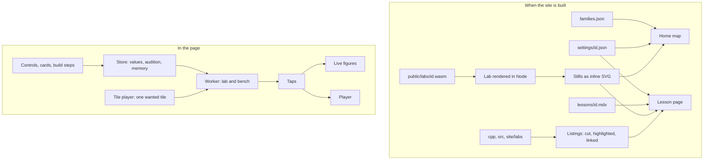
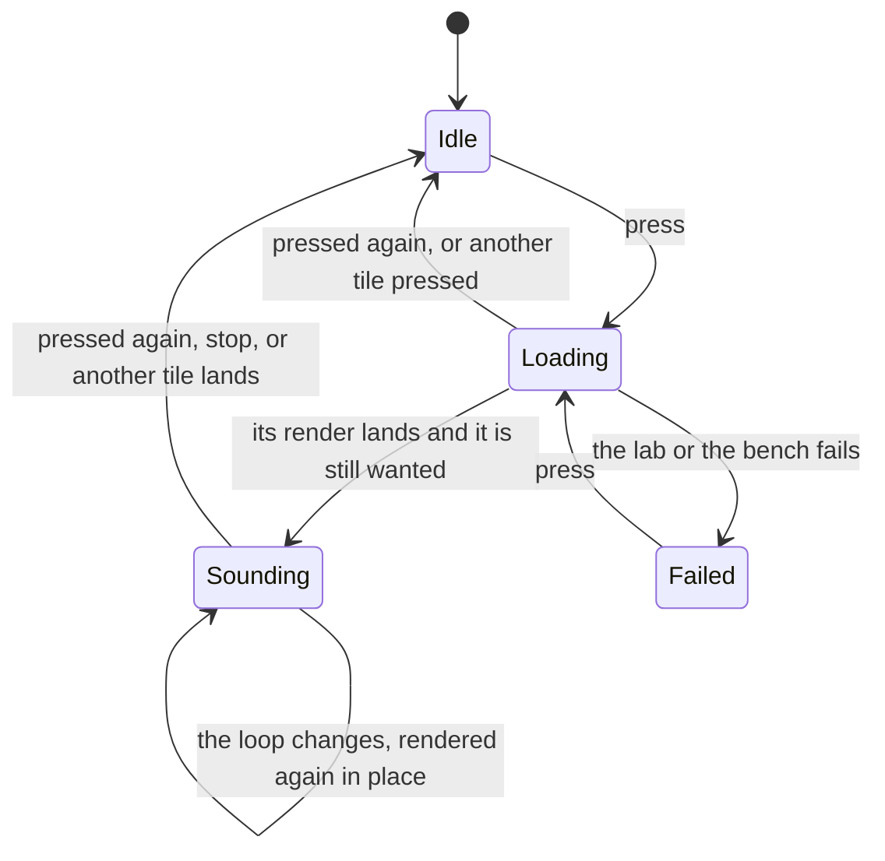
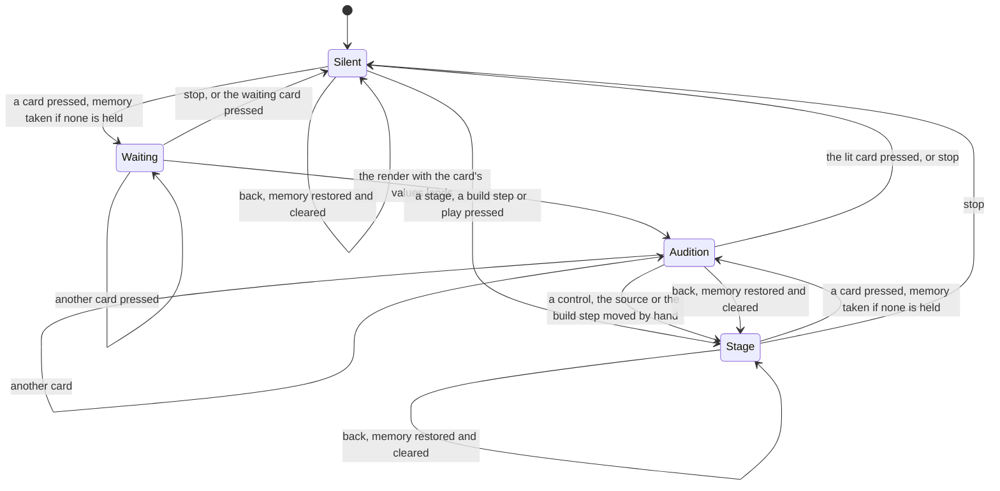
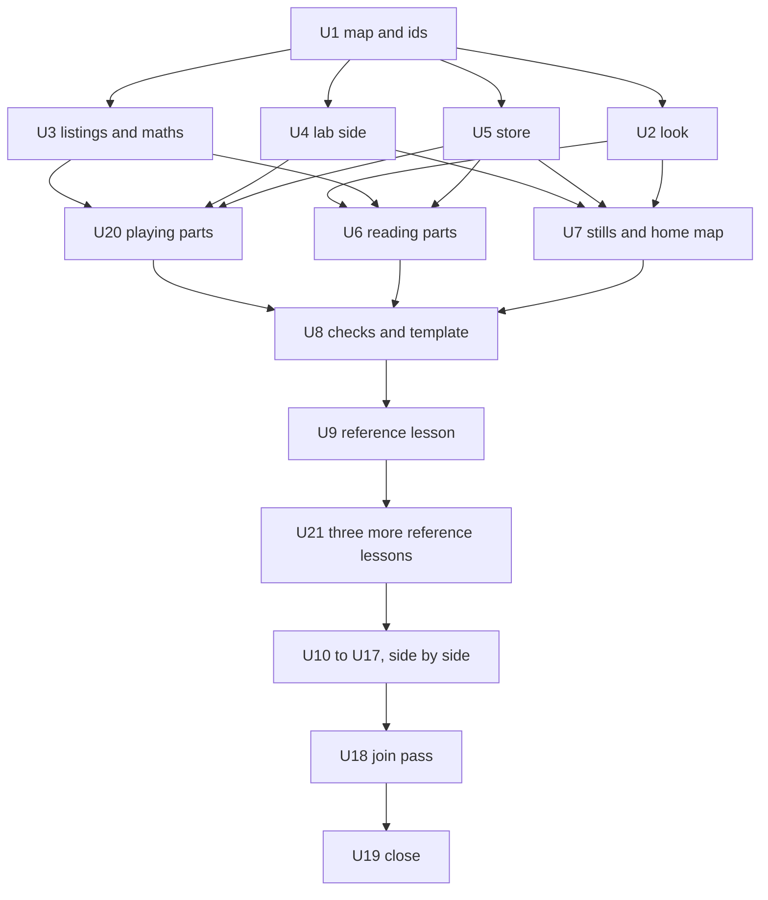

# The Map Look And Thirty-Two Long Lessons - Plan

## Goal Capsule

- Objective: a reader of the live-mix site opens a map of thirty-two lessons, hears any of them from its tile, and in each lesson reads one technique through from why it exists to how the engine does it: what it is used on, how to build it a piece at a time, each stage with set mathematics and the highlighted real source, how to use it, what goes wrong and what people get wrong about it. Every sound and picture on the way comes from the engine's own code.
- Means: a foundation of page parts, data and checks built first (KTD1 to KTD12), four reference lessons of unlike kinds (U9, U21), then one worker a lesson writing to a single template side by side (KTD13).
- Authority: this plan's Requirements first; then the two reference frames of the owner's chosen look for layout and type; then the engine's sources under `cpp/` and `src/` for what a lesson may say; then `site/LESSONS.md` as U8 rewrites it; then `docs/contributing.md`.
- Stop conditions: a settled decision turns out not to work; a lesson cannot be built from the engine's headers without changing them; the whole check cannot pass without skipping or weakening a test.
- Execution profile: one branch (`claude/audio-lessons-site-cvepgr`), one pull request against `main`, opened as a draft once the reference lessons stand (U21) so the owner can look while the rest is written; the work does not wait on that look. The machine has four cores, so heavy commands from workers queue (KTD12). Other work changes `cpp/` and `src/` at the same time: this change stays inside R23's list and takes `main` in before it is checked (U18, U19).
- Nobody can listen in this environment. A number a lesson states is measured on a render and held by a test, read off the code beside a link to the line, or a setting from the lesson's settings file (R16). Whether a lesson sounds right, reads well and teaches is for the owner's ear and eye, and the pull request says so.

---

## Product Contract

### Summary

Rebuild the lessons site to the look the owner picked, and bring every lesson to one long shape. The home page becomes a map: eight families of four lessons, each tile with a picture and a play button. A lesson becomes a long read in nine parts with listening and pictures throughout, a part where the reader builds the technique one piece at a time, set mathematics, and highlighted listings of the real source that link to it. The twenty lessons that exist are rewritten to that shape and twelve are added.

### Problem Frame

The site merged with twenty lessons that each walk a device stage by stage: an opening, a strip of stages, and three closing sections, 2,800 to 4,800 words. The owner read them and asked for more: why a technique is needed in the first place, what sounds it is used on, how the parts come together one by one, the real source and beautiful mathematics, what goes wrong, common misconceptions and ways to use it, in a lighter look he chose from a design board. The lessons also cite code only by links: 126 hand-typed line ranges that nothing checks, and one listing in all twenty. Twelve techniques the engine uses have no lesson.

### Key Decisions

- **The look is the owner's chosen direction, light first.** (session-settled: user-directed — chosen over the dark grid of clips drawn earlier: he asked for "the lighter thing" and said "Let's build this design".) Governs R1, R2, R5.
- **Every lesson is a long read in nine parts, with a build-it part and listening throughout.** (session-settled: user-directed — chosen over the shorter stage-by-stage lesson as merged: he wants "a long educational read" that tells why, on what, how it is built, what goes wrong and what people get wrong.) Governs R7, R8, R11.
- **Thirty-two lessons in eight families of four.** (session-settled: user-approved — chosen over stopping at twenty: he said "all of these" to the twelve proposed.) Governs R6.
- **Lessons run the engine's own code.** (session-settled: user-directed — chosen over teaching copies of the signal processing written again in JavaScript: a copy can disagree with the device.) Governs R8, R15.
- **Listings are highlighted and link to their source.** (session-settled: user-directed — chosen over plain unlinked listings: he asked for "code highlighting" and "links to sources".) Governs R9, R10.
- **Mathematics is set by a real LaTeX renderer.** (session-settled: user-directed — chosen over mathematics set by hand in HTML as on the design board: he asked for "the math LaTeX renderer that looks really like real math".) Governs R9.
- **A picture earns its place by what the reader does with it.** Research for this plan found that a demonstration only watched teaches little, and that predicting first, reader-paced steps and reader-controlled time are what help. "More visuals" is met by figures that carry a task and by stills, not by motion. Governs R12, R13, R21.

### Requirements

**The look**

- R1. The site is set in the kit's Paper scheme, and in its Graphite scheme when the system asks for dark, in the two typefaces of the reference frames, served from the site itself.
- R2. The home page is a map of the thirty-two lessons in eight family rows of four. A tile shows the lesson's number, title, a picture and a play button.
- R3. A tile's play button plays the chosen loop through that lesson's lab, at settings the lesson names, loading that one lab and no other. A lesson whose lab makes its own sound plays its own notes and says it takes no loop.
- R4. One tile is wanted at a time: a tile is idle, loading, sounding or failed. A new press replaces the wanted tile; pressing the sounding or loading tile stops the sound and drops the load; a failure is said in words at the tile and harms nothing else. A small bar gives stop, level and a meter.
- R5. A lesson page opens with its family, its place in the family, its title, a standfirst and a contents list of its parts; then the row of sounds the lesson can be heard on and an opening picture of the sound going in and what comes out on one time axis, with a key and a button to hear each; keeps a play bar in reach; and ends with tiles for the lesson before and after.

**The lessons**

- R6. There are thirty-two lessons, in the families and order of "The thirty-two lessons" below, numbered 01 to 32 by that order.
- R7. Every lesson has these nine parts, in this order: why you need it; what it does, in one picture; what you use it on; build one, a piece at a time; inside the engine, stage by stage; ways to use it; what goes wrong; common misconceptions; the real device. The least each part holds is in "The lesson packet".
- R8. In the build part the reader adds one piece at a time. Each step shows what the piece is for, the lines of code it adds, what the signal looks like so far, the controls that exist so far, and a button to hear it so far. The sound and pictures of every step are rendered by the lab.
- R9. Each stage of the engine's device has its purpose in words and a figure or a listing of the real source; its equation, set as mathematics with terms coloured as the figure's lines are, where the stage is arithmetic; and a way to hear it where its tap is sound. A stage whose tap is not sound says what kind of signal it is.
- R10. A listing is read from the repository when the site is built, is syntax-highlighted, shows its file and line numbers, and links to those lines at the commit built. The build fails when the text a listing names is not found, or found twice.
- R11. A card that says "Hear", "Try it" or "Use these" sets the page to a complete named setting and plays. Only the card that is sounding is lit, and pressing another card switches to it. The page offers the way back to the settings, source and stage from before the first card.
- R12. Each lesson asks the reader to predict an outcome at least once before showing it.
- R13. A lesson has at least twelve figures, counting live figures and stills, where a still is a picture rendered from the lab when the site is built. Every figure carries a key of its lines by name. A live figure's caption says what to try and what to notice; a still's says what to notice.
- R14. The last part shows the real device's plate. Where the lab's controls are the device's parameters it also shows the lesson's starting settings beside the device's defaults, with a button that sets the page to the defaults.

**Truth**

- R15. Every stage and every build step says where it comes from: the running device, a kit class, the engine's TypeScript, or code written for the lesson. Where the build rebuilds engine code, the lab names the last step that does so and the engine output it is compared with (a device or a kit class); that comparison is made on every render and the page shows the difference in decibels. A step after it is labelled as written for the lesson and held by its own test (KTD11).
- R16. Every number a lesson states has one of three homes. A quantity measured on a render is written as a claim and held by a test to within the rounding of the number as written, and its sentence names the settings and the source it was measured on where it would not hold on others. A number read off the code stands beside a link to the line that holds it (KTD5). A setting comes from the lesson's settings file (KTD3).
- R17. For each build step that states a number, a test shows that number moving outside its tolerance when the piece is switched off.
- R18. Nothing in the site, the labs, the tests, the docs or the pull request is named after a product, a brand, a maker, an artist or a track, and nothing is described by comparison with another program. Standard names of the mathematics stay. This holds for the lines a listing shows.
- R19. The lessons, `docs/site.md` and the pull request say what was measured and where, and what only an ear or an eye can judge.

**Reading it anywhere**

- R20. With JavaScript off a lesson shows its text, equations, listings, stills, captions, every build step in order and the answer to each prediction. The home page shows the tiles as links with their pictures.
- R21. Nothing sounds or moves until the reader starts it. Every control works by keyboard and by touch, and scrolling the page, by wheel or by finger, never moves one. No page scrolls sideways at 390 px or 1,280 px. Under the reduced-motion setting step changes and contents links change at once; the playhead and the meter still run, and only while the reader's sound does.

**The repository**

- R22. `site/LESSONS.md` is the template a lesson is written to, and `docs/site.md` states the counts and what was checked as this change leaves them.
- R23. The change touches only `site/`, `docs/`, `CONCEPTS.md` and `.github/workflows/site.yml`. The root `package.json`, the root lockfile and every file under `cpp/` and `src/` are unchanged.
- R24. `bash site/scripts/check.sh --root` exits 0 on the final commit, and the Site workflow is green on the pull request.

### The thirty-two lessons

"Family" is the row of the home map the lesson sits in. "Was" is the lesson's number today. "Lab runs" names the engine code the lab is built on; a worker verifies it against the tree before writing. "Pieces" is the build part's order, to be adjusted where the device's code says otherwise.

| No. | Family | Id | Was | Lab runs | Pieces, in order | A picture it needs |
| --- | --- | --- | --- | --- | --- | --- |
| 01 | Signals | `samples-and-aliasing` | 01 | `kit::SineOsc`, `kit::BlepOsc`; bench `string-machine` | a phase that wraps; a naive saw; the step correction; the slope correction | dots on a wave tracing a lower wave past half the rate, beside the spectrum line folding back |
| 02 | Signals | `level-and-loudness` | new | `lab.h` peak and RMS, the level detector of `ambient-comp`, the oversampled peak of `ambient-limiter`; weighting and gating written for the lesson (KTD11) | peak; RMS over a window; decibels; peaks between samples; frequency weighting; gating | two sounds with equal peaks and unequal loudness on one fader marked in gain and decibels |
| 03 | Signals | `bit-depth-and-dither` | new | the quantiser of `vintage-digital` (4 to 16 bits, no dither) for rounding and the error; the dither of `cpp/devices/echo-memory/memory_store.h`; noise shaping written for the lesson; bench `vintage-digital` | round to N bits; the error; add dither; shape the noise | the error as a staircase tied to the signal, then as steady hiss; harmonics turning into a flat floor |
| 04 | Signals | `wavetables` | new | `wavetable`, `kit::SineTable`, `sampler` for playback | one cycle in a table; a phase that reads it; interpolation; a table per octave; morphing | a cycle beside its harmonic bars, the top bars folding back as the pitch rises |
| 05 | Spectrum | `fourier-transform` | 02 | `spectral-blur`, the kit's transform | one probe sine; a bank of probes; the window; the way back | the turning vectors, and a wave rebuilt from a chosen number of sines |
| 06 | Spectrum | `short-time-fourier` | 03 | `glimmer` | one frame; a window; hops; overlap and add; change the bins | a window sliding along the wave, each stop laying a column |
| 07 | Spectrum | `spectral-processing` | new | `spectral-blur`, `sift`, `sustainer` | analyse; hold a frame; smear over time; gate bins; rebuild | bins as bars, held and gated, and the frames summing back to a constant |
| 08 | Spectrum | `frequency-shifting` | 16 | `freq-shifter` | two copies a quarter turn apart; multiply by sine and cosine; add or subtract; feedback | harmonics on a ruler: adding against multiplying |
| 09 | Filters | `one-pole` | 04 | the kit's one-pole and smoother; bench `tremolo` | a running average; one multiply; the coefficient from a time; the high-pass by subtraction; smoothing a control | a dot moving a fixed fraction of the way each sample |
| 10 | Filters | `state-variable-filter` | 05 | `auto-filter` | two integrators; the loop; damping; the four outputs; modulation | one diagram with each output lit in turn |
| 11 | Filters | `equalising` | 06 | `ambient-eq` | one biquad; a bell; the shelves; the cuts; the chain | poles and zeros beside the response they make |
| 12 | Filters | `phasing` | 12 | `phaser` | one all-pass; a chain; mixing with the dry signal; the sweep; feedback | two copies of a wave drifting until they cancel |
| 13 | Dynamics | `compression` | 07 | `ambient-comp` | a wire; measure; threshold and ratio; knee; attack and release; make-up; mix | level, curve with a riding dot and gain, linked |
| 14 | Dynamics | `limiting` | 08 | `ambient-limiter` | clip; the gain needed; look-ahead; release; peaks between samples | the gain dipping before the peak arrives |
| 15 | Dynamics | `saturation` | 09 | `saturator` | a curve; drive; bias; oversampling; the anti-derivative form; the DC block | harmonics folding back, then oversampling switched on |
| 16 | Dynamics | `tremolo-and-ring-modulation` | new | `tremolo`, `ring` | multiply by a slow wave; depth and shape; phase between the ears; audio rate; remove the offset | sidebands appearing as the modulator speeds up |
| 17 | Delays | `delay-and-echo` | 10 | `tape-echo` | a ring of memory; a read head; feedback; reading between samples; filters in the loop; wow | the ring with its heads, one click going round |
| 18 | Delays | `chorus-and-flanging` | 11 | `chorus`, `flanger` | a delay; move it; mix with dry; feedback; several voices | comb notches sweeping; one delay time from flange to chorus to slap |
| 19 | Delays | `pitch-shifting` | 17 | `pitch-shifter` | read faster; a sawtooth delay; a window; a second head; the crossfade | the splices, visible under the windows |
| 20 | Delays | `granular` | 18 | `grain-delay` | record; one grain and its window; many grains; scatter; pitch | grains as dots over the recording |
| 21 | Rooms | `plate-reverb` | 13 | `plate-reverb` | predelay; input diffusers; one tank loop; two, crossed; damping; the taps | one click thickening stage by stage |
| 22 | Rooms | `feedback-delay-network` | 14 | `fdn-reverb` | one comb; several; the mixing matrix; damping; diffusion; movement | echoes per second climbing as the matrix is switched in |
| 23 | Rooms | `convolution-reverb` | 15 | `convolver-reverb`, the engine's room | one sample stamps the impulse; the sum of stamps; in blocks by transform; the room | three samples stamped by hand |
| 24 | Rooms | `spring-reverb` | new | `spring-reverb` | a delay; dispersion by all-passes; feedback; several springs; damping | chirps on the spectrogram of the impulse |
| 25 | Space and motion | `envelopes-and-lfos` | new | `cpp/kit/env.h`, the kit's LFO, `tremolo`, `auto-filter` | a gate; attack; decay to sustain; release; an LFO; a destination | a playhead running along the envelope while a note is held |
| 26 | Space and motion | `stereo` | new | `stereo-widener`, `kit::pan_gains`, `spread` | the pan law; mid and side; width; a short delay on one side; the sum to mono | left against right as a cloud of dots |
| 27 | Space and motion | `rotary-speaker` | new | `rotary` | the crossover; a turning horn's loudness; its pitch wobble; the drum; the speed change | a view from above with pitch, loudness and side as three traces |
| 28 | Space and motion | `binaural-beats` | new | `binaural`, `ear-shift`, `isochronic` | one tone; two tones in the air; one tone an ear; warmth and bed; a pulse for contrast | two tones summed against one in each ear |
| 29 | Synthesis | `oscillators-and-subtractive-voice` | new | `dusk`, `ladder-bass`, `kit::BlepOsc` | an oscillator; a second, detuned; a filter; an envelope on level; an envelope on the filter | each block with its own small wave and spectrum |
| 30 | Synthesis | `plucked-string` | 19 | `guitar` | a burst of noise; a delay loop; the loss filter; fine tuning; pick position; the body | one period of noise going round, smoother each pass |
| 31 | Synthesis | `frequency-modulation` | 20 | `fm-glass` | a carrier; a modulator into its phase; the index; the ratio; an envelope on the index; feedback | sidebands growing with the index |
| 32 | Synthesis | `modal-synthesis` | new | `modal-bells`, `twin-bars` | one resonator; a strike; several modes; their ratios; a decay each; strike position | a bank of ringing bars, each dying at its own rate |

### Scope Boundaries

- No redirects from the old lesson addresses: the site has never been published, so no link to them exists outside this repository.
- Sound does not carry from the home page into a lesson. A lesson opens on its own first source.
- No scroll-driven animation and no theme switch in the page.
- A lesson's text names a control by its label and never by the kind of control it is drawn as.
- Engine findings made while writing lessons are reported, not fixed (R23).

#### Deferred to Follow-Up Work

- Match-the-target challenges, review questions that come back later, and figures where the reader draws the input.
- A domain for the site, and switching Pages on: both are the owner's.
- Firefox and Safari: the browser tests run in Chromium only.

### Sources

- The two reference frames of the chosen look (the home map and the full Compression lesson) are held outside the repository, in the project's shared files, with the research written for this plan.
- The earlier plan: `docs/plans/2026-10-15-2230-feat-lessons-site-plan.md`. Its decisions stand except where this plan says otherwise.
- `docs/solutions/best-practices/mutation-check-a-measuring-harness.md` (R17), `docs/solutions/best-practices/click-checks-need-an-event-free-reference.md` (U4), `docs/solutions/best-practices/a-headroom-claim-names-the-patch-it-was-measured-on.md` (R16), `docs/solutions/design-patterns/polyblep-folded-energy-and-closed-form-pulse.md` (lessons 01, 04, 29), and the three sleep learnings under `docs/solutions/logic-errors/` (labs of devices that sleep).

---

## Planning Contract

### Key Technical Decisions

- KTD1. **One data file is the map.** `site/src/content/families.json` lists the eight families and, in each, its four lessons by id and title. A lesson's number is its place there. Lesson ids lose their number (`compression`), so an insertion or a reorder renames no file and changes no address. A lesson's front matter names its family as a cross-check. The home page, the previous and next tiles and the tests read the file; a lesson whose text is not written yet is a tile marked as not yet written, until U19 requires all thirty-two.
- KTD2. **The build part runs on taps of its own.** A lab declares a `build` control with one choice a step and a second path that writes `built…` taps (the sound so far, and the lanes the steps draw). The lab's main path, its claims and every other figure are untouched by the step. Chosen over switching pieces off on the main path, which would redraw every figure on the page half-built and force the default to the last step. The lab names the step that is compared with the engine and the bound it holds (R15): the last step in most lessons, an earlier one where the later pieces are written for the lesson. Instantiates the long-read and own-code decisions; governs R8, R15, R17.
- KTD3. **Named settings live in one file a lesson.** `site/src/content/settings/<id>.json` holds the tile's entry (its setting, the tap it plays, and its picture: the taps drawn, the view and the span of time), the sets the cards play and, where the lab's controls are the device's, the device's defaults as lab values. A set is complete: a control it does not name goes to the lab's starting value, and it never sets `build`. It may name a source from the lesson's list and the tap to play. The page, the home tile and the lab test read the same object, and the build fails on an unknown id or a value out of range. Chosen over values written in each card's markup, which a test could not render.
- KTD4. **The store names what is sounding, not only which tap.** It gains an audition (an id and a label beside the sounding tap), a memory taken at the first audition and restored by "back" (every control but `build`, the source and the tap), one action that sets many values, and a tag on each render saying which values it carries. From silence a card's sound starts when the render carrying its values lands, with the audio context made in the press; until then the pressed card's own button is marked busy, and pressing it again cancels the start. The memory is taken at the first audition or the first press of the device-defaults button, whichever comes first, whether or not anything is sounding; that button sets the page to the defaults and starts no sound. Governs R11, R14.
- KTD5. **A listing is the framework's own code component with one theme and one transformer.** The theme's colours are the page's CSS variables, so listings follow the scheme. The transformer cuts the range, numbers lines from the file's own numbering, marks lines and links each number to the source. The range is given by text (`from`, `to`), never by line number; the same anchor form replaces hand-typed ranges on source links. A listing may leave lines out, visibly marked, and the wording check reads listings like any other text (R18). No package is added. Governs R9, R10.
- KTD6. **Coloured terms go through classes.** The mathematics component gains two macros: one wraps a term in the class of a signal role, one links a term to a listing line. The renderer shows an untrusted command as red text and no error, so the component trusts exactly these commands and a unit test holds it. Governs R9.
- KTD7. **Stills are rendered from the lab when the site is built.** One helper renders a lab in Node on a bench source at a named setting and returns the points; a component draws them as inline SVG. Tile pictures and the pictures of parts 1 and 3 are stills. They cost the browser nothing and are there with scripts off. Governs R2, R13, R20.
- KTD8. **The home page has one worker and one wanted tile.** The lab worker learns to load another lab in place and keeps the bench's sources by loop length. A small module holds the tile state machine of R4 and hands the rendered tap to the page player, which already crossfades. Ending the worker is the only way to cancel a render, so a press on another tile during a load ends it and starts one.
- KTD9. **Roles are named, not coloured.** The six signal roles are fixed once for both schemes in `site/src/styles/site.css`. A caption names a line by its label, and each figure prints a key of swatch and name from the lab's own description. Chosen over captions that name colours, as all twenty do today: the two schemes colour the roles differently. The shape check fails a caption that names a colour.
- KTD10. **Typefaces come from packages in `site/package.json`, served by the site.** The framework's fonts support reads the installed packages with no request at build time or in the page, and gives a metric-matched fallback so the large headings do not jump. The site points the kit's font variables at them and ships each licence text. If that support fails under the linked package layout, plain `@font-face` rules over the same files replace it.
- KTD11. **Where the engine's code is not C++, the lab's stage is written for the lesson and checked against the engine.** Loudness weighting and gating exist only in `src/core/analysis/loudness.ts`: the lab rebuilds them, labelled as written for the lesson, and the lab test holds the result to the TypeScript analyser on the same signal. Noise shaping exists nowhere in the engine and is labelled so.
- KTD12. **One script checks one lesson, and heavy commands queue.** `site/scripts/lesson.sh <id>` builds that lab, runs its test, builds a site holding that one lesson into its own folder, and runs the claims, wording, shape and browser checks on it at its own port. It also checks the format of the lesson's own files. Each heavy step takes one of a few lock slots when `SITE_SLOTS` names a lock folder, so many workers on four cores do not starve each other; a slot is a file lock, which is let go when the command holding it ends for any reason. Workers share one working tree, so the one-lesson build loads that lesson's text, settings and figure pair only, the claims, wording and shape checks take the lesson's id, and a failure in a file outside the lesson's packet ends the script with a code of its own and the file's name: the worker runs again and edits nothing it does not own.
- KTD13. **One worker a lesson, one checker a lesson, then a join pass.** A worker owns its lesson's four files (lab, lab test, text, settings) and at most one figure pair of its own with its styles inside it, and makes no git writes; the orchestrator commits by path. A worker who finds a shared part wanting reports it to the orchestrator, who changes it once for every lesson; the worker does not work round it in the lesson's own files. A second worker then checks the lesson cold: reruns `lesson.sh`, reads the page at both widths, tries to break each claim, reads each claim's number against its test's assertion, and lists every number with a unit that has none of R16's three homes. The repository's own record is that faults in sibling devices were found only after the siblings were joined, so U18 reviews across lessons and spreads the checks one lesson had and the others lacked.
- KTD14. **A lesson not yet rewritten keeps building.** Front matter gains `long: true`. The shape check and the long layout apply to lessons that carry it; the others render as they do today. U19 removes the flag and requires the long shape of all thirty-two.
- KTD15. **The bench grows by three loops and the lab by headroom.** `site/labs/bench.cpp` gains a bass line, a pad and a mix of drums, bass and chords, played by the engine's instruments, so part 3 can be heard on more than drums and a guitar. `site/labs/lab.h` allows 64 taps. The exported interface does not change.

### High-Level Technical Design

These sketches give the shape of the work. The units fix names and details.

What is made when the site is built, and what runs in the page:

A home tile:

What is sounding on a lesson page:

The order of work:

### The lesson packet

What one lesson's worker delivers. U8 writes this into `site/LESSONS.md`; until then this section is the template, and U10 to U17 cite it.

Files: `site/labs/<id>.cpp`, `site/tests/labs/<id>.test.ts`, `site/src/content/lessons/<id>.mdx`, `site/src/content/settings/<id>.json`, and optionally one figure pair (`site/src/figures/<Name>.tsx` with `site/src/components/lesson/<Name>.astro`).

The least each part holds:

| Part | Holds at least |
| --- | --- |
| 1 Why you need it | a concrete sound and a question about it; the problem shown failing before the fix; two stills; one prediction (R12) |
| 2 What it does, in one picture | one live figure, at most three controls, one sentence the reader can check against it |
| 3 What you use it on | three cards, each a still, why, starting settings and a card that plays them (R11) |
| 4 Build one, a piece at a time | four steps, each with its purpose, the lines it adds from the lab's build path, lanes and the controls so far; across the steps at least one stated number, held per R16 and R17 |
| 5 Inside the engine, stage by stage | a signal-flow picture; every stage of the device, each per R9; then all the stages at once |
| The tile | its setting, the tap it plays, and a still that tells this lesson from its neighbours, taken from "A picture it needs" where a tap gives it (KTD3) |
| 6 Ways to use it | four cards, each with settings to try |
| 7 What goes wrong | three faults, two of them heard through a card, each with what to do about it |
| 8 Common misconceptions | four statements people make, each with what is true and where the page shows it |
| 9 The real device | per R14, with links to the device's page, its source and its tests |

The whole lesson: 3,500 words or more, twelve figures (R13, the opening picture among them), four listings and six equations counted across the lesson, every number per R16. A claim's test passes its measurement through the shared written-number helper (U4) with the number exactly as the sentence writes it; a measurement that supports fewer digits is written with fewer.

The teaching rules, each from the research behind the Key Decision on pictures: a picture comes before its formula, and the formula is then read back term by term against the picture; one signal is shown in linked views added one at a time; each figure shows one idea, a live one carrying a sentence on what to try and one on what to notice and a still one on what to notice; anything that moves is started, paused and stepped by the reader; a comparison is offered as dry, processed and the difference.

Rules carried from what the repository has learned: a claim names its settings and source and says which band or window a level or a time counts; no "never" or "always" beside a level; a click or an onset is measured against the same render without the event; a lab of a device that sleeps follows the pattern of the chorus lab and remembers the pass that is thrown away; lessons that play notes use the words of `CONCEPTS.md`.

The text names a control by its label, never as a knob, a slider or a switch.

A lesson is done when `bash site/scripts/lesson.sh <id>` exits 0 and its checker has no open finding.

### Assumptions

These are bets made without the owner's word, each visible in the result. Most are cheap to reverse; the packet's floors and the three new loops stop being cheap once U10 to U17 have run, which is why the draft pull request and its pictures go to the owner after U21 and before the result of that fan-out is called done.

- A ranged control in the text is the kit's knob, as the lesson frame draws it, dragged sideways and deaf to the wheel so that scrolling a long page never moves one; arrow keys step it and a double click puts it back. A control of a few choices is a group of choices.
- The frame draws no play bar. The site keeps the one it has, fixed in reach, beside the frame's row of sounds under the title; both pick the same source.
- Graphite is the dark scheme. The frames show only the light one.
- A tile's picture is drawn from the lab's own output, where the home frame draws a glyph by hand.
- The frames' third typeface, used for set mathematics and pull quotes, is dropped: equations take the renderer's own faces, and pull quotes take the renderer's italic that is already on the page.
- The three new loops are a bass, a pad and a mix. The frame also shows a voice; the engine has no instrument that sings, so there is none.
- The floors in "The lesson packet" (words, figures, cards a part) are this plan's reading of "a long educational read".
- The home page's loop row lists the six musical loops. Test signals stay in the lessons.
- Part 9's table and button appear only in lessons whose lab controls are the device's parameters.
- The framework's fonts support works with packages installed under the site's linked layout. It was read, not run; KTD10 names the fallback.
- A lab render stays near 300 ms with the build path added. It was not measured; a lab that runs long drops lanes from its build path before it drops a stage.

### Risks

| Risk | What is done about it |
| --- | --- |
| Twenty-eight lessons written side by side drift from the template, or meet a shared part that fits only the first lesson | U9 and U21 prove the template on four unlike lessons first, whose workers may have the shared parts changed; `lesson.sh` and the shape check hold each lesson; a checker reads each; a shared part found wanting later is changed once by the orchestrator (KTD13); U18 reviews across them |
| Workers starve the machine and tests fail on load | KTD12's slots; one astro build at a time; browser tests at one worker a lesson; judged on the final whole check, run alone |
| A rewrite loses a held number, or keeps a claim's id and changes its number | The claims check fails an id with no test and, in a long lesson, a claim whose written numbers are not in the test that names it (U8); a worker keeps a claim or removes sentence and test together; the checker compares the claim ids before and after and reads each number against its assertion |
| `main` moves under the branch and a device's change shifts a held number or a listing's anchor | U18 starts by taking `main` in and running every lab test; U19 takes it in again before the final whole check |
| The stronger loop-wrap check finds a real step in one of the twenty labs | U4 mends that lab's loop, in `site/labs/`, and says so in its commit |
| A listing shows a line that trips the wording rule | The build fails on it; the listing leaves the line out, marked (KTD5) |
| The Site workflow grows from 100 lesson tests to 160 and more | U8 splits the no-script walk by lesson, sets a time limit on the job and runs the browser tests in two shards |
| Tile loads are slow on a phone | The tile shows that it is loading; U7 measures one load and records it; the bench render is kept by loop length |

---

## Implementation Units

| Unit | Title | Files | Depends on |
| --- | --- | --- | --- |
| U1 | The map of thirty-two and ids without numbers | `site/src/content/families.json`, `site/src/content.config.ts`, `site/src/lib/lessons.ts`, renames under `site/labs`, `site/tests/labs`, `site/src/content/lessons` | none |
| U2 | Paper, Graphite, the typefaces and the roles | `site/src/styles/site.css`, `site/src/layouts/Base.astro`, `site/astro.config.mjs`, `site/src/figures/canvas.ts`, `site/package.json` | U1 |
| U3 | Listings, source anchors and coloured mathematics | `site/src/components/lesson/Listing.astro`, `Src.astro`, `M.astro`, `site/src/lib/listing.ts`, `site/src/lib/code-theme.ts` | U1 |
| U4 | The lab side: build path, more loops, stronger shared checks | `site/labs/lab.h`, `site/labs/bench.cpp`, `site/labs/compression.cpp`, `site/src/lab/sources.ts`, `site/tests/labs/support.ts` | U1 |
| U5 | The store and named settings: cards, back, sound that starts on its render | `site/src/lab/store.ts`, `page.ts`, `player.ts`, `worker.ts`, `site/src/lib/settings.ts`, `site/tests/unit/store.test.ts` | U1 |
| U6 | The lesson page and its reading parts | `site/src/pages/lessons/[slug].astro`, `site/src/components/lesson/`, `site/src/styles/lesson.css` | U2, U3, U5 |
| U7 | Stills and the home map | `site/src/lib/still.ts`, `site/src/components/lesson/Still.astro`, `site/src/pages/index.astro`, `site/src/lab/tiles.ts`, `site/src/figures/TileMap.tsx` | U2, U4, U5 |
| U8 | One-lesson check, shape check, the template, the workflow | `site/scripts/lesson.sh`, `site/scripts/check-lessons.mjs`, `site/scripts/check.sh`, `site/LESSONS.md`, `site/tests/browser/`, `.github/workflows/site.yml` | U6, U7, U20 |
| U9 | Compression, the reference lesson | the four files of `compression` | U8 |
| U10 | Signals | the files of lessons 01 to 04 | U21 |
| U11 | Spectrum | the files of lessons 05, 07 and 08 | U21 |
| U12 | Filters | the files of lessons 09, 10 and 12 | U21 |
| U13 | Dynamics | the files of lessons 14 to 16 | U21 |
| U14 | Delays | the files of lessons 17 to 20 | U21 |
| U15 | Rooms | the files of lessons 21 to 24 | U21 |
| U16 | Space and motion | the files of lessons 25 to 28 | U21 |
| U17 | Synthesis | the files of lessons 29, 31 and 32 | U21 |
| U18 | The join pass | any lesson's files, `site/tests/labs/support.ts` | U10 to U17 |
| U19 | Close: the flag goes, the docs are restated, the whole check | `site/src/content.config.ts`, `docs/site.md`, `CONCEPTS.md` | U18 |
| U20 | The lesson page's playing parts | `site/src/figures/`, `site/src/components/lesson/`, `site/src/styles/parts.css` | U3, U4, U5 |
| U21 | Three more reference lessons: a string, an equaliser, frames | the files of lessons 06, 11 and 30; shared parts through the orchestrator | U9 |

### U1. The map of thirty-two and ids without numbers

- **Goal:** the thirty-two lessons, their families and their order exist as data, and the twenty that exist carry their new ids.
- **Requirements:** R6; KTD1, KTD14.
- **Dependencies:** none.
- **Files:** `site/src/content/families.json` (new); `site/src/content.config.ts`; `site/src/lib/lessons.ts`; `site/src/components/lesson/Lesson.astro` (new); renames of all twenty under `site/labs/`, `site/tests/labs/`, `site/src/content/lessons/`; `site/tests/browser/search.spec.ts`, `convolution.spec.ts`; `site/tests/unit/lesson-kit.test.ts`; `site/scripts/look.mjs`; `site/src/lab/worker.ts`, `room.ts` (comments); `site/tests/unit/lessons-map.test.ts` (new).
- **Approach:** write the map as in "The thirty-two lessons". Rename with `git mv`; inside each test file the lab's name is a literal or one constant. The schema gains `family` (a reference into the map), `long`, and drops `order`: `lessonsInOrder()` sorts by the map and throws on a lesson the map does not list, a family named wrongly, or an id listed twice. Add `<Lesson id>`, which prints "lesson 13, Compression" as a link, and replace the 52 plain "lesson N" mentions with it. Two of those look back at a lesson that now comes later (phasing at chorus, frequency shifting at phasing): reword them to look forward. First lines of labs and `describe(...)` titles lose their number.
- **Patterns to follow:** the thrown messages of `site/src/lib/lessons.ts`; `site/src/lib/lab-info.ts` for failing the build on a wrong name.
- **Test scenarios:**
  - The map lists eight families of four, thirty-two distinct ids, in the order of this plan's table.
  - A lesson whose `family` is not the one the map puts it in fails with a message naming the lesson.
  - A lesson file the map does not list fails; a listed lesson with no file is reported as not yet written and does not fail.
  - `<Lesson id="compression" />` renders the number and title from the map and a link to the lesson; an unknown id fails the build.
  - The claims check passes on all twenty after the renames (it keys on the text file's name).
- **Verification:** `pnpm labs`, `pnpm test`, `pnpm build` and the claims and links checks pass with the twenty lessons at their new addresses; `grep -rnE "[Ll]essons? [0-9]+" site/src/content/lessons` finds nothing.

### U2. Paper, Graphite, the typefaces and the roles

- **Goal:** every page is in the chosen look's scheme and type, and a figure's roles are fixed for both schemes.
- **Requirements:** R1; KTD9, KTD10.
- **Dependencies:** U1.
- **Files:** `site/src/styles/site.css`; `site/src/layouts/Base.astro`; `site/astro.config.mjs` (fonts only); `site/package.json`, `site/pnpm-lock.yaml`; `site/src/figures/canvas.ts`; `site/src/components/Mermaid.astro`; `site/src/components/Header.astro`, `Footer.astro`; `site/public/licences/` (new).
- **Approach:** the page's scheme attribute takes `paper` or `graphite` from the system's preference; four places test for the literal `dark` today and are changed to ask whether the scheme is a dark one. Add the two variable font packages, configure the fonts support per KTD10, and set the kit's two font variables from it. Fix the six roles for both schemes with enough contrast against each background. Canvas text reads the mono family from the page and figures redraw when the fonts are ready. Type scale, hairline rules, header and footer follow the frames.
- **Patterns to follow:** `site/src/figures/canvas.ts`, which already re-reads colours when the scheme attribute changes.
- **Test scenarios:**
  - A page loaded with the system asking for dark carries the Graphite scheme; otherwise Paper.
  - No request leaves the site for a font; the browser tests' rule that any failed request fails the page still passes.
  - Each of the six roles differs from the background and from the other five in both schemes (a unit test on the resolved values).
  - A canvas figure's axis numbers are drawn in the mono family after the fonts load.
- **Verification:** `pnpm build` and the existing browser tests pass; `node scripts/look.mjs` pictures of one lesson at 1,280 px and 390 px in both schemes are read by eye against the frames.

### U3. Listings, source anchors and coloured mathematics

- **Goal:** a lesson can show highlighted, numbered, linked source cut by text anchors, and equations whose terms take a role's colour.
- **Requirements:** R9, R10, R18; KTD5, KTD6.
- **Dependencies:** U1.
- **Files:** `site/src/components/lesson/Listing.astro` (new); `site/src/lib/listing.ts`, `site/src/lib/code-theme.ts` (new); `site/src/components/lesson/Src.astro`, `M.astro`; `site/astro.config.mjs` (the highlighter's theme only); `site/src/styles/site.css` (code variables); `site/tests/unit/listing.test.ts`, `maths.test.ts` (new).
- **Approach:** per KTD5. `Listing` takes `path`, `from`, `to`, optional `mark` (text of lines to mark as new) and `skip` (a range to leave out, shown as a marked gap). The whole file is tokenised and then cut, so a range that starts inside a comment is still coloured right. Each line number links to that line at the built commit; ids carry the listing's name so two listings on a page do not collide. The figure is kept out of the search index. `Src` gains `at="text"`, which computes the lines; `lines=` stays until U19. The same theme serves fenced code in the docs. `M` gains the macros and trust rule of KTD6.
- **Patterns to follow:** `site/src/components/lesson/Src.astro` for reading from `REPO_ROOT` and linking at `COMMIT`; `examples/readme/` for listings held to files.
- **Test scenarios:**
  - `from` and `to` found once each give the lines between them, numbered as in the file.
  - `from` absent, or found twice, fails with the lesson, the file and the text named.
  - A marked line carries the mark; a skipped range renders as one gap line saying how many lines are left out, and numbering resumes correctly after it.
  - A range that starts inside a block comment is coloured as comment.
  - An equation using the role macro renders with the role's class and no error colour; a command outside the trusted set fails the test.
  - A listing over `cpp/kit/filters.h` and one over a lab file both link to `blob/<commit>/<path>#L<n>`.
- **Verification:** `pnpm test`, `pnpm typecheck`, and a built page holding one listing and one coloured equation pass the links check.

### U4. The lab side: build path, more loops, stronger shared checks

- **Goal:** a lab can carry a build path, the bench plays six musical loops, and the checks every lab shares are the strong ones.
- **Requirements:** R8, R15, R16, R17; KTD2, KTD15.
- **Dependencies:** U1.
- **Files:** `site/labs/lab.h`; `site/labs/bench.cpp`; `site/labs/compression.cpp` and its test (a first cut of the build path); `site/src/lab/sources.ts`; `site/tests/labs/bench.test.ts`; `site/tests/labs/support.ts`; `site/tests/unit/lab-support.test.ts` (new); any lab under `site/labs/` whose loop the stronger wrap check fails.
- **Approach:** raise the tap limit to 64. Add to the bench a bass line, a pad and the mix of KTD15, in the same two bars and key. In `support.ts`: move in the helpers the lab tests each declare again (the sample rate, a click, a range, the sample at a time); replace the loop-wrap check, a largest-step comparison that two learnings show is blind on bright sounds, with a third-difference check across the wrap; add the two-render difference for clicks, the half-peak onset, `expectBuild(lab, source)`, which holds that the `build` control has a choice a step, that each step changes a built tap, and that the comparison the lab declares, at the step it names, is under the bound the lab states; and a written-number helper that takes a measurement and the number as the lesson writes it (`'39 ms'`) and allows half of the last written digit, with a second form for a stated bound (`'less than 0.001 dB'`). The compression lab gets a first cut of its build path (the `build` control, three steps of `built…` taps and the comparison with the device), held by `expectBuild`, so the page parts of U6 and U20 are built on a real lab; U9 completes it. `expectSoundLab` leaves `build` out of its rule that every control moves a tap on the main path, and adds it to the built taps.
- **Execution note:** show each new shared check failing on a lab altered to break it before trusting it green.
- **Patterns to follow:** `site/labs/compression.cpp` keeps a second device instance beside the first; `site/labs/chorus-and-flanging.cpp` for a device that sleeps.
- **Test scenarios:**
  - The bench's taps equal `SOURCES`, now eleven, and every one loops without a click by the new check.
  - The new wrap check fails a tap whose crossfade is removed, on noise and on a saw, where the old one passed.
  - The onset helper reads 10 ms on a ramp built to reach half its peak at 10 ms.
  - `expectBuild` fails a lab whose step changes nothing, and one whose compared step is further from the engine's output than its bound.
  - The written-number helper passes 39.4 against `'39 ms'` and fails 39.6; passes 0.0004 against `'less than 0.001 dB'` and fails 0.002; fails a string it cannot read.
  - All twenty lab tests still pass with the shared helpers moved.
- **Verification:** `pnpm labs && pnpm test` pass; the bench's render time for a four-second loop in Node is recorded in the commit message.

### U5. The store and named settings: cards, back, sound that starts on its render

- **Goal:** the page's state can hold a named audition and its way back, and a card's sound begins with the card's settings.
- **Requirements:** R11, R21; KTD4.
- **Dependencies:** U1.
- **Files:** `site/src/lab/store.ts`, `page.ts`, `player.ts`, `worker.ts`; `site/src/content.config.ts` (the settings collection); `site/src/lib/settings.ts` (new); `site/tests/unit/store.test.ts`, `player.test.ts`, `settings.test.ts` (new).
- **Approach:** per KTD4 and the second state diagram. The worker gains a message that loads another lab in place and keeps bench sources by loop length (KTD8 uses it). The player gains a call that makes or resumes its context inside a press without starting sound. `settings.ts` reads a lesson's settings file and checks it against the lab per KTD3; a lesson with no settings file has none, which is not a fault until U19. It lives here so that the page (U6), the tiles (U7) and the cards (U20) read one reader and can be built side by side.
- **Patterns to follow:** the stand-in renderer and sounder of `site/tests/unit/store.test.ts`.
- **Test scenarios:**
  - Covers R11. A card pressed from silence: nothing sounds until the render tagged with its values lands; then its tap sounds and its id is the audition.
  - A second card while the first sounds switches to it; pressing the lit card stops; no other card is lit at any time.
  - A control moved by hand during an audition clears the audition's name, leaves the sound and keeps "back" on offer.
  - "Back" after two cards and a control moved by hand restores every control but `build`, the source and the tap from before the first card, and clears the offer.
  - A set that names no value for a control puts that control at the lab's starting value; `build` is unchanged by any set.
  - A render in flight when a card is pressed: the sound starts on the render that carries the card's values, not on the earlier one.
  - Stop while a card waits cancels the start, and so does a second press of the waiting card; another card pressed while one waits becomes the one that waits.
  - A card pressed from silence and then stopped leaves "back" on offer, and "back" restores the values from before the card.
  - The device-defaults action sets every control to the defaults set, starts no sound, takes the memory if none is held, and during an audition clears the audition's name as a control moved by hand does.
  - A settings file naming a control the lab lacks, a value out of range or a source the lesson does not list fails the build with the lesson and the set named.
  - A set that leaves a control out resolves to the lab's starting value for it, and no set resolves a value for `build`.
  - A card pressed while the real device sounds moves the sound to the lab's tap; "back" returns to the device if its plate is still open.
- **Verification:** `pnpm test` passes; the browser tests of the twenty lessons still pass unchanged.

### U6. The lesson page and its reading parts

- **Goal:** a lesson carrying `long: true` renders in the chosen look, with the parts that are text and layout.
- **Requirements:** R5, R7, R12, R14, R20; KTD3, KTD14.
- **Dependencies:** U2, U3, U5.
- **Files:** `site/src/pages/lessons/[slug].astro`; new under `site/src/components/lesson/`: `Part`, `Predict`, `Uses` and `Use`, `Ways` and `Way`, `Faults` and `Fault`, `Myths` and `Myth`, `DeviceTable`; `site/src/styles/lesson.css`.
- **Approach:** the page draws the hero and contents from the map and the parts found in the text, the previous and next tiles, and part 9 from front matter and settings. `Part` is a numbered section with the frame's label column. The card components lay out a still, text, starting settings and a slot for U20's `Hear` button. `Predict` is choices and a native disclosure, with any listen button inside the answer. Under the title the hero leaves a slot for the row of sounds (U20) and lays out the opening picture of R5: a still of two taps the front matter names, the source going in and the lab's output, with a key and a listen button for each. The `noscript` sentence is reworded, since stills are pictures a page without scripts does show.
- **Patterns to follow:** every `.astro` under `site/src/components/lesson/` is usable in a lesson by its name; `site/src/lib/lab-info.ts` for build-time checks against the lab.
- **Test scenarios:**
  - The opening picture draws the two taps the front matter names with a key; a tap the lab lacks fails the build naming the lesson.
  - With scripts off, the prediction's answer can be opened and every card's text and settings are on the page.
  - A lesson without `long: true` renders as it does today.
  - The hero's contents list links to each part present, in order.
  - At 390 px and 1,280 px a long page does not scroll sideways.
- **Verification:** `pnpm typecheck`, `pnpm test` and `pnpm build` pass; a scratch long page made from the compression lesson (its text marked long, holding only the parts under test and held to no floor; not committed as it stands, and free to become the start of U9) opens with no console error.

### U7. Stills and the home map

- **Goal:** the home page is the map, each tile plays, and a lesson can place pictures rendered when the site is built.
- **Requirements:** R2, R3, R4, R13, R20, R21; KTD7, KTD8.
- **Dependencies:** U2, U4, U5.
- **Files:** `site/src/lib/still.ts`, `site/src/components/lesson/Still.astro` (new); `site/src/pages/index.astro`, `site/src/pages/lessons/index.astro`; `site/src/lab/tiles.ts`, `site/src/figures/TileMap.tsx` (new); `site/src/styles/home.css` (new); `site/tests/unit/tiles.test.ts`, `still.test.ts`, `site/tests/labs/tiles.test.ts`, `site/tests/browser/home.spec.ts` (new).
- **Approach:** `still.ts` moves the Node render of a bench source out of the tests' support file, renders a lab at a named set and caches by lab, set and source; `Still` draws chosen taps as an inline SVG with a caption. A tile's picture is the still its tile entry names (KTD3). A lesson that has a lab and no tile entry yet plays and draws its lab's last sound tap at the lab's starting values; a lesson with no lab yet is a tile marked as not yet written, a link with no picture and no play button. A tile's button is named "Hear", "Loading" or "Stop" followed by the lesson's title; a failed tile prints one line under its title saying that it did not load and that a press tries again, and the line is announced once in a polite status region. The home page is static: the family rows, tiles as links with their stills, the loop row as a group of choices that picks and does not play. One island adds the play buttons and the small bar and runs KTD8's state machine. A tile of a lab that makes its own sound says so and ignores the loop row. `tiles.test.ts` renders every tile on every loop and holds its level inside a stated band. The lessons index becomes the same map without the hero.
- **Patterns to follow:** `site/src/lib/lab-info.ts` already loads every lab in Node when the site is built; the play bar's meter markup, which the browser tests' `sounds()` reads.
- **Test scenarios:**
  - Covers R4. Stand-in tests of the state machine: press gives loading then sounding; a second tile pressed during a load ends the first load and only the second sounds; pressing the sounding tile stops; pressing the loading tile drops the load and nothing starts later; a failed load says so and a press retries; a loop change renders a sounding tile again in place.
  - Covers R3. In the browser: pressing a tile fetches that lesson's module and the bench and no other lab's module; the bar's meter moves; Escape stops.
  - A tile whose lesson has no text yet is drawn as not yet written and has no play button.
  - Every tile that plays, on every loop it takes, has an RMS level inside the stated band.
  - With scripts off the home page shows a link for every lesson in the map, a picture for every lesson that has a lab, and no play buttons.
  - `Still` with an unknown tap or set fails the build naming the lesson.
  - The home page does not scroll sideways at 390 px or 1,280 px.
- **Verification:** `pnpm test`, `pnpm build` and `npx playwright test tests/browser/home.spec.ts` pass; the time from a press to sound for one tile in headless Chromium is recorded in the commit message; `node scripts/look.mjs` pictures of the home page at 1,280 px and 390 px in both schemes, and a picture of a loading tile and of a failed tile saved by `home.spec.ts`, are read by eye against the home frame.

### U8. One-lesson check, shape check, the template, the workflow

- **Goal:** a worker can prove one lesson alone, the long shape is a check, and the template is written down.
- **Requirements:** R7, R13, R18, R22, R24; KTD9, KTD12, KTD14.
- **Dependencies:** U6, U7, U20.
- **Files:** `site/scripts/lesson.sh`, `site/scripts/check-lessons.mjs` (new); `site/scripts/check.sh`; `site/astro.config.mjs`, `site/src/content.config.ts` (the one-lesson build); `site/tests/browser/lessons.spec.ts`, `docs.spec.ts`, `support.ts`; `site/playwright.config.ts`; `site/LESSONS.md`; `.github/workflows/site.yml`; `site/tests/unit/checks.test.ts`.
- **Approach:** `SITE_ONLY_LESSON=<id>` makes the build hold that lesson and the home page only, written to `site/.lesson/<id>/`; `lesson.sh` runs KTD12's steps in order, the format check of the lesson's own files first, and stops at the first failure, keeping KTD12's rule for a fault outside the lesson's packet. `check-claims.mjs` learns one rule for long lessons: each number with a unit in a claim's sentence appears, as written, in the test that names the claim, in its title or in a call of the written-number helper. `check-lessons.mjs` reads built lesson pages that carry the long mark and holds "The lesson packet" floors, the nine parts in order, a key on every figure and no colour named in a caption. The lesson browser test learns the long page: a card switches and lights alone, "back" restores a moved control, the build steps forward and sounds, the prediction opens. The no-script walk becomes one test a lesson. `LESSONS.md` is rewritten around "The lesson packet", keeps its six rules and its lab and test sections, and gains the store's card rules and the rules carried from the learnings. The workflow gets a time limit and two browser shards.
- **Patterns to follow:** `site/scripts/check-claims.mjs` and `check-wording.mjs` for a check that reads the built pages and prints one line a fault; `site/tests/unit/checks.test.ts` for testing a check on a made-up page.
- **Test scenarios:**
  - The shape check passes a made-up page with nine parts at the floors, and fails with one line each for: a part missing, parts out of order, two cards where three are the floor, a figure with no key, a caption naming a colour.
  - `lesson.sh` on a lesson with a claim no test names exits non-zero at the claims step.
  - The claims check fails a long lesson's claim that writes "39 ms" where its test holds "41 ms", and passes when both say the same.
  - `lesson.sh` on a lesson while another lesson's figure pair does not compile exits with the code for a fault outside its packet and names that file.
  - Two `lesson.sh` runs started together with `SITE_SLOTS` set both finish, and their site builds do not overlap in time.
  - `check.sh` runs the shape check and still passes on the twenty old-shape lessons, which it skips.
- **Verification:** `bash site/scripts/check.sh` exits 0 on the twenty old-shape lessons, with the shape check proven on the made-up page of `site/tests/unit/checks.test.ts`. The long page's browser cases are written here and first run green in U9, on the compression lesson.

### U9. Compression, the reference lesson

- **Goal:** one lesson in the full long shape, as the frame draws it, that every other worker copies from.
- **Requirements:** R7 to R17; "The lesson packet".
- **Dependencies:** U8.
- **Files:** `site/labs/compression.cpp`, `site/tests/labs/compression.test.ts`, `site/src/content/lessons/compression.mdx`, `site/src/content/settings/compression.json`.
- **Approach:** follow the lesson frame part for part, with the seven build pieces of the table. Keep the lesson's existing claims (the ripple after one and two poles, the two attack times, the paused release). The build path's level reads as the device's does, so the lesson's threshold gives the reductions it states. Where this lesson shows the template wanting, change the template in `site/LESSONS.md` and the shared parts, not the lesson alone.
- **Test scenarios:**
  - Every claim id the lesson had before is still held, or its sentence and test are removed together and listed in the commit message.
  - Each of the seven build steps changes the built sound, and the last is within its stated bound of the device (R15).
  - For threshold and ratio, attack and release, and make-up: the stated number moves outside its tolerance with the piece switched off (R17).
  - Each named set renders, and the number its card states is held (R16).
  - The device-defaults set equals the defaults in `cpp/devices/ambient-comp/device.json`.
- **Verification:** `bash site/scripts/lesson.sh compression` exits 0; `bash site/scripts/check.sh` exits 0 with this one long lesson among nineteen old ones; the signal-flow picture shows the side chain and the dry path round to the mix as the frame does; a second worker's cold read has no open finding; pictures at both widths are read against the frame.

### U10. Signals

- **Goal:** lessons 01 to 04 in the long shape.
- **Requirements:** R6 to R19; "The lesson packet"; KTD11 for lessons 02 and 03.
- **Dependencies:** U21.
- **Files:** the four files of `samples-and-aliasing`, `level-and-loudness`, `bit-depth-and-dither`, `wavetables`.
- **Approach:** one worker and one checker a lesson (KTD13). 01 keeps its split of aliasing claims by band and has no `out` tap, so its tile names its tap. 02 holds its loudness figures to the TypeScript analyser. 03 rounds with the quantiser of `vintage-digital`, places its comparison with that device on the rounding step, and labels noise shaping as written for the lesson. 02's comparison sits on the last piece the engine's C++ has (peaks between samples); weighting and gating are written for the lesson. 04 states which band its "folds back" figures count, as 01 does.
- **Test scenarios:**
  - The lesson packet's done rule holds for each of the four.
  - 02: the lab's loudness of a 1 kHz sine and of the drum loop is within 0.1 LU of `src/core/analysis/loudness.ts` on the same samples.
  - 03: with dither on, the error's correlation with the signal falls to the stated figure; with it off the harmonics the lesson names are present.
  - 04: reading a table above its band limit raises the folded energy by the stated amount.
- **Verification:** `bash site/scripts/lesson.sh <id>` exits 0 for each.

### U11. Spectrum

- **Goal:** lessons 05, 07 and 08 in the long shape (06 is in U21).
- **Requirements:** as U10.
- **Dependencies:** U21.
- **Files:** the four files of each of `fourier-transform`, `spectral-processing`, `frequency-shifting`.
- **Approach:** 05 keeps its own figure of turning vectors. 07 reads the transform sizes and latencies from the devices it runs and lines its taps up against them. 08 no longer looks back at phasing (U1).
- **Test scenarios:**
  - The lesson packet's done rule holds for each of the three.
  - 07: a held frame's spectrum stays within the stated bound while the input changes; overlapped windows sum to the stated constant.
- **Verification:** as U10.

### U12. Filters

- **Goal:** lessons 09, 10 and 12 in the long shape (11 is in U21).
- **Requirements:** as U10.
- **Dependencies:** U21.
- **Files:** the four files of each of `one-pole`, `state-variable-filter`, `phasing`.
- **Approach:** 09's device is the tremolo, whose parameters are not the lab's controls, so it has no defaults table (R14). 09 names the tap its tile plays. 12 looks forward to chorus and flanging (U1).
- **Test scenarios:**
  - The lesson packet's done rule holds for each of the three.
- **Verification:** as U10.

### U13. Dynamics

- **Goal:** lessons 14 to 16 in the long shape (13 is U9).
- **Requirements:** as U10.
- **Dependencies:** U21.
- **Files:** the files of `limiting`, `saturation`, `tremolo-and-ring-modulation`.
- **Approach:** 15's lab controls differ from the device's parameter names, so its defaults set maps them by hand or is left out. 14 and 15 use the render made 30 dB lower as their reference for what a clip adds. 16's tremolo sleeps and has a free-running LFO: its lab follows the chorus lab's pattern.
- **Test scenarios:**
  - The lesson packet's done rule holds for each of the three.
  - 16: with the modulator at audio rate and the offset removed, the carrier's line falls by the stated amount and the two sidebands sit at the sum and the difference.
- **Verification:** as U10.

### U14. Delays

- **Goal:** lessons 17 to 20 in the long shape.
- **Requirements:** as U10.
- **Dependencies:** U21.
- **Files:** the four files of `delay-and-echo`, `chorus-and-flanging`, `pitch-shifting`, `granular`.
- **Approach:** 18 has no `out` tap and names its tile's tap. 20's lab holds 96 MB; its build path reuses the recording and adds no second one.
- **Test scenarios:**
  - The lesson packet's done rule holds for each of the four.
- **Verification:** as U10.

### U15. Rooms

- **Goal:** lessons 21 to 24 in the long shape.
- **Requirements:** as U10.
- **Dependencies:** U21.
- **Files:** the four files of `plate-reverb`, `feedback-delay-network`, `convolution-reverb`, `spring-reverb`.
- **Approach:** 21 is nearest the tap limit and gets its build lanes from the headroom of KTD15. 23 keeps its three browser-held claims and its browser test, renamed. 22's listing leaves out the header lines that trip the wording rule. 24's spring sleeps; its lab follows the chorus lab's pattern.
- **Test scenarios:**
  - The lesson packet's done rule holds for each of the four.
  - 24: the impulse's high band arrives later than its low band by the stated time.
- **Verification:** as U10; `npx playwright test tests/browser/convolution.spec.ts` passes.

### U16. Space and motion

- **Goal:** lessons 25 to 28, all new.
- **Requirements:** as U10.
- **Dependencies:** U21.
- **Files:** the four files of `envelopes-and-lfos`, `stereo`, `rotary-speaker`, `binaural-beats`.
- **Approach:** 25 describes the envelope as `cpp/kit/env.h` stands now. 26's device needs its compiled source named in the lab's `lab-sources` line. 27's listing leaves out the header lines that trip the wording rule. 28 runs the `binaural` device and the `ear-shift` effect that landed with the beat devices, states plainly that what a listener perceives is not measured, and asks for headphones.
- **Test scenarios:**
  - The lesson packet's done rule holds for each of the four.
  - 26: summed to mono, the widened signal loses the stated amount in the stated band.
  - 28: each ear's channel holds one tone, the two differ by the beat rate, and neither channel alone shows the beat in its envelope.
- **Verification:** as U10.

### U17. Synthesis

- **Goal:** lessons 29, 31 and 32 in the long shape (30 is in U21).
- **Requirements:** as U10.
- **Dependencies:** U21.
- **Files:** the four files of each of `oscillators-and-subtractive-voice`, `frequency-modulation`, `modal-synthesis`.
- **Approach:** all three make their own sound, as the plucked string of U21 does: `sources: [none]`, notes played by the lab with one id a key. 29 copies 01's care with aliasing figures and shows the closed-form pulse of the Chord Harp as the case where correction is not enough. 32 reads `modal_bells.h`'s idle branch before it says anything about a control moved in silence.
- **Test scenarios:**
  - The lesson packet's done rule holds for each of the three.
  - 32: each mode's ring time is measured against a plain struck key, not against silence long after.
- **Verification:** as U10.

### U18. The join pass

- **Goal:** the thirty-two lessons read as one work and share their best checks.
- **Requirements:** R16, R17, R18, R19; KTD13.
- **Dependencies:** U10 to U17.
- **Files:** any lesson's files; `site/tests/labs/support.ts`; `site/LESSONS.md`.
- **Approach:** start by taking `origin/main` into the branch, rebuilding the root and the labs, and running `pnpm typecheck && pnpm format:check` and every lab test on the result; a claim or a listing's anchor that `main` moved is measured or anchored again. Then list the checks each lab test carries and move into the shared file any that more than one lesson needs. Read the thirty-two tiles side by side for any two that cannot be told apart. Read across lessons for one voice, for a claim worded two ways, and for `<Lesson>` references that point the right way. Sweep tolerances: every claim's test goes through the written-number helper, so no assertion allows more than the rounding of the number as written; fix what the lesson checkers reported on this or list it in the pull request. Collect the engine findings the workers reported.
- **Test scenarios:**
  - No lab test declares a helper that `support.ts` exports.
  - A script lists the claim tests that do not pass their measurement through the written-number helper; the list is empty, or each entry is a claim with no number.
- **Verification:** `pnpm test` passes; the cross-lesson review's findings are fixed or listed in the pull request.

### U19. Close: the flag goes, the docs are restated, the whole check

- **Goal:** all thirty-two are required in the long shape, and the docs say what is true now.
- **Requirements:** R6, R19, R22, R23, R24; KTD14.
- **Dependencies:** U18.
- **Files:** `site/src/content.config.ts`, `site/src/pages/lessons/[slug].astro`, `site/scripts/check-lessons.mjs`, `site/src/components/lesson/Src.astro` (drop `long` and `lines=`); `docs/site.md`; `CONCEPTS.md`; `site/README.md`.
- **Approach:** take `origin/main` in once more before the final check. Remove the flag and the old layout's branch; a whole build now fails on a listed lesson with no file or with no tile entry in its settings, and the tile's fall-back of U7 goes. Under `SITE_ONLY_LESSON` the lessons left out stay tiles marked as not built, so the one-lesson check still works. `Src` accepts only anchors. Restate `docs/site.md`: counts of lessons, tests, claims, pages and links from this run's output, and "what has been checked, and where". Add the site's own terms (lab, tap, claim, still, set, family) to `CONCEPTS.md`.
- **Test scenarios:**
  - A map entry with no lesson file fails a whole build, and `bash site/scripts/lesson.sh compression` still exits 0 after the flag is removed.
  - With scripts off the home page shows thirty-two links with pictures and no play buttons.
  - A `<Src lines=…>` with no anchor fails the build.
  - Test expectation for the docs: none -- prose restated from the run's own output.
- **Verification:** `pnpm build` in the root, then `bash site/scripts/check.sh --root`, exits 0 on a tree that already holds `main`; `git diff --stat origin/main...HEAD -- cpp src package.json pnpm-lock.yaml` is empty.

### U20. The lesson page's playing parts

- **Goal:** the parts of a lesson that play and move: cards that sound, the build stepper, lanes, the signal-flow picture, and a key on every figure.
- **Requirements:** R8, R9, R11, R13, R20, R21; KTD2, KTD4, KTD9.
- **Dependencies:** U3, U4, U5.
- **Files:** new pairs under `site/src/components/lesson/` and `site/src/figures/`: `Hear`, `Build` and `Step`, `Lanes`, `Flow`, `StageBlock`, `Sounds`; `site/src/figures/PlayBar.tsx`, `Plot.tsx`, `Control.tsx`, `Listen.tsx`, `roles.ts`; `site/src/styles/parts.css` (new); `site/tests/unit/build-steps.test.ts` (new).
- **Approach:** `Hear` is one card button bound to a named set and the store's audition; it is marked busy (its name reads "Loading" and it carries `aria-busy`) from the press until its render lands, and so is "Hear it so far". `Sounds` is the frame's row of sounds under the title, bound to the same source as the play bar's picker. `Control` draws a ranged control as the kit's knob, dragged sideways and deaf to the wheel, and a control of a few choices as a group of choices; the browser tests drive both by keyboard and find them by role, and the lessons still in the old shape take the same control. `Build` puts every step in the built HTML and, once the lab is ready, shows one at a time and drives the `build` control; `Step` holds the text, the listing with its new lines marked, `Lanes` and the controls so far. `Lanes` stacks taps on one time axis. `Flow` draws a signal-flow picture from blocks that each name a row and what feeds them, so it can draw a side row that leaves and rejoins the main path, a path round a block, and a feedback path drawn back against the flow; it lights the block that is sounding. `StageBlock` lays out one stage per R9, with the equation, the listing and the listen button as slots a stage may leave empty. Figures print the key of KTD9. The play bar names an audition, offers "back", and lists built taps as "Built so far". Buttons that need the lab are hidden until a script marks the page. `Plot` stops drawing the grid twice. The playhead and meter run only while sound does; under the reduced-motion setting step changes do not animate. The page's scroll padding clears the fixed play bar at the top and the bottom, so a control reached by keyboard is never under it.
- **Patterns to follow:** figures read the one page store through `useLab()`; `site/src/figures/Trace.tsx` is the shortest figure pair; `site/src/figures/roles.ts` resolves tap names against the lab when the site is built.
- **Test scenarios:**
  - With scripts off, a page with a three-step build shows all three steps' text and listings in order.
  - With scripts on, the build shows one step; Add moves the `build` control and the lanes redraw; "Hear it so far" plays the built tap; Add while it sounds keeps it sounding at the new step; Add while something else sounds changes the pictures and not the sound.
  - Two cards on one tap: pressing the second switches to it and only it is lit (R11).
  - Every figure prints a key with a name for each line it draws, taken from the lab's description.
  - `Flow` given a block that names a tap the lab lacks fails the build; a flow with a side row and one with a feedback path each render every connection and light the block of the sounding tap.
  - A pressed card shows busy until it sounds.
  - With the reduced-motion setting emulated, Add changes the step with no transition and nothing moves before play.
  - A knob takes arrow keys, Home and End; a wheel turned over it scrolls the page and leaves its value; at 390 px a control focused by keyboard is not under the play bar.
  - Picking a sound in the row under the title changes the play bar's picker, and the other way round.
  - The play bar shows the audition's label while one is live and the tap's name after a control is moved by hand.
- **Verification:** `pnpm typecheck`, `pnpm test` and `pnpm build` pass. Once U6 has also landed, the two are proven together by the orchestrator: the scratch long page of U6, on the compression lab's first build path from U4, steps through its build and plays a card in headless Chromium.

### U21. Three more reference lessons: a string, an equaliser, frames

- **Goal:** the template and the shared parts are proven on three lessons unlike compression before twenty-eight workers depend on them.
- **Requirements:** as U10; KTD13.
- **Dependencies:** U9.
- **Files:** the four files of each of `plucked-string` (30), `equalising` (11) and `short-time-fourier` (06); shared parts and `site/LESSONS.md` through the orchestrator.
- **Approach:** one worker and one checker a lesson, side by side, as in the fan-out, with one difference: these workers are expected to find the shared parts wanting and say so. The plucked string plays its own notes and has a feedback path in its signal flow; the equaliser's build is drawn as responses over frequency, not lanes over time; short-time Fourier is drawn in frames. Each reports what `Lanes`, `Flow`, `Build`, the tiles or the packet's floors could not express; the orchestrator changes the shared part and the template once, and the four reference lessons are run again on the result. 06 keeps its own figure of overlapping windows; 11 names the tap its tile plays. Then the branch is pushed, the pull request is opened as a draft, and pictures of the home map and of a reference lesson at both widths go to the owner; U10 to U17 start without waiting for an answer.
- **Test scenarios:**
  - The lesson packet's done rule holds for each of the three.
  - A lesson with `sources: [none]` shows no row of sounds, its tile ignores the loop row, and its cards play its own notes.
  - The equaliser's build steps draw a response over frequency for each piece.
- **Verification:** `bash site/scripts/lesson.sh <id>` exits 0 for each of the four reference lessons after the last shared change; `bash site/scripts/check.sh` exits 0; the draft pull request is open and watched.

---

## Verification Contract

Run from `site/` unless a path says otherwise. The root must be built first (`pnpm build` in the repository's root) and Emscripten 4.0.15 on the path (`source /opt/emsdk/emsdk_env.sh` on this machine).

| Gate | Command | Proves |
| --- | --- | --- |
| One lesson | `bash scripts/lesson.sh <id>` | that lesson's lab, test, claims, wording, shape and browser test |
| Labs | `pnpm labs` | every lab compiles |
| Types and format | `pnpm typecheck && pnpm format:check` | the site's TypeScript and formatting |
| Unit and lab tests | `pnpm test` | the store, tiles, listings, settings, checks, and every claim's test |
| The whole site | `bash scripts/check.sh --root` | everything above, the build, claims, wording, shape, links, browser tests, and a build for a domain's root |
| Engine untouched | `git diff --stat origin/main...HEAD -- cpp src package.json pnpm-lock.yaml` (repository root) | R23: prints nothing, wherever `main` has moved to |
| Remote | the Site workflow on the pull request | R24 |

Judge a run by its exit code. The whole check is run alone, with no worker running, on a tree that already holds `main`, before it is called green.

What no command proves: how any lesson sounds, whether the pictures read well, whether the lessons teach. A number on the build path is shown to move when its piece is switched off (R17); a number measured on the running device is held by its test and has no such proof, because nothing under `cpp/` may be switched off. The pull request says both and names what was measured in headless Chromium.

---

## Definition of Done

- All thirty-two lessons are in the map, carry the nine parts, and pass `bash site/scripts/lesson.sh <id>`.
- `bash site/scripts/check.sh --root` exits 0 on the final commit, run alone, after `main` was last taken in.
- The Site workflow is green on the pull request.
- Every requirement R1 to R24 is met, or the pull request names the one that is not and why.
- `site/LESSONS.md` and `docs/site.md` describe the site as this change leaves it, with counts taken from this run.
- Nothing under `cpp/` or `src/` and neither root package file is changed.
- No scratch lesson, abandoned figure, unused component or left-over built folder is in the diff; `site/.lesson/` is ignored by git.
- Findings about the engine made on the way are listed in the pull request, not fixed.
