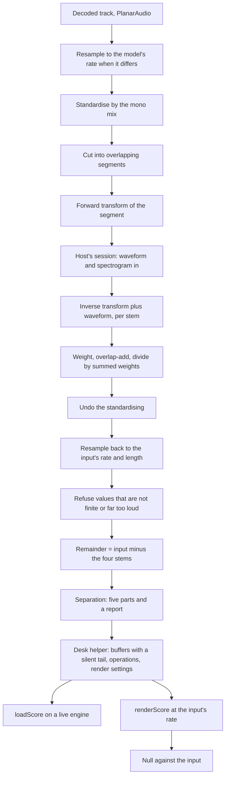

# Stem Separation - Plan

## Goal Capsule

- Objective: a page built on live-mix can take a finished track, get it back as vocals, drums, bass, other and a remainder, lay those five on a desk, and bounce the untouched desk to a file that is the track it was given.
- Means: a new public entry, `./separation`, written in plain TypeScript over a model the host hands in (KTD1, KTD2, KTD3).
- Authority: this plan's Requirements first; then `AGENTS.md`; then `docs/contributing.md` and `docs/decisions.md` where `AGENTS.md` is silent; then the reference implementation of the model for the signal conventions KTD4 names.
- Stop conditions: a settled decision turns out not to work; the null of R9 cannot be reached without changing how the engine eases a clip's edges; `pnpm check` cannot pass without skipping or weakening a test.
- Execution profile: one branch (`claude/project-thread-ow39ec`), no pull request. `AGENTS.md` asks for `pnpm check`, a fetch of `main`, and a merge into `main` by the agent that did the work.
- Nobody can listen in this environment. What a stem sounds like is for the owner's ear. This work proves the arithmetic (the five parts add up to the input, the bounce nulls) and that a real model runs through the code on a real recording, and the docs say which of those ran where.

---

## Product Contract

### Summary

Add stem separation to the engine as library code. A host passes a decoded track and a separator and gets four stems plus a remainder, with a report of how large the remainder is. A second helper turns that result into score operations for five audio tracks and the settings a render needs, so the untouched desk bounces back to the input. The first separator runs a neural model in the browser through an ONNX runtime the host supplies. No weights ship with the package.

### Problem Frame

The mixing app in `kieranklaassen/auto-mix` starts from a finished track and has to mix its parts. live-mix has the desk, the score and the offline bounce, and nothing that splits a recording: "stems" in the engine today means bouncing tracks out of a mix (`renderStems`, `renderScoreStems`). The owner asked for the separation to live in the engine so that any host of the engine can use it. The brainstorm's first build step is a spike with no model listening or planning: separate, desk, bounce, and learn the engineering facts (how large the remainder is, how long a song takes, how much memory it holds).

### Key Decisions

- **Separation is library code in live-mix.** (session-settled: user-directed — chosen over a hosted call behind an interface inside the app's Rails server: the owner wants it reusable from the engine.) Governs R1, R4, R10.
- **Four stems and a remainder.** (session-settled: user-approved — chosen over the six-stem model: its guitar and piano stems bleed, by the model's own notes.) Governs R1, R2, R3.
- **The app is its own repository and pins live-mix by commit.** (session-settled: user-directed — chosen over building the app inside live-mix or ambient-live: the owner asked for a separate repository.) Governs the scope boundary on the drop page.
- **A spike before any listening or planning model.** (session-settled: user-approved — chosen over starting with the listener and planner: the spike answers the engineering unknowns first.) Governs R8, R9.

### Requirements

**Separating**

- R1. A host hands the library a decoded track at any sample rate, mono or stereo, and gets back four stems named vocals, drums, bass and other, each at the input's sample rate, length and channel count.
- R2. A fifth part, the remainder, is the input minus the sum of the four stems, so the five parts added together are the input.
- R3. The result carries a report: the remainder's level against the input in dB, the remainder's peak, the model's sample rate, and whether the input was resampled.
- R4. The first separator runs a model in the browser. The package ships no weights and no address for weights, and never imports an ONNX runtime: the host passes both.
- R5. A separator is one small interface, so another model or a hosted service can take the place of the first without a change to callers.
- R6. A run reports progress, stops when its `AbortSignal` fires, hands the thread back between segments, and uses nothing a worker lacks.
- R7. A run whose stems hold a value that is not finite, or a peak more than 12 dB over the input's peak, fails with an error and returns nothing.

**The desk**

- R8. A helper lays the five parts on a score as five audio tracks starting at 0 s, as one undo step, with ids no source or track of that score already has.
- R9. A render of that untouched score, with the settings the helper returns, is the input: in a real browser the difference stays under -100 dBFS for a full-scale input, for stems that start and end away from zero as well as ones at rest.

**Packaging and what the docs say**

- R10. The code lives in a new public entry that `.`, `./dsp` and `./testing` never reach, and the package gains no runtime dependency.
- R11. The docs say what ran and where, state the license position of the model's weights plainly, and describe the feature in the engine's own words with no comparison to another product.

### Success Criteria

- With every part untouched, the bounce and the input cancel to under -100 dBFS (R9).
- A real model, run through this code on a real recording, gives four stems whose remainder is reported and whose bass stem is the lowest in pitch content of the four.
- A host of the engine that does not use separation downloads and parses nothing more than before.

### Scope Boundaries

- The Rails app, its drop page, its storage and its jobs are in `kieranklaassen/auto-mix` and are not planned here.
- No model listens to a stem or plans a mix here.
- No weights, no address for weights and no code that downloads or caches them. The host creates the model session.

#### Deferred to Follow-Up Work

- A separator for a hosted service. It needs a named service, a decode on the main thread, and a stated way to line stems up after a lossy codec's delay. The interface of R5 is where it will sit.
- A second model kind: four per-stem spectrogram models whose publisher states a CC BY 4.0 license. It reuses the transform and the segment runner of U2 and U3.
- Keeping stems across a reload. A saved score reopens with five silent tracks until the host stores the stems and resolves their sources.

#### Considered and not built

- Averaging over time-shifted passes ("shifts"). It multiplies the run time. Evidence that would change the call: the owner hears a difference worth the wait.
- Half-precision weights. Others report values that are not numbers on WebGPU with them.
- A worker owned by the library. A worker bundle cannot leave the ONNX runtime out, and a host that wants WebGPU has to import the runtime in its own worker anyway. R6 keeps the code usable there.
- Freeing a stem's decoded sound when its tracks are undone. The engine's sample store has no such step for any source today.

### Sources

- The brainstorm "AI mixing app: brainstorm" (a Claude Doc, 2026-11-21), sections "Stem separation", "The order to build it in" and "How we know it works".
- `docs/decisions.md` KD8 (tiers), KTD1 (no runtime dependencies), U32 (a peer the library never imports), U35 (a dependency gets its own entry).

---

## Planning Contract

### Key Technical Decisions

- KTD1. **A new entry, `./separation`, at tier Dream, pulled by the mixing app.** `./wam` is the precedent for code with a dependency of its own (`docs/decisions.md` U35). `scripts/check-pack.mjs` already fails a build in which `.`, `./dsp` or `./testing` reach an optional peer. (session-settled: user-directed — chosen over a hosted call inside the app: the owner wants it reusable from the engine.) Serves R10.
- KTD2. **The runtime and the model session are handed in.** The library declares a structural interface for the two things it uses, a tensor constructor and a session's `run`, and the host passes `onnxruntime-web`'s. This is the `signalsmith-stretch` precedent (`StretchNodeFactory` in `src/core/sources/StretchSource.ts`): an optional peer in `package.json`, never imported and not a dev dependency. A dynamic `import()` is a lint error in `src/`, and a dev dependency of this size would be downloaded by every install of the engine from git. Serves R4.
- KTD3. **The segment runner knows nothing of the model.** A segment model takes one fixed-length segment and returns four. The runner cuts, weights and adds. The first model kind is the hybrid one: a waveform and its spectrogram in, a spectrogram and a waveform per stem out, a stem being the inverse transform of the first plus the second. Its numbers (segment 343,980 frames at 44.1 kHz, transform size 4096, hop 1024, stem order drums, bass, other, vocals) are defaults of a spec object, and tensors are fed by the session's input order because the export's names are generated. The hybrid kind comes first because it is the model the brainstorm names, it has the best published separation figures of the candidates that run in a browser, and it gives four stems from one file in one pass. The per-stem kind with a stated license is deferred, not dropped. Serves R5.
- KTD4. **Signal conventions follow the model's reference implementation; only the deltas are ours.** The transform and its padding follow `_spec` and `_ispec` in `demucs/htdemucs.py`. The segmenting follows `apply_model` in `demucs/apply.py`: a stride of three quarters of a segment, triangular weights, a short last segment centred, a division by the summed weights. The standardising by the mono mix's mean and deviation follows `demucs/api.py`. Our deltas: no shifts, and a deviation of zero divides by one.
- KTD5. **Everything works on `PlanarAudio`, with the library's own resampler.** A windowed-sinc resampler takes the output length it must produce, so 48 kHz to 44.1 kHz and back is exact in frames. The browser's own resampling in a buffer source is linear interpolation and needs an audio context. The remainder is computed at the input's rate after the stems are brought back to it, so resampling error lands in the remainder and R2 holds. Serves R1, R2, R6.
- KTD6. **Stems reach the engine as `AudioBuffer`s with a shared silent tail.** `AudioTrack` eases a clip's edge over 5 ms when the sound steps there, and decides per buffer, so five stems could be eased five ways. A tail of 20 ms of silence on every buffer stops a stem from "coming round" on itself, and a clip that ends inside its buffer at silence is left square. The same buffers serve the live engine and the render, which saves a second decode of about 420 MB for a four-minute song. Serves R9.
- KTD7. **The helper returns operations, a partial resolver and the render's settings.** It follows `patchEffectOps` in `src/score/patch.ts`: the caller applies one `batch`. A renderer's `resolveSource` is fixed when it is made, so the helper also returns the source ids and buffers for `engine.samples.load`. The settings are `durationSec`, `sampleRate` and `numberOfChannels`, with a duration chosen so that `Math.ceil(durationSec * sampleRate)` is the input's frame count. Serves R8, R9.
- KTD8. **The null is proved in the browser suite with a stand-in separator, and the test is broken on purpose once.** Node has no `OfflineAudioContext`, so `pnpm test` can only check what the graph was told. The spec holds the difference under -100 dBFS, and with the remainder track muted the same measure must come out above -40 dBFS. The floor matches `browser-tests/specs/cut-pieces.spec.ts`. Serves R9.
- KTD9. **The real model is checked by a script outside `pnpm check`.** The script takes the path of a runtime module, a model file and a WAV, runs the built entry in Node, and writes the five parts and the report. The runtime's WebAssembly build runs in Node, so the script exercises the same code a browser would. WebGPU is not run here: the machine has no graphics card.
- KTD10. **The guard of R7 sits in the one function every separator's result passes through.** WebGPU runs are reported to return garbage without an error. A check for values that are not finite and for a peak over four times the input's is one pass over the stems.

### High-Level Technical Design



The segment loop (transform, model, inverse) is the only part that touches the host's session. Everything from "Cut into overlapping segments" to "divide by summed weights" is the segment runner of KTD3, and a different model kind replaces only the three boxes inside the loop.

### Output Structure

```text
src/separation/
  index.ts            the entry, with its @module comment
  types.ts            StemName, Separator, Separation, the report, the error
  stft.ts             forward and inverse transform for a segment
  resample.ts         windowed-sinc resampler to a stated length
  segments.ts         the segment runner
  hybrid-model.ts     the hybrid segment model over a host's session
  separate.ts         separateTrack: rates, channels, guard, remainder, report
  desk.ts             operations, buffers, resolver, render settings
  __tests__/          one test file per module
browser-tests/harness/separation.ts
browser-tests/specs/separation.spec.ts
scripts/try-separation.mjs
docs/separation.md
```

### Assumptions

These are bets made without the owner's word.

- A mono input is given to the model on both channels, and each stem comes back as the mean of the model's two.
- The guard's threshold is 12 dB over the input's peak, and the null's floor is -100 dBFS.
- The silent tail is 20 ms. A flow check in Node found it enough in three cases, and U7 holds it in a browser.
- The host creates the session, so download progress, caching and the choice between WebGPU and WebAssembly are the host's.
- No hosted separator is built in this change, although the brainstorm leaned to a hosted model first.
- The drop, desk and bounce page is built in the app's repository and not in `playground/`.
- A run of the real model in Node counts as the proof on real audio for this change. A browser run with the real model waits for the app.

### Risks

| Risk | Why it is real | What is done here |
| --- | --- | --- |
| The weights' license | The model's author writes that the code is MIT and that "the license of the weights is not clear", for research use | No weights and no address ship (R4). `docs/separation.md` states the position and names the second model kind as the route to a stated license |
| WebGPU is not run | No graphics card here. Others report garbage without an error and stalls of a page that shares the card | The guard of R7. The docs say WebGPU was not run |
| Speed without threads | Measured during research in Node: about 6 to 7 s a segment on four threads, 28 s on one. A page that is not cross-origin isolated gets one thread | The docs state the figures and what isolation a host needs |
| Memory | About 420 MB of planar stems for four minutes of stereo, the same again as buffers, and the runtime's own heap, measured at 3.0 GB resident in Node | KTD6 shares buffers between the live engine and the render. The docs tell a host to drop the planar copy once the buffers exist |
| The export's tensor names | The published export's names are generated (`onnx::ReduceMean_1`, `5073`) | KTD3 feeds and reads by position, and the spec object can name them |

---

## Implementation Units

### U1. The `./separation` entry and its types

**Goal:** a public entry that builds, is documented and is pinned, holding the types every later unit uses.

**Requirements:** R5, R10 (KTD1, KTD2).

**Dependencies:** none.

**Files:**
- `src/separation/index.ts`, `src/separation/types.ts`
- `package.json` (`exports`, `peerDependencies`, `peerDependenciesMeta`)
- `scripts/build.mjs` (the tsup entry map)
- `typedoc.json`
- `src/__tests__/public-entry.test.ts`
- `examples/tsconfig.json`, `browser-tests/tsconfig.json`, `playground/tsconfig.json` (`paths`)
- `browser-tests/build-harness.mjs` (`SUBPATHS`)
- `scripts/ci-local.sh`, `.github/workflows/ci.yml` (the `test -f` lists of built entries)

**Approach:**
1. Declare the stem names, the `Separator` interface (audio in, four stems out, with `signal` and `onProgress`), the `Separation` result, the report and one error class.
2. Declare the structural runtime interface of KTD2: a tensor constructor and a session with `inputNames`, `outputNames` and `run`.
3. Add the entry to every list above, and `onnxruntime-web` as an optional peer that no file imports.

**Patterns to follow:** `src/wam/index.ts` for an entry with a `@module` comment; `StretchNodeFactory` for a structural interface over a peer; the must-exist lists in `public-entry.test.ts`.

**Test scenarios:**
- The entry exports each public name this plan adds (a must-exist list, as for `./wam`).
- `.` exports none of them.
- No file under `src/` imports `onnxruntime-web`.

**Verification:** `pnpm build` writes `dist/separation/index.js` and its types, and `pnpm pack:check` passes.

### U2. The transform and the resampler

**Goal:** the two signal tools the model's segment needs, pure and tested in Node.

**Requirements:** R1, R6 (KTD4, KTD5).

**Dependencies:** U1.

**Files:**
- `src/separation/stft.ts`, `src/separation/resample.ts`
- `src/separation/__tests__/stft.test.ts`, `src/separation/__tests__/resample.test.ts`
- `src/core/devices/native/cleanup/fft.ts` (imported as it is, or moved if the build's layout asks for it)

**Approach:** the forward transform returns the spectrogram in the layout the model takes (per channel, real then imaginary, the top bin dropped) and the inverse takes the same layout back to a waveform of a stated length. Both follow KTD4's reference for window, scaling and padding. The resampler is a windowed-sinc kernel evaluated per output frame, with the output length passed in, and returns its input untouched when the rates are equal.

**Patterns to follow:** `Fft` in `src/core/devices/native/cleanup/fft.ts`; `src/core/analysis/onsets.ts` for pure functions over `Float32Array`s.

**Test scenarios:**
- A segment of 343,980 frames gives 336 frames of 2048 bins.
- Noise through the forward then the inverse transform comes back within -100 dB of itself.
- A sine at a bin's centre frequency puts its energy in that bin.
- A 1 kHz sine at 48 kHz resampled to 44.1 kHz is a 1 kHz sine within -70 dB, and has the length asked for.
- A band-limited signal taken 48 kHz to 44.1 kHz and back, for a run of lengths that includes ones where rounding differs, has exactly its first length and is within -60 dB of itself away from its ends.
- Equal rates return the same arrays.
- An output length of zero or a rate of zero throws.

**Verification:** the two test files pass, and neither module names `window`, `document` or an audio context.

### U3. The segment runner

**Goal:** turn any segment model into a `Separator` for a track of any length.

**Requirements:** R5, R6 (KTD3, KTD4).

**Dependencies:** U1.

**Files:**
- `src/separation/segments.ts`
- `src/separation/__tests__/segments.test.ts`

**Approach:** standardise the track, walk it in strides, hand each segment to the model, weight and add the four results, divide by the summed weights, and undo the standardising. Between segments call `signal.throwIfAborted()`, report `{ done, total }`, and yield to the event loop.

**Patterns to follow:** `renderPatch` in `src/dsp/patch-render.ts` for `signal` and yielding.

**Test scenarios:**
- With a stand-in model that returns its input as "other" and silence for the rest, "other" equals the input within 1e-6 for tracks shorter than a segment, exactly one segment, one frame over, and several segments long.
- The model is always called with arrays of exactly the segment's length.
- A silent track gives silent stems and no value that is not finite.
- A track with a constant offset comes back with that offset.
- Progress is reported once per segment and ends at `done === total`.
- A signal aborted after the second segment rejects with the signal's reason, and the model is not called a third time.
- A model that rejects makes the run reject with that error.

**Verification:** the test file passes with a stand-in model only.

### U4. The hybrid model over a host's session

**Goal:** the first segment model: the hybrid kind of KTD3 run through the session the host passes.

**Requirements:** R4, R5 (KTD2, KTD3, KTD4).

**Dependencies:** U1, U2.

**Files:**
- `src/separation/hybrid-model.ts`
- `src/separation/__tests__/hybrid-model.test.ts`

**Approach:** build the two input tensors with the host's constructor, feed them by the session's input order, read the two outputs by its output order, run the inverse transform on each stem's spectrogram, add the waveform branch, and map the model's stem order onto the four names. Check the outputs' sizes before reading them.

**Execution note:** the proof that the conventions match the model is U8's run of the real export. Write this unit so its tests pin shapes and wiring, and expect U8 to send you back here.

**Test scenarios:**
- A stand-in session receives one tensor of shape [1, 2, 343980] and one of [1, 4, 2048, 336], in the order of its `inputNames`.
- A stand-in that returns the input's own spectrogram for one stem and silence elsewhere gives that stem equal to the input segment within -100 dB.
- A stand-in that returns a waveform for one stem and an empty spectrogram gives exactly that waveform.
- The stem returned first by the model is named drums, and the fourth vocals, and a spec with another order is honoured.
- A session with one input, or an output of the wrong size, throws the entry's error and names what it found.
- A session whose `run` rejects makes the model reject with that error.

**Verification:** the test file passes with a stand-in session, and no file imports a runtime.

### U5. `separateTrack`: rates, channels, the guard, the remainder and the report

**Goal:** the one call a host makes, which every separator's result passes through.

**Requirements:** R1, R2, R3, R6, R7 (KTD5, KTD10).

**Dependencies:** U1, U2, U3.

**Files:**
- `src/separation/separate.ts`
- `src/separation/__tests__/separate.test.ts`

**Approach:** bring the input to the separator's rate and to two channels, run the separator, bring the stems back to the input's rate, length and channel count, apply the guard, subtract the four stems from the input to get the remainder, and measure the report.

**Test scenarios:**
- With a stand-in separator, the five parts added in float32 equal the input within one unit in the last place, for stereo and for mono.
- A 48 kHz input with a 44.1 kHz separator gives five parts at 48 kHz with the input's frame count, and the report says the input was resampled.
- A stand-in whose stems add up to the input exactly gives a remainder of silence and a report of negative infinity dB.
- A stand-in that returns half the input in one stem gives a remainder 6.02 dB under the input, within 0.01 dB.
- A stem holding one value that is not a number makes the call reject with the entry's error, naming the stem.
- A stem whose peak is five times the input's makes the call reject, and one at three times does not.
- An input of zero frames, or of three channels, throws before the separator is called.
- An aborted signal rejects and returns no partial result.

**Verification:** the test file passes, and the function's result alone is enough for U6.

### U6. The desk helper

**Goal:** lay a separation on a score and say how to render it so that it nulls.

**Requirements:** R8, R9 (KTD6, KTD7).

**Dependencies:** U1, U5.

**Files:**
- `src/separation/desk.ts`
- `src/separation/__tests__/desk.test.ts`

**Approach:** make one buffer per part with the tail of KTD6, through a buffer factory the caller may replace. Return a `batch` of `source.add`, `track.add` and `clip.add` for five tracks, the map of source id to buffer, a resolver that answers only for those ids, and the render settings of KTD7. Take the score to pick ids it does not hold.

**Patterns to follow:** `patchEffectOps` in `src/score/patch.ts`; `resolveTone` in `playground/src/demo.ts`; `src/score/__tests__/renderScore.test.ts` for a render against the mock context.

**Test scenarios:**
- Applied to an empty score, the batch adds five sources and five audio tracks named for the five parts, each with one clip at 0 s with no fade and no gain.
- Applied to a score that already has a track and a source with the names the helper would choose, the new ids differ and the old track is unchanged.
- One undo removes all five tracks and sources.
- A second separation laid on the same score gets five more tracks with fresh ids.
- Each buffer is 20 ms longer than the input and silent over that tail, and each clip's length is the input's.
- The resolver returns the buffer for each of its ids and `undefined` for any other.
- For a run of frame counts and both 44,100 and 48,000 Hz, `Math.ceil(durationSec * sampleRate)` is the frame count.
- A mono separation gives `numberOfChannels` 1.
- Rendered against the mock offline context, no clip of a stem that starts and ends on a step is told to ramp its gain.

**Verification:** the test file passes. What the test cannot show, that the samples sum to the input, is U7's.

### U7. The null in a real browser

**Goal:** show R9 on real samples, and show that the test can fail.

**Requirements:** R9 (KTD8).

**Dependencies:** U5, U6.

**Files:**
- `browser-tests/harness/separation.ts`, `browser-tests/harness/main.ts`
- `browser-tests/specs/separation.spec.ts`

**Approach:** the harness makes a few seconds of synthetic sound, runs `separateTrack` with a stand-in separator written in the harness, lays the result on a score with U6's helper, renders with the returned settings, and returns the difference against the input as a peak in dBFS. The stand-in splits the input by gains and one-pole filters and adds a constant offset to one stem and a whole-cycle sine to another, so stems start and end on a step and the remainder is not small.

**Patterns to follow:** `browser-tests/harness/cut-pieces.ts` and `browser-tests/specs/cut-pieces.spec.ts`; `collectPageErrors` in `browser-tests/specs/page-errors.ts`.

**Test scenarios:**
- Covers R9. At 44,100 Hz, stereo, the difference is under -100 dBFS.
- The same at 48,000 Hz, and for a mono input.
- With the remainder track muted, the difference is over -40 dBFS.
- With the tail of KTD6 left off, measured once while writing the spec, the difference is recorded in a comment beside the threshold, so the floor is known to sit between the real run and the broken one.
- The page raises no error.

**Verification:** `pnpm test:browser` passes this spec with `LIVE_MIX_BROWSER_PATH` set to the machine's Chromium.

### U8. A run of the real model

**Goal:** show that a real export of the model runs through this code on a real recording, and record what was measured.

**Requirements:** R4, R11 (KTD9).

**Dependencies:** U4, U5.

**Files:**
- `scripts/try-separation.mjs`

**Approach:** the script imports the built entry and the runtime module whose path it is given, creates a session on the model file, decodes a WAV with `decodeWav`, runs `separateTrack`, and writes five WAV files and the report as JSON. It prints the time per segment, the remainder's level, and each stem's level and spectral centroid. Nothing it needs is added to `package.json`.

**Execution note:** this is a smoke check on a machine with no graphics card. Fetch the export and a short freely licensed recording into a scratch directory outside the repository, run on 20 to 30 s of it, and keep the numbers for U9. If a reference implementation of the model can be installed here, compare its stems with ours and record the difference; if it cannot, record that the comparison was not made.

**Test scenarios:**
- Test expectation: none -- the script is a manual check that needs a model file the repository does not hold. Its inputs are validated: a missing path prints what to pass and exits non-zero.

**Verification:** the run finishes, the five written files add up to the input within the tolerance of 16 or 32 bit WAV, the bass stem has the lowest centroid of the four, and the remainder's level is a finite number that goes into the docs.

### U9. Docs, glossary and changeset

**Goal:** a reader can use the entry from the docs alone and knows what was and was not checked.

**Requirements:** R11.

**Dependencies:** U1 to U8.

**Files:**
- `docs/separation.md`, `docs/README.md` (the Reference table)
- `README.md` (the entry map)
- `docs/status.md`, `docs/decisions.md`
- `CONCEPTS.md`
- `.changeset/stem-separation.md`

**Approach:** `docs/separation.md` covers the call, the result, the desk helper, how a host creates a session and what it must serve, the cross-origin isolation threads need, the license position of the weights, the measured figures from U8, and a section "What has been checked, and where". `docs/decisions.md` records the tier of KTD1 and the decisions of KTD2, KTD5 and KTD6. `CONCEPTS.md` gains Stem, Remainder and Separator. The changeset is a patch and names the new exports.

**Test scenarios:**
- Test expectation: none -- prose. `pnpm lint` checks its formatting, and the wording check of the Verification Contract runs over it.

**Verification:** `pnpm check` passes with the docs in place, and the docs name every figure's source.

---

## Verification Contract

| Gate | Command or check | Applies to |
| --- | --- | --- |
| Types, lint, unit tests, build, package | `pnpm check` | every unit |
| The null in a browser | `pnpm build`, then `LIVE_MIX_BROWSER_PATH=<the machine's Chromium> pnpm test:browser` | U7. The whole suite is run once before the merge |
| The real model | `node scripts/try-separation.mjs` with a runtime, a model and a WAV | U8 |
| Wording | no added line compares the engine with another product: `git grep -n -P "Ableton(?! (Link\|Push))"` and `\bLive('s)?\b` over the added lines | U9 and every comment |
| The main entry is unchanged in reach | `pnpm pack:check` | U1 |

A whole run is judged by its exit code.

## Definition of Done

- R1 to R11 hold, each by the unit and gate that names it.
- `pnpm check` exits 0 on the branch after `main` is brought in.
- The separation spec passes in the browser suite, and the suite as a whole has no new failure against `main`.
- U8's run finished and its figures are in `docs/separation.md`, with what was not run stated beside them.
- No experiment, scratch file, model file or recording is left in the diff.
- The change carries a changeset.
