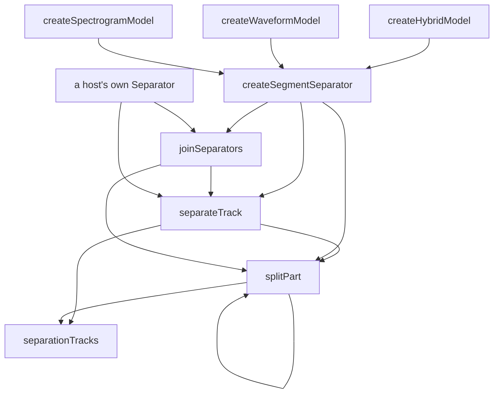

# More Stems from the Separation Entry - Plan

## Goal Capsule

- Objective: the separation entry takes a track apart into as many parts as a host's models give, and can spend more runs for a better answer. A separator says which stems it answers with, several separators stand as one, a part is split further by a second separator, and a track is run at several offsets and averaged. The parts and the remainder still add up to the track.
- Means: the stem list becomes a type parameter that defaults to the four (KTD1), so every call written against the four compiles and behaves as it does today. Three functions compose separators (KTD4, KTD5, KTD6), and two new model kinds let a host run the files that exist for more parts (KTD7, KTD8).
- Authority: this plan's Requirements first. Then `AGENTS.md`. Then `docs/separation.md` as U11 rewrites it, and `docs/contributing.md` for exports and docs. Then the earlier plan `docs/plans/2026-11-21-1847-feat-stem-separation-plan.md`, where this plan does not say otherwise.
- Stop conditions: the parts cannot be made to add up to the track with more than four stems, after a split or after averaging. A call the app makes today cannot be kept compiling and behaving the same without a change in the app beyond its pin. A check cannot pass without skipping or weakening a test. A weights file, a key or a recording would have to enter a repository.
- Execution profile: the run that executes this plan works in one repository, `live-mix`, on the branch `claude/project-thread-ow39ec`, with no pull request and one merge into `main` after every engine gate of the Verification Contract. The app's pin is the caller's step after the hand-back.
- Who finishes: the run that executes this plan hands back to its caller. The caller simplifies, reviews, runs the gates, merges, and then moves the pin in `kieranklaassen/auto-mix` and runs that repository's checks (Definition of Done).
- Everything is proven on stand-ins in Vitest and in headless Chromium, and measured by hand with the model files that are on the machine that runs this. Nobody listens to a stem. The docs say so.

---

## Product Contract

### Summary

A separator names its stems, and a separation carries them in order with one remainder taken last. Separators are joined, a part is split by a second separator, and a segment separator can run a track more than once at offsets drawn from a seed. Two more kinds of model join the first: one that takes sound and answers every stem's sound, and one that takes a segment's spectrogram and answers one stem's. The default is unchanged: four stems and a remainder, one run.

### Problem Frame

`main` is at `cf6d85c`. `src/separation/` fixes four names in its types: `Separator.separate` answers `Record<StemName, Channels>`, the segment runner and `separateTrack` loop over `STEM_NAMES`, `createHybridModel` refuses a spec whose stems are not the four, and `separationTracks` lays out `PART_NAMES`. A host with a model that answers six parts, or one part, cannot use the entry.

The owner asked whether more than four stems are possible and what the highest quality is, and then said that more parts are welcome and quality matters most. What is published points three ways. More parts come from a six-part model of the first kind's family, and from a second model run over one stem: drums into kick, snare, toms and cymbals, vocals into lead and backing, other into guitar and piano. A better answer from the same model comes from running the track more than once at small offsets and averaging, and from a set of four models each tuned for one stem, at four times the cost. The exports that exist for these are of two shapes the entry cannot run: sound in and sound out with the transform inside the graph, and one stem's spectrogram with the transform outside at a size that depends on the stem.

The app `kieranklaassen/auto-mix` pins this repository by commit and types about 35 files by `PartName`. Its desk, presets, rule and agent assume five parts. Changing that is the next slice, so this one must leave every call the app makes compiling and behaving as it does.

### Key Decisions

- **Separation lives in the engine.** (session-settled: user-directed — chosen over separation code in the app: the owner asked for it in the library so any host can use it.) Governs R1, R7, R8.
- **Quality comes first, and more parts are welcome where they do not cost it.** (session-settled: user-directed — chosen over more parts as the only aim: the owner's words, "quality is the most important".) Governs R5, R6, R7, R15.
- **The parts and the remainder add up to the track, to the sample, whatever a separator got wrong, and laid on a score untouched they bounce back to the track.** (session-settled: user-approved — chosen over stems that are only close to the track: a mix starts from the track as it was.) Governs R2, R3, R4, R8.
- **The library ships no weights, imports no ONNX runtime and names no address for a model.** (session-settled: user-approved — chosen over a bundled or downloaded model: the licenses of published weights, and the repository's rule.) Governs R14.
- **No hosted model is called from here and no key is set or asked for.** (session-settled: user-directed — chosen over calling a service to try a heavier model: the owner's standing rule on keys and on what leaves this machine.) Governs R14, R15.
- **Nothing is named after or compared with a product, brand, maker, artist or track.** (session-settled: user-directed — chosen over naming parts and kinds after the models that give them: the owner's standing rule.) Governs R14.

### Requirements

**Names and parts**

- R1. A separator says which stems it answers with, in order. One that says nothing answers the four. A name is a lower-case letter followed by lower-case letters, digits or hyphens. A list is refused when it is empty, names a stem twice, holds a name of another shape, or names `remainder`.
- R2. A separation holds its stems by name and says their order, and its remainder is the track minus every stem, taken last at the track's rate. A separation made by hand that says no order is read as the four. One whose stems are not exactly its names is refused, with the name that differs.
- R3. The stems and the remainder added together are the track for any number of stems, held by a null whose threshold is set from what is measured at the largest count tested, and the docs give that floor with its count of parts.
- R4. A separation of any number of parts is laid on a score as that many audio tracks, the stems in the separation's order and the remainder last, as one undo step, and the untouched score bounces back to the track.
- R5. Every call written against the four behaves as it does today: the same exports, names and order, and for the default run the same samples.

**A better answer**

- R6. A segment separator can run a track more than once, each run's segments starting at an offset of its own, and average the answers. The offsets come from a seed, so a run is the same twice. One run, the default, is today's.
- R7. Several separators stand as one: each is run over the track in turn and the named stems of each are kept, in the order they are named. The set is refused when it is empty, when two of them keep one name, when one is asked for a stem it does not answer or for none, or when their sample rates differ.

**More parts**

- R8. A part of a separation is split by a second separator. The part is replaced, in its place, by the stems the second separator gives and by what they leave of the part. Those add up to the part, the separation's one remainder is not touched, the separation handed in is not changed, and the result can be split again.
- R9. The first model kind takes a spec with any list of stems.
- R10. A second model kind takes a segment's sound and answers every stem's sound, for an export that keeps its transform inside the graph.
- R11. A third model kind takes a segment's spectrogram and answers one stem's, with the transform outside the graph at the size, hop, count of kept bins and count of frames its spec gives.
- R12. A model says whether the track is brought to a standard level before it is run. One that says nothing is run as today, at a standard level.

**Running**

- R13. Within one call the progress's `total` never changes, `done` rises by one from 1, and the last call has `done` equal to `total`, through every pass of a segment separator and every separator of a joined set. A stop during any of them rejects with nothing returned.

**Packaging and what the docs say**

- R14. The entry still reaches no ONNX runtime and ships no model, `.` exports none of it, every new value export is pinned, and parts and kinds are named by what they are.
- R15. The docs say what ran and where, on which model, stems, sample rate, offsets, seed and recording. They state the license of each published model they cite as it was found, or that it was not found. They say that a six-part model measures lower on the stems it shares with the four-part one, and that nobody has listened.
- R16. The app's pin moves with no other line of its source changed, and its checks pass.

### Acceptance Examples

- AE1. **Covers R1, R2, R3.** Given a stand-in separator that names six stems, when a stereo track of noise is separated, then the separation has those six in order and a remainder, and the seven summed in single precision null against the track under the measured threshold.
- AE2. **Covers R5.** Given seeded noise run through the segment runner and `separateTrack` on `main` before any edit, when the same run is made after every unit, then the samples are the same bits, and the existing tests of the entry pass with no edit but the two cases U1 and U2 name.
- AE3. **Covers R6.** Given a model that returns what it is given, when a track is run with 1, 2 and 5 passes, then each answer is the track. Given a model whose answer depends on where a frame sits in its segment, then 2 passes differ from 1, the same seed gives the same bits twice, and another seed gives another answer.
- AE4. **Covers R7.** Given one separator that answers the four and one that answers `vocals` alone, when they are joined keeping `drums`, `bass` and `other` of the first and `vocals` of the second, then the answer has four stems and its `vocals` is the second's.
- AE5. **Covers R8, R3.** Given a separation of the four, when `drums` is split by a separator that answers `kick`, `snare`, `toms` and `cymbals`, then the stems are `vocals`, `kick`, `snare`, `toms`, `cymbals`, `drums`, `bass`, `other`, the five in the place of `drums` null against the old `drums`, the remainder is the same array, and all nine parts null against the track.
- AE6. **Covers R8.** Given a track at 48 kHz and a second separator at 44.1 kHz, when a part is split, then its stems come back at 48 kHz with the part's length and channel count.
- AE7. **Covers R13.** Given a joined set of two separators, when the signal fires during the second, then the call rejects and the first's answer is not returned.
- AE8. **Covers R11.** Given a session that returns the spectrogram it is given and a spec that keeps every bin, when a segment is run, then the stem is the segment from its first frame to its last. With half the bins kept, a tone above the cut is gone and one below it is whole.
- AE9. **Covers R4, R3.** Given a separation of eleven parts, the four with `drums` split in four and `vocals` in two, when it is laid on a score and the untouched score is rendered in a real browser, then the bounce nulls against the track, and with one sub-part muted it does not.
- AE10. **Covers R2.** Given a separation written by hand with six stems and no order, when it is laid on a score or split, then it is refused by the name of a stem its order does not say, and is never laid as four.

### Success Criteria

- A host with a six-part export, a set of one-stem exports or a drum model can run it through the entry by writing a spec and no engine code.
- The app's checks pass at the new pin with no line of its source changed.
- `docs/separation.md` gives, for each real run made here, the figures and what they were measured on.

### Scope Boundaries

- The app's desk, presets, rule, agent and server take five parts. Nothing in `kieranklaassen/auto-mix` changes but its pin and one sentence of its docs.
- No weights file, runtime, key or recording enters a repository, and no service is called. A separator that calls a service stays what it is today, an interface a host fills, and the doc gains an example of one.
- A host splits before it lays. Replacing a part that is already on a score by its split is not in this work, and the doc says that laying a separation a second time adds every part again.
- No constant for a six-part spec. Published exports disagree on the order of their last two stems, so a host writes the spec from its own file.
- Not built, and said in the doc as departures: a second run on the negated segment averaged with the first, zeroing the lowest bins, the trimmed and butted chunks of the one-stem kind's reference (the runner's weighted overlap is used), a learned mixer over several models' answers, and several segments in one batch.
- No figure of quality against reference stems is stated unless a recording with its stems under a license that allows it is found, and it would stay outside the repository.
- Nothing is run on a graphics card.

### Deferred to Follow-Up Work

- The app's desk taking any number of parts: the next slice, in `kieranklaassen/auto-mix`.
- A joined set whose separators run at different sample rates.
- A model kind for the heavier families of models. A host can run one behind `Separator` today.

---

## Planning Contract

### Key Technical Decisions

- KTD1. **The stem list is a type parameter that defaults to `StemName`.** `Separator`, `SegmentModel`, `Separation`, `SeparationTracks` and `HybridModelSpec` take `Name extends string = StemName`. `STEM_NAMES`, `StemName`, `PART_NAMES` and `PartName` stay the four and the five. Widening `StemName` to `string` would slacken the app's types in about 35 files, widening `SeparationTracks['parts']` fails `auto-mix/app/frontend/desk/open.ts:342`, and a parameter with no default fails `auto-mix/app/frontend/separation/runtime.ts:57`.
- KTD2. **Names travel as optional lists, read in one place.** `Separator.stems` and `SegmentModel.stems` are optional and absent means the four. `Separation.names` is optional for a separation written by hand, typed as a list of its `Name`, and always set by the engine, so a separation of other names does not compile where the four are asked for. `Separation.stems` stays a record. A required list fails `auto-mix/app/frontend/desk/open.ts:229-238` and eight of the app's test files. Two exported readers, `stemNames` and `partNames`, give a separation's order, and they refuse a separation whose record's own keys are not exactly its names. `separationTracks` and `splitPart` read through them.
- KTD3. **An answer is held to the list.** `separateTrack` refuses a separator's answer that lacks a named stem, as today, and one that holds a stem the separator did not name. The runner holds a model's answer to a segment the same way. A six-part model run without its list would otherwise lose two stems into the remainder without a word. This is the one place where a separator of the four meets something new: one that answers a fifth stem was run with the extra left in the remainder, and is now refused by that stem's name. Nothing the entry makes and nothing the app hands in answers more than it names.
- KTD4. **Shifts live in the segment runner.** `createSegmentSeparator(model, { overlap, shifts, seed })`. The track is standardized once, every pass adds into the same weighted sums, and nothing is held a second time. The first pass is on today's grid. Pass `k` from the second on starts its grid up to half a second before the track, by an offset drawn from the seed and `k` alone, with silence in front. Every offset is drawn before the first segment, so the count of segments is known from the start. On `separateTrack` it would have to run the separator whole each time and hold every pass's answer.
- KTD5. **Joining is a separator made of separators.** `joinSeparators([{ separator, take }])` answers a `Separator` whose `stems` are the kept names in order. It runs its separators one after another and lets go of each stem it does not keep before the next starts. A set of one is allowed: it is how a host picks or reorders a separator's stems. It covers a set of one-stem models, four tuned models each kept for one stem, and one model's vocals beside another's three.
- KTD6. **A split is a function over a separation.** `splitPart(separation, name, separator, options)` runs the separator over the part as a track, through the same resampling and guard as `separateTrack`, and answers a new separation. What the sub-stems leave keeps the part's own name unless `options.rest` names it, so a fader on the part's group still moves all of the part. The untouched parts are the same arrays, not copies. Folding the rest into the one remainder would move part of the drums out of the drums.
- KTD7. **Every kind is sound in and sound out.** `SegmentModel.run` keeps its shape, and a kind's transform stays inside its adapter, as in `src/separation/hybrid-model.ts`. The app's worker calls `model.run([silence, silence])` and must not change.
- KTD8. **The one-stem kind gets a transform of its own.** `src/separation/stft.ts` is the first kind's: it drops frames at the ends, scales by `1/sqrt(size)` and needs a hop of a quarter of the size. The new one is centred with reflection, unscaled, keeps the first `bins` bins and puts the rest back as silence, and divides by the windows that cover each frame so the ends come back whole. One published size is 6144, three times a power of two, which `Fft` refuses, so the entry gains a transform for sizes `2^n` and `3 × 2^n` built on `Fft`.
- KTD9. **A model that was trained on sound as it is says so.** `SegmentModel.standardize` is optional and absent means true, which is today's run for every model a host already has. The one-stem kind sets it false, and the runner then skips the mean and deviation. The waveform kind stays standardized: its family's reference standardizes the track before the model, whatever is inside the graph.
- KTD10. **A separator may say how many steps a track takes.** `Separator.steps(frames)` is optional: the count of progress calls for a track of that many frames, counted at the separator's own `sampleRate`, which is what `separateTrack` hands it after resampling. A segment separator says it, from its passes' offsets. A joined set says the sum of its separators' and reports one count across them. A separator that does not say is one step, counted when it has answered, and what it reports itself is not passed on. A later separator's total is otherwise not known before it starts, and the app estimates the time left from `done` and `total`.
- KTD11. **The changeset is a patch.** No call of the four that worked has to change, and `.changeset/README.md` keeps minor for a change a consumer's code must follow. Three refusals are new for inputs that were taken wrongly before, and the changeset names them: an answer with a stem its separator did not name (KTD3), a part laid at another length or channel count than the remainder, and a hybrid spec that names a stem twice, which is now refused by that name. The pending `.changeset/stem-separation.md` stays as it is.
- KTD12. **A stem's name is an id, a key and a file name as it stands.** One private check holds the shape of R1 wherever a list of names enters: a spec's `stems`, a model's, a separator's, a `take`, a separation's `names` and a split's `rest`. It runs before a model is asked or a track resampled. Names of any shape would let `Kick` and `kick` meet on one id, `__proto__` vanish from a record, a whole number change a record's key order, and a slash reach a host's file name. Answers are read as own keys only.
- KTD13. **A spec's order is its tensor's, and a separator's is the desk's.** `HYBRID_MODEL_SPEC.stems` is drums, bass, other, vocals, the order of the model's answer. A model whose spec names exactly the four says them in the order of `STEM_NAMES`, so the default separation is laid vocals first as it is today. A model with other names says them in its spec's order. A host that wants another order joins a set of one and takes the names in that order.

### High-Level Technical Design

The sketches below show the intended shape. They are direction for review, not code to copy.

How the pieces compose. A box is a function of the entry, and an arrow reads "is handed to".



The three kinds of model.

| Kind | A session's inputs | A session's outputs | Transform | Stems | Standardized |
| --- | --- | --- | --- | --- | --- |
| Hybrid (today) | a segment's sound and its spectrogram | every stem's spectrogram and sound | outside, `stft.ts` | the spec's list | yes |
| Waveform | a segment's sound, `[1, 2, frames]` | every stem's sound, `[1, stems, 2, frames]` | inside the graph | the spec's list | yes |
| Spectrogram | a segment's spectrogram, `[1, 4, bins, frames]` as left real, left imaginary, right real, right imaginary | one stem's spectrogram, the same shape | outside, the centred one | one name | no |

The surface, as a caller would write it.

```text
separator.stems                      // optional, absent: the four
separator.steps(frames)              // optional, absent: one step
separation.names                     // optional, absent: the four
stemNames(separation)                // the stems in order, the record held to them
partNames(separation)                // the stems in order, then 'remainder'

createSegmentSeparator(model, { overlap, shifts, seed })
joinSeparators([{ separator, take }, …])            -> Separator
splitPart(separation, 'drums', separator, { rest, signal, onProgress }) -> Separation

createHybridModel(runtime)                          // the default spec, the four
createHybridModel(runtime, { …, stems })            // the spec's names
createWaveformModel(runtime, { sampleRate, segmentFrames, stems })
createSpectrogramModel(runtime, { sampleRate, fftSize, hop, bins, frames, stem, gain })
```

A pass of a shifted run. `length` is the track's frames at the model's rate, `lead` is the silence in front of the track for that pass.

| Pass | `lead` | Segments | A segment's frame `i` reads |
| --- | --- | --- | --- |
| 1 | 0 | `ceil(length / stride)` | the track at `j × stride + i` |
| `k`, from 2 | a whole number from 0 to `floor(0.5 × sampleRate)`, both ends included, drawn from `(seed, k)` | `ceil((length + lead) / stride)` | the track at `j × stride + i − lead`, silence where that is before the track |

Every pass adds its weighted answers and its weights into the same sums, and the division by the summed weights comes once at the end. `steps(length)` is the sum of the segments column.

A split, by name. `drums` split by a separator that answers `kick`, `snare`, `toms`, `cymbals`:

```text
before: vocals, drums, bass, other                          + remainder
after:  vocals, kick, snare, toms, cymbals, drums, bass, other + remainder (the same array)
        drums (after) = drums (before) − kick − snare − toms − cymbals
```

Where a stop is seen.

| Stage | The signal is looked at | What is left |
| --- | --- | --- |
| Before a separator is asked | at once | nothing |
| A segment in a model | before the next segment, in every pass | nothing |
| Between the separators of a joined set | before the next separator | nothing: the kept stems so far are let go |
| Stems brought back to the track's rate | after each stem | nothing |
| A split | as a run on the part | the separation handed in, unchanged |

### Assumptions

- A1. Both new model kinds are in this slice. Without a kind that published files exist for, no host can run more parts and every proof here would be a stand-in. The cost is the transform of KTD8.
- A2. What a split leaves keeps the part's name by default (KTD6). A host that splits `vocals` with a model that answers `lead` alone names the rest `backing`. After a split, `stems.drums` is what is left of the drums, and the doc says so in one sentence.
- A3. A shifted run pools its passes by the runner's weights instead of averaging whole passes. A frame at the edge of one pass's segment then leans on the passes where it sits further in, and the track's first frames, which one pass alone covers at a segment's edge, gain most.
- A4. `shifts` counts runs, and 1 is today's. The model's reference draws an offset for its single default run as well, so its default is not the same twice. Here the default stays the same samples as today (R5). `seed` defaults to 0, and a seed with one run does nothing.
- A5. The engine always sets `names` on a separation it makes. Nothing in the app compares a whole separation.
- A6. `splitPart` refuses the name `remainder`. The remainder is what no separator gave and is not a stem. It also refuses a separation with no report: a split is of a separation the engine made.
- A7. A track's name on the desk is the stem's name with a capital first letter and a space for each hyphen, and the five of today keep the names they have.
- A8. The one-stem files on the machine that runs this are four stems again, at a lower published measure than the first kind's model, and each is cut off above a frequency of its own. A real run of them proves the kind and the join and is not a better separation. The doc says so, and says that a joined set's remainder is not to be read against one model's.
- A9. A real split with a real model is run only if a drum or vocal model in one of the three shapes can be fetched to that machine. If none can, the doc says a split has run on stand-ins only.
- A10. The guard keeps its floor for a part that is near silence. What a model that is not standardized answers to silence is measured in U10. If that is over the floor, the doc says that a split of a silent part with that kind is refused, and the floor is not raised without a measured reason.

### Risks

| Risk | What is done about it |
| --- | --- |
| The null's floor falls as parts are added. Each part is one more single-precision addition in a mixer's sum: by arithmetic about 138 dB at five parts, 130 dB at eleven, 120 dB at 33. The unit tests hold 130 dB today. | U1, U5 and U9 measure it at the largest count each tests before a threshold is written. Each threshold sits between the measured figure and the figure of the test's own broken variant. The doc gives the floor with its count. |
| Generic code changes the order of a floating-point sum and the default run's samples move. | The remainder's sum and the runner's loops keep the order of the names, and with one run the runner does today's operations in today's order. AE2 holds the bits against a record made before the first edit. |
| The app fails to compile at the new pin. | U1 adds a test file that writes the app's shapes against the entry's types, so `pnpm typecheck` fails first. The caller tries the pin on the branch's head before the merge. |
| The transform for `3 × 2^n` is wrong in a way a round trip hides. | U7 holds the forward transform against a plain sum over every bin, at sizes 8, 12 and 6144. |
| A one-stem file does not run on the WebAssembly runtime in Node, or takes minutes a segment. | U10 says what ran. A kind that could not be run with a real file is said to be proven on a stand-in session only. |
| More parts hold more memory: about 85 MB a part for four minutes of stereo, so about 595 MB for six stems and a remainder and 935 MB for eleven parts, both counted as a finished separation at the track's rate. A joined separator makes every stem of its model before the set lets go of the ones it does not keep. | Passes add into one set of sums, a joined set runs strictly one after another, a split shares the untouched arrays. The doc gives the arithmetic under what is not measured, and says that a host that cannot hold every session writes a `Separator` that makes and lets go of its session inside `separate`. |
| A name a host chooses collides with an id on the score, with `master`, or with another part's suffixed id. | U2 picks one suffix under which no part's id is taken, counts `master` as taken, and refuses a separation whose ids would not be distinct. |
| The published factor for the one-stem kind's answer is applied two ways by other code. | `gain` is a spec field that defaults to 1, applied to the stem. The doc says what the factor is and that its use is disputed. |
| Bringing ten stems back to a track at another rate is about half a minute in which a stop is not seen. | `separateTrack` looks at the signal after each stem is brought back, and gives the loop a turn there so a worker can receive the message. |

### Deferred to Implementation

- The exact return type of `splitPart` and the inferred type of a joined set over separators of different names. A `string` is enough; a tighter one is welcome if it costs no cast at a call site.
- How the transform for `3 × 2^n` is built on `Fft`: three interleaved transforms of `2^n` combined, or a chirp transform. Whichever passes U7's tests and reads plainly.
- The command line of `scripts/try-separation.mjs` for several models. Today's flags must keep working.
- Whether `src/separation/separate.ts` is split in two files once `splitPart` shares its core.
- The wording of each refusal, and every threshold, which is written after its figure is measured.

### Sources

- `docs/separation.md`, `docs/plans/2026-11-21-1847-feat-stem-separation-plan.md`, `docs/contributing.md`, `.changeset/README.md`.
- The app's call sites, read and not compiled: `auto-mix/app/frontend/separation/{worker,runtime,stand-in-session,client}.ts`, `auto-mix/app/frontend/desk/{open,mix}.ts`.
- Published sources, read on 23 November 2026. The one-stem spectrogram kind: the `kuielab/mdx-net-submission` code (MIT, copyright AIcrowd), its track A weights at Zenodo record 5717356 (CC BY 4.0), trained on MUSDB18-HQ, whose own record says "Other (Non-Commercial)". No page read settles whether the dataset's terms reach the weights. The six-part model: the Demucs README, which calls it experimental, its piano weak, and its weights' license "not clear". Shifts: `demucs/apply.py`. Its gain of "up to 0.2" dB was stated for an earlier model of that family, and no figure was found for the hybrid transformer model. Drum and vocal splitting models: public lists, with licenses that are unstated or disputed.
- Files on the machine that runs this, outside every repository: a four-stem hybrid export, four one-stem spectrogram files with inputs `[batch, 4, 2048, 512]` (read with a local ONNX runtime), and a 10.9 s recording under Creative Commons Attribution 3.0.

---

## Implementation Units

| Unit | What it adds | Depends on |
| --- | --- | --- |
| U1 | The stem list opens | none |
| U2 | Tracks for any number of parts | U1 |
| U3 | Shifts in the segment runner | U1 |
| U4 | Separators joined as one | U1, U3 |
| U5 | A part split by a second separator | U1 |
| U6 | The waveform model kind | U1 |
| U7 | A centred transform at sizes `2^n` and `3 × 2^n` | none |
| U8 | The one-stem spectrogram kind | U1, U3, U4, U7 |
| U9 | More parts bounce whole in a browser | U2, U5 |
| U10 | Real runs, measured | U3, U4, U5, U6, U8 |
| U11 | The docs, the glossary and the changeset | U1 to U10 |

### U1. The stem list opens

- **Goal:** a separator, a segment model and a hybrid spec name their stems, a separation carries them in order, and every call written against the four is unchanged.
- **Requirements:** R1, R2, R3, R5, R9, R12 (the type only), R13, R14.
- **Dependencies:** none.
- **Files:** `src/separation/types.ts`, `src/separation/names.ts` (new), `src/separation/separate.ts`, `src/separation/segments.ts`, `src/separation/hybrid-model.ts`, `src/separation/index.ts`, `src/separation/__tests__/default-run.test.ts` (new), `src/separation/__tests__/names.test.ts` (new), `src/separation/__tests__/separate.test.ts`, `src/separation/__tests__/segments.test.ts`, `src/separation/__tests__/hybrid-model.test.ts`, `src/separation/__tests__/default-shapes.test.ts` (new), `src/__tests__/public-entry.test.ts`.
- **Approach:** type parameters as KTD1. `Separator.stems`, `Separator.steps`, `SegmentModel.stems`, `SegmentModel.standardize` and `Separation.names` as KTD2, KTD9 and KTD10. `names.ts` holds the one check of a list (KTD12) and the two readers (KTD2). `separateTrack` checks the separator's names before it resamples, loops them where it loops `STEM_NAMES`, holds the answer to the list (KTD3), looks at the signal after each stem is brought back, takes the remainder in the names' order and sets `names`. The runner reads its model's names, holds each segment's answer to them, offers them as the separator's `stems`, and says `steps`. `createHybridModel` has two signatures, one with no spec that answers a model of the four and one with a spec that answers a model of the spec's names. It drops the check for the four, keeps the session's sizes following `spec.stems.length`, and says its stems as KTD13.
- **Execution note:** before the first edit, write `default-run.test.ts`: seeded noise through the existing stand-in model, the runner and `separateTrack`, at 44.1 kHz and with a track at 48 kHz, with a checksum of every channel of every part written into the test from what `main` gives. It stays unedited to the end. Run one silent segment of a one-stem file through the script's runtime now as well, before any kind is written for it, so a file that the WebAssembly runtime cannot run is known at the start and not at U10.
- **Patterns:** refusals as `rejects.toThrow(SeparationError)` with a regular expression on the named stem (`src/separation/__tests__/separate.test.ts`). `byGains` and `summed` there, widened to any names.
- **Test scenarios:**
  - Covers AE2. `default-run.test.ts` passes after this unit, unedited. The runner over the stand-in model with no `stems` and with `stems` the four: `toEqual` on every channel of every stem.
  - Covers AE1. A separator naming six stems, stereo noise at 44.1 kHz and at 48 kHz against a separator at 44.1 kHz: six stems in order, `names` set, the seven null against the track.
  - A separator naming one stem: one stem and a remainder that null against the track.
  - Twelve stems: the null still holds. Its measured figure is printed once and R3's threshold for this file is written from it.
  - Names: `kick`, `lead-2` and `a` pass. An empty list, a name twice, `Kick`, `2nd`, `__proto__`, `a/b`, an empty name and `remainder` are each refused with the name, before the separator is asked.
  - An answer without a named stem and an answer with a stem that was not named are refused by name. A model's answer to a segment with a stem too many is refused.
  - The guard names a stem outside the four when it peaks over the limit, and when it holds a value that is not finite.
  - A signal fired while the stems are brought back rejects.
  - `createHybridModel` with a spec of six stems: the session is fed the same two tensors, six stems come back from an answer sized for six, and the model says them in the spec's order. With the default spec the model says the four in the order of `STEM_NAMES`. A spec naming a stem twice is refused by that name. This is one planned edit to an existing case: `refuses a spec whose stems are not the four, each once` in `src/separation/__tests__/hybrid-model.test.ts` hands in drums, bass, other, other and expects the word `vocals`. The spec is refused as before, the name in the message is now `other`, and the case is renamed and its expression changed to match.
  - `stemNames` and `partNames` of a separation with no `names` are the four and the five. A record with a key its names do not say, and a name its record does not hold, are each refused by that name.
  - The segment separator's `steps(frames)` is the count of progress calls its run makes, for a track shorter than a segment and for one several long.
  - `default-shapes.test.ts` writes, against the entry's types and with no cast, what the app writes: `Record<PartName, { trackId: string }>` from `separationTracks(...).parts`, an `Omit<Separation, 'report'>` literal with the four keys, `PART_NAMES.map` over `stems[name]`, and `createHybridModel(runtime)` assigned to `SegmentModel`. It also holds, with an expected type error, that a separation of six names is not assignable to `Separation`. It fails `pnpm typecheck` when a default is lost.
  - One removal for each new check: with the unlisted-stem refusal taken out, its test fails.
- **Verification:** `pnpm vitest run src/separation src/__tests__/public-entry.test.ts` and `pnpm typecheck` exit 0, with no existing case of the entry edited but the one named above.

### U2. Tracks for any number of parts

- **Goal:** `separationTracks` lays any separation on a score.
- **Requirements:** R2, R4, R5.
- **Dependencies:** U1.
- **Files:** `src/separation/tracks.ts`, `src/separation/__tests__/tracks.test.ts`.
- **Approach:** the parts are `partNames(separation)`, so a record that does not match its names is refused here (KTD2). Ids stay the names with one suffix on all, the first suffix under which no part's id is a strip host, an element track, a source or `master`. A track's name is as A7. `SeparationTracks<Name>['parts']` is keyed by the names and `remainder`, and a caller reads the order they were laid in from `partNames(separation)`: the result gains no list of its own. Each part is held to the remainder's frames and channel count, and a separation whose ids would not be distinct is refused. The silence after each part, the clip's length, the label `Add stems` and the render settings are untouched.
- **Patterns:** `describe('rendered')` in `src/separation/__tests__/tracks.test.ts`, under fake timers with `createMockOfflineContext`.
- **Test scenarios:**
  - Seven parts and eleven parts: that many tracks in the order of `partNames(separation)`, the remainder last, one batch, and on the mock the rendered sum is the track.
  - The default five give the same operation as before this unit: the existing expectations pass unedited, but for one planned edit. `says how to render so that the bounce has the track’s frames` lays four stems of one frame beside a remainder of up to 11,520,001 frames, which the new check of length refuses. Its four stems become the same silent arrays as its remainder, as its own comment already says of every part, and what it expects is untouched.
  - Covers AE10. A hand-written separation with six keys and no `names` is refused by the name of the fifth key.
  - A score that already holds `kick` gets `-2` on every part of a separation that has a `kick`. A separation with a stem named `master` gets `-2` on every part.
  - A part with another length or channel count than the remainder is refused by name.
  - Names `vocals` and `vocals-2` in one separation on a score that holds `vocals`: the ids are distinct, or the separation is refused, and never two parts on one id.
  - A stem named `guitar` gives a track named `Guitar`, and `lead-vocals` gives `Lead vocals`.
- **Verification:** `pnpm vitest run src/separation/__tests__/tracks.test.ts` exits 0, with no existing case edited but the one named above.

### U3. Shifts in the segment runner

- **Goal:** a segment separator runs a track more than once at seeded offsets and averages.
- **Requirements:** R6, R13, R5.
- **Dependencies:** U1.
- **Files:** `src/separation/segments.ts`, `src/separation/__tests__/segments.test.ts`.
- **Approach:** as KTD4 and the pass table. `shifts` is a whole number from 1, refused otherwise when the separator is made, as `overlap` is. `seed` defaults to 0 and is brought to a whole number as the engine's other seeds are. A pass's offset is a function of the seed and the pass's number alone, drawn afresh in every call, so a second track, a run after a stop and a second separator with the same seed draw the same offsets. The mean and deviation are the track's alone and the same in every pass. With one run the code draws nothing and does today's operations in today's order. The signal is checked before each segment of each pass, the turn between segments stays, and progress counts across passes against `steps`.
- **Patterns:** the counting model of `src/separation/__tests__/segments.test.ts` that reads the weights. `seededUnit` and `seededRandom` in `src/core/clips/chance.ts`, whose rule is that a draw depends on its seed and what it is for, never on when it was asked.
- **Test scenarios:**
  - Covers AE2. `default-run.test.ts` passes unedited.
  - Covers AE3. A model that returns its input, tracks shorter than a segment, one frame over a stride and several segments long, at 1, 2 and 5 passes, at 44.1 kHz and 48 kHz: the answer nulls against the track at the existing threshold.
  - Covers AE3. A model that adds a ramp along its segment: 2 passes differ from 1 by more than a stated figure, the same seed twice gives `toEqual`, another seed differs.
  - The offsets of a seed are whole numbers from 0 to half a second, the first pass's is 0, and two calls of one separator draw the same.
  - A model that records what it was fed shows `lead` zeros at the head of the first segment of a later pass, and one scale across all passes.
  - Progress: `total` is the same in every call and equal to `steps(frames)`, `done` rises by one from 1 to `total`.
  - A signal fired in the second pass rejects.
  - `shifts` of 0, 1.5, -1 and `NaN` are refused when the separator is made. `shifts` 1 with any seed is `toEqual` to no `shifts` at all.
  - A removal: with the offset forced to 0 the ramp test fails.
- **Verification:** `pnpm vitest run src/separation/__tests__/segments.test.ts src/separation/__tests__/default-run.test.ts` exits 0.

### U4. Separators joined as one

- **Goal:** `joinSeparators` makes one separator of several.
- **Requirements:** R7, R13, R14.
- **Dependencies:** U1, U3.
- **Files:** `src/separation/join.ts` (new), `src/separation/__tests__/join.test.ts` (new), `src/separation/index.ts`, `src/__tests__/public-entry.test.ts`.
- **Approach:** as KTD5 and KTD10. `take` left out is every stem of its separator, in its order. The refusals of R7 are made when the set is joined, with both rates in the message where the rates differ. Each separator is run with the caller's signal, and the signal is looked at between separators. A stem that is not kept is let go before the next separator starts. The set says `steps` as the sum of its separators', and reports one rising count. The channels handed to one separator are handed to the next, on the rule already in `src/separation/types.ts` that a separator does not write to them.
- **Test scenarios:**
  - Covers AE4. The vocals of the answer are the second separator's arrays, and the first's vocals are in no answer.
  - Four separators that each answer the four, each kept for one stem: four stems, one from each, and each separator ran once.
  - A set of one with `take` in another order: the separator's `stems` are in that order.
  - Through `separateTrack`: a joined set of two gives stems and a remainder that null against the track, and a stand-in that answers differently for each separator shows whose stem is whose.
  - Refusals when joined: an empty set, one name kept twice, a `take` of a stem the separator does not name, an empty `take`, two sample rates.
  - Progress over two segment separators with different segment lengths, one of them with 2 passes: one `total` in every call, `done` by one to `total`. With a separator that says no `steps`, it counts one.
  - Covers AE7. A signal fired while the second runs rejects, and the second is not asked at all when the signal fired during the first.
  - A separator that rejects makes the joined one reject with the same error.
- **Verification:** `pnpm vitest run src/separation/__tests__/join.test.ts src/__tests__/public-entry.test.ts` exits 0.

### U5. A part split by a second separator

- **Goal:** `splitPart` replaces one part of a separation by its sub-stems and what they leave.
- **Requirements:** R8, R2, R3, R13, R14.
- **Dependencies:** U1.
- **Files:** `src/separation/split.ts` (new), `src/separation/separate.ts`, `src/separation/__tests__/split.test.ts` (new), `src/separation/types.ts`, `src/separation/index.ts`, `src/__tests__/public-entry.test.ts`.
- **Approach:** as KTD6. The core of `separateTrack` that resamples to a separator's rate, runs it, folds a one-channel track's answer, resamples back and guards is shared, and `splitPart` hands it the part as the track. The guard's limit is taken from the part's own peak and its message names the sub-stem and the part. The rest is the part minus its sub-stems, summed in double precision in the names' order and stored in single. The report gains an optional `splits`, one entry for each split: the part, the names it became, the rest's level against the part and its peak, the separator's rate and whether the part was resampled. The separation's names are read first, through `partNames`, so a record that does not match its names is refused by that name before anything else is looked at. Then, refused before the separator is asked, by name: a part the separation does not have, `remainder`, a separation with no report, a sub-stem or a rest whose name another part already has, and a separator that names the part itself while the rest keeps that name. The separation handed in is never written to, so a split that is refused or stopped leaves the host what it had.
- **Test scenarios:**
  - Covers AE5. Names, order, the five nulling against the old `drums`, the remainder `toBe` the same array, all nine nulling against the track.
  - Covers AE6. Track at 48 kHz, second separator at 44.1 kHz, and a one-channel track.
  - `rest: 'backing'` with a separator that answers `lead`: `vocals` is gone and `lead`, `backing` stand in its place.
  - A split of a split, and `drums` then `vocals` split: eleven parts null against the track at a threshold written from the measured figure.
  - A part that is silence, split by a standardized stand-in, comes back as silent sub-stems and a silent rest and is not refused.
  - A sub-stem that peaks over four times the part's peak is refused, and the message names the sub-stem and the part.
  - Each refusal above, and the separator's `separate` was not called.
  - Covers AE10. A hand-written separation with six keys and no `names` is refused by the name of the fifth key, with a report and without one: the names are read before the report is looked for.
  - The separation handed in has the same names and arrays after a split, after a refused one and after a stopped one. The report's `splits` has the entry, and the remainder's figures are unchanged.
  - A signal fired during the run rejects.
  - A removal: with the rest left out of the answer the null against the old part fails.
- **Verification:** `pnpm vitest run src/separation` exits 0.

### U6. The waveform model kind

- **Goal:** `createWaveformModel` runs an export that takes sound and answers every stem's sound.
- **Requirements:** R10, R14.
- **Dependencies:** U1.
- **Files:** `src/separation/waveform-model.ts` (new), `src/separation/__tests__/waveform-model.test.ts` (new), `src/separation/index.ts`, `src/__tests__/public-entry.test.ts`.
- **Approach:** a spec of `sampleRate`, `segmentFrames` and `stems`. One tensor in, `[1, 2, segmentFrames]`, the two channels one after the other. One tensor out, read as `[1, stems, 2, segmentFrames]`. Tensors are fed and read by position, as the hybrid kind does. The model says its stems as KTD13 and stays standardized (KTD9). A session without one input and one output, and an answer of another size, are refused.
- **Patterns:** `session(answer, spec)` and the local `Tensor` class of `src/separation/__tests__/hybrid-model.test.ts`.
- **Test scenarios:**
  - A session that answers each stem as the input times a gain of its own: each stem is the segment times that gain, in the spec's order, for four and for six stems.
  - The feed is one tensor of the stated shape, left channel first.
  - Through `createSegmentSeparator` and `separateTrack`: a track longer than a segment nulls against its parts.
  - Refusals: two inputs, an answer one frame short, a spec with a stem twice.
- **Verification:** `pnpm vitest run src/separation/__tests__/waveform-model.test.ts` exits 0.

### U7. A centred transform at sizes `2^n` and `3 × 2^n`

- **Goal:** the entry has the transform the one-stem kind's files were trained with.
- **Requirements:** R11.
- **Dependencies:** none.
- **Files:** `src/separation/centred-transform.ts` (new), `src/separation/__tests__/centred-transform.test.ts` (new).
- **Approach:** as KTD8. Private to the entry, as `stft.ts` is. It reflects `size / 2` frames on each side of a segment, uses a periodic Hann window, applies no scale, and gives `segmentFrames / hop + 1` frames of `size / 2 + 1` bins, of which the first `bins` are kept. The inverse takes `bins` bins a frame, reads the rest as silence, overlap-adds windowed frames, divides by the summed squared windows that cover each frame, and drops the reflected ends. Refused when it is made: a size that is neither `2^n` nor `3 × 2^n`, a hop that does not divide the size, `bins` over `size / 2 + 1`, a segment that is not a whole number of hops or is shorter than the reflection needs, and a hop under which some frame of the segment is covered by no window.
- **Patterns:** `slowForward` of `src/separation/__tests__/stft.test.ts`: the transform is held against plain sums written from the definition, never against the code under test.
- **Test scenarios:**
  - The forward transform of noise against a plain sum over every bin, at sizes 8, 12 and 6144, with a hop of a quarter and of a sixth or an eighth of the size.
  - Covers AE8. With every bin kept, the inverse of the forward is the segment from frame 0 to its last, at a measured threshold. With half the bins kept, a tone above the cut is under a stated level and a tone below it nulls.
  - A level of 1 puts each frame's sum of the window in bin 0 and nothing in its imaginary part.
  - Each refusal above.
  - A removal: with the divide by the summed windows left at the steady-state value, the ends of the round trip fail.
- **Verification:** `pnpm vitest run src/separation/__tests__/centred-transform.test.ts` exits 0.

### U8. The one-stem spectrogram kind

- **Goal:** `createSpectrogramModel` runs a one-stem export whose transform is outside the graph, and the runner honours a model that is not standardized.
- **Requirements:** R11, R12, R14.
- **Dependencies:** U1, U7, and U3 and U4: it edits the runner after the shifts are in, and one of its tests joins four models.
- **Files:** `src/separation/spectrogram-model.ts` (new), `src/separation/segments.ts`, `src/separation/__tests__/spectrogram-model.test.ts` (new), `src/separation/__tests__/segments.test.ts`, `src/separation/index.ts`, `src/__tests__/public-entry.test.ts`.
- **Approach:** as KTD9. A spec of `sampleRate`, `fftSize`, `hop`, `bins`, `frames`, `stem` and `gain` (1 when absent), checked when the model is made. `segmentFrames` is `hop × (frames − 1)`. The tensor is `[1, 4, bins, frames]` in the order of the kinds table, the answer is read the same way, and the stem is the inverse's sound times `gain`. The model names its one stem and says `standardize` false. A session without one input and one output, and an answer of another size, are refused. The runner, for a model that says `standardize` false, feeds the track's own values and adds back nothing.
- **Patterns:** `session(answer, spec)` of `src/separation/__tests__/hybrid-model.test.ts`.
- **Test scenarios:**
  - Covers AE8, through the model: a session that returns its input gives the segment back with every bin kept.
  - A level of 1 on the left channel alone puts it in the first plane and nothing in the third and fourth. The session is fed one tensor of `[1, 4, bins, frames]`.
  - `gain` of 1.035 scales the stem by that.
  - The runner over a model with `standardize` false: a model that records its feed sees the track, not the track over its deviation. Over a model that says nothing, the existing standardizing tests and `default-run.test.ts` pass unedited.
  - Through `joinSeparators` and `separateTrack`: four one-stem stand-in models with four cuts give four stems and a remainder that null against the track, and the remainder holds what lies above each cut.
  - Refusals: a spec whose size the transform does not take, two inputs, an answer one plane short.
- **Verification:** `pnpm vitest run src/separation` exits 0.

### U9. More parts bounce whole in a browser

- **Goal:** a real `OfflineAudioContext` shows that seven and eleven parts add up.
- **Requirements:** R4, R3, R8.
- **Dependencies:** U2, U5.
- **Files:** `browser-tests/harness/separation.ts`, `browser-tests/specs/separation.spec.ts`.
- **Approach:** the harness's stand-in gains a six-stem form and second stand-ins that split one stem in four and one in two. A case says how many stems and which splits are made. The existing cases and their thresholds are not edited. New thresholds are written from what the browser measures, with the count of parts beside them.
- **Patterns:** the two cases that must fail, `remainderMuted` and `noSilenceAfter`, in `browser-tests/specs/separation.spec.ts`.
- **Test scenarios:**
  - Six stems and a remainder, stereo at 44.1 kHz and one channel at 48 kHz: the bounce nulls against the track.
  - Covers AE9. Four stems with `drums` split in four and `vocals` in two: eleven parts null against the track.
  - Covers AE9. With one sub-part's track muted the difference is above the level the existing failing cases use.
  - With the rest of a split part muted, the same.
- **Verification:** `pnpm build` and then `LIVE_MIX_BROWSER_PATH=<a Chromium> pnpm test:browser` exit 0.

### U10. Real runs, measured

- **Goal:** the script runs every kind, a joined set, a split and shifts on real files, and the figures that go in the doc exist.
- **Requirements:** R15, R6, R7, R10, R11.
- **Dependencies:** U3, U4, U5, U6, U8.
- **Files:** `scripts/try-separation.mjs`.
- **Approach:** the script keeps its flags and gains a way to name several models with their kind, spec and kept stems, a split, `--shifts` and `--seed`, and a way to give the difference in dB between this run's parts and an earlier run's. Its report gains, for each part, its level against the track and where the weight of its spectrum lies, the remainder's level, the time and the process's peak memory, and the offsets a shifted run drew. The runs below are made by hand on the machine that executes this plan, with files that stay outside the repository.
- **Execution note:** each figure is written down with its model's kind, stems, sample rate, shifts, seed, recording and thread count as it is measured. A run that fails is recorded as failed with its error, not left out.
- **Test scenarios:** Test expectation: none. The script is a measuring tool outside `pnpm check`, and `eslint` covers its syntax. Its runs:
  - First of all, one silent segment of a one-stem file under the script's runtime (U1's execution note), so the kind is known to run before it is written.
  - The four-stem hybrid export on the 10.9 s recording, 1 pass and 3 passes with one seed: the remainder's level each time, the difference between the two answers for each stem, the time of each, and the same seed twice giving the same files.
  - The four one-stem spectrogram files joined, on a recording at least three of their segments long (the 10.9 s recording is shorter than one segment of 11.87 s, so it is repeated end to end where nothing longer under a license that allows it is on the machine, and the doc says so): each part's level and spectral weight, the remainder's level, the time and memory. On the same recording, the four-stem hybrid export, and for each one-stem part its difference in dB from the hybrid run's part of the same name beside its difference from a part of another name. A part that is no closer to its namesake than to another stem says the layout or the stem is wrong, which two transforms written from one reading could not.
  - One segment of the one-stem vocals file through `createSpectrogramModel`, against the same file run by a local ONNX runtime over a transform written with a numerical library, outside the repository: the difference in dB. Both transforms are written from one reading of the published code, so this run says that the two agree and that the engine's is not wrong by itself. That the reading is right rests on the run above against the hybrid's parts.
  - One silent segment through a one-stem file: the level of what it answers, against the guard's floor (A10).
  - The hybrid export's `drums`, `bass` and `other` joined with the one-stem `vocals`.
  - A split with a real model, if one can be fetched (A9).
- **Verification:** the runs' reports exist beside their parts outside the repository, and U11 cites them.

### U11. The docs, the glossary and the changeset

- **Goal:** the docs say what the entry does now, what ran and what did not.
- **Requirements:** R15, R14, R3.
- **Dependencies:** U1 to U10.
- **Files:** `docs/separation.md`, `CONCEPTS.md`, `README.md`, `docs/decisions.md`, `docs/status.md`, `docs/README.md`, `.changeset/more-stems.md` (new), `src/separation/index.ts` (the module comment).
- **Approach:** `docs/separation.md` gains sections on naming stems and what a name may be, the three kinds with what an export of each must look like, joining, splitting and what the kept name holds after a split, shifts with their cost, progress and where a stop is seen, and a separator that is a service, with a short example of each. It says to run one silent segment before a track, that one session runs one segment at a time so splits are chained, and that laying a separation twice adds every part again. Its "Measured" section gains U10's figures with what each was measured on, and the floor of the sum with its count of parts. Its table of what has been checked gains the new rows, and "No shifts" and "A model of any other kind" leave its lists of departures and of what is not checked where a run now covers them. The memory of six and eleven parts is given as arithmetic under what is not checked. Its section on weights states each cited model's license as found. A paragraph says what each way costs and what is published of it: a six-part model measures lower on drums, bass and vocals than the four-part one and its makers call its piano weak, the tuned set costs four runs, no figure for shifts was found for the first kind's model, and the one-stem files run here are cut off above a frequency of their own. Its list of departures from the reference says of shifts that the passes are pooled by the runner's weights where the reference averages whole runs, that a single run draws no offset where the reference draws one, and that the offsets come from a seed. It says that the floor of the sum was measured on stand-in stems of even level. `CONCEPTS.md` rewrites Stem, Remainder and Separator without the count of four and gains Split. The changeset is one paragraph in backticked names (KTD11).
- **Test scenarios:** Test expectation: none. Prose and a changeset. `pnpm lint` runs Prettier over the docs.
- **Verification:** `pnpm lint` exits 0. A search of the added lines outside `docs/plans/` finds no em-dash, no name of a product, brand, maker, artist or track outside the section on weights, and no id of this plan.

---

## Verification Contract

| Gate | Command | Applies to | Passes when |
| --- | --- | --- | --- |
| Engine checks | `pnpm check` in `live-mix` | U1 to U11 | exit 0 |
| Browser | `pnpm build` then `LIVE_MIX_BROWSER_PATH=<a Chromium> pnpm test:browser` | U2, U5, U9 | exit 0 |
| Real runs | `node scripts/try-separation.mjs …` by hand | U10 | each run's report is written, or its failure is recorded |
| App types and tests at the new pin | `npm run check` and `npm test` in `auto-mix` | R16 | exit 0, with `package.json` and `package-lock.json` the only source changed, and one sentence of `docs/separating.md` |
| App, the rest | `bin/rails db:test:prepare test`, `bin/rubocop`, `npx vite build`, `npm run test:browser -- --trace off` in `auto-mix` | R16 | exit 0 |

Judge every run by its exit code. A test that fails is run again alone while it is mended, and the whole of `pnpm check` runs once more on the final tree.

## Definition of Done

- Every requirement has a test or a recorded run that covers it, and every acceptance example is a test.
- No existing case of the entry was edited but the two U1 and U2 name, and `default-run.test.ts` holds the default run to the bits `main` gave (AE2).
- `pnpm check` and the browser suite exit 0 on the final tree of the branch.
- `docs/separation.md` gives each real run's figures with what they were measured on, says which kinds ran with a real file and which on a stand-in only, and says nobody has listened.
- No weights file, runtime, key or recording is in the repository, and `.` exports nothing of the entry.
- `main` was fetched just before the merge and brought into the branch if it had moved, and the branch is merged into `main` with no pull request.
- By the caller, after the hand-back, in `kieranklaassen/auto-mix`: `package.json` and `package-lock.json` name the merged commit, one sentence of `docs/separating.md` says the engine can give more parts than the app shows yet, every gate of that repository passes with no other line changed, and its branch is merged into its `main`.

## Deferred / Open Questions

These are items a review of this plan left for the author. None of them blocks the work.

### From 2026-11-23 review

- **What a split leaves keeps the part's own name, so a setting kept for that part would land on the leftover.** Assumptions, A2 (P2, adversarial-document-reviewer, confidence 75)

  After `drums` is split, the track named `drums` holds only what the kick, snare, toms and cymbals left. A host that keeps a level, a chain or a preset under the name `drums` would put it on that leftover and not on the drums as a whole, and nothing in this slice builds the group that would stand for the whole. The plan goes ahead with the part's name as the default and `options.rest` for another, and the doc says in one sentence what the name holds after a split. The owner may prefer a default such as `drums-rest`.

  Change: make the rest's default name the part's name with `-rest`, and keep `options.rest` for a host that wants the part's own name.

- **The app's pin moves in this slice although the app shows nothing new.** Definition of Done (P3, scope-guardian-reviewer, confidence 50)

  Moving the pin proves that the app compiles and passes at the new engine, and costs the app's whole suite once more. The other way is to check the app at the new commit without merging it and move the pin with the next slice, which changes the desk anyway. The plan moves it now, since the next slice then starts from an app that is already on this engine.

- **No recording with its stems is on the machine, so no figure of quality can be stated.** Scope Boundaries (P2, adversarial-document-reviewer, confidence 75)

  Every figure this slice can state is a level, a difference between two runs, a time or a memory. Whether shifts or a tuned set give a better separation is not shown by any of them. A recording with its stems under a license that allows the use, kept outside every repository, would let a figure be stated.

